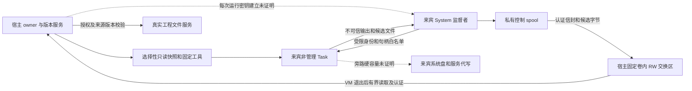

> **已退役的 Windows Sandbox VM 资料。** 当前运行与验收入口见[执行环境](execution-environments.md)和[测试](testing.md)。历史脚本可从[退役记录](documentation-status.md#windows-sandbox-vm-retirement)定位。

# Windows Sandbox 存储与执行契约预审

**当前状态（2026-11-03）：本轮 Windows/Node 整合交付范围已完成。四项剩余任务、P0 真实桌面回放及性能检查均已闭合；结果、支持范围与兼容条件见本文件末尾 §70。以下旧状态均为历史记录。**

历史日期：2026-11-02。当时状态：**宿主仅用 D:\PowerShell\7\pwsh.exe（7.6.9）。记录替换故障已修正；原生单盘生命周期、唯一WSB卷GUID共享/32B读取限定通过。唯一容量现场取得114MiB后原始112拒绝及宿主核对证据，限定容量结论获审；原入口最终记录失败仍保留，修正经离线验证、原任务经外部精确收尾清理。第0.36节唯一固定合成候选的正常捕获及自动清理限定通过；异常GUID/脱卷与真实工程适配仍未验收，生产接入/默认关闭。**

历史预审范围经独立审核 revision 165 / turn `01a195c5-0c99-7fc3-a9e3-5c14532a4f28` 确认，认证信封及 Job 边界经 revision 166 / turn `01a195c9-1231-76e0-8cdf-215fa9d23961` 澄清，revision 169 完成只读收口。**第 1–9 节完整保留为批准调整前的历史证据，不再整体作为当前门槛；当前范围以第 0 节为准。旧 G0/G1/G2 没有因此通过。** 仅 Windows、单人、单会话串行；生产真实工作区接入、默认切换及相关权限退役保持关闭，P0 桌面回放独立待办。

本文用 **[官方定义]**、**[代码事实]**、**[设计要求]**、**[待验证]** 区分证据层次。官方页面在历史预审中读取日期为 2026-11-01；它们不是固定 Windows Sandbox 客户端 `0.8.107.0` 已通过的现场行为。离线小项不重新查询客户端或系统状态；版本沿用主方案的已审基线，未来仍须紧邻实际操作核对。

## 0. 用户批准的首版范围及离线实施顺序（2026-11-01）

用户已分别选择：接受平台存储承诺调整并继续 WSB；采用整台来宾不可信、宿主独占权威的契约；允许先更新方案并实现宿主侧离线候选检查与结果来源区分。独立审核 revision 171 / turn `01a195e3-38dc-7430-8b1e-4678d94c6f13` 澄清保障差异；批准后 revision 172 / turn `01a195f7-930b-7063-a145-35c233472a67` 确认离线范围，无需重新询问。这是明确调整产品承诺和实施顺序，不是补齐原门槛的证据，也不是原有固定验收失败。

| 事项 | 当前承诺及状态 | 与历史预审的关系 |
| - | - | - |
| 平台存储 | 首版不承诺 WSB 系统可写层及全部平台开销有任务级磁盘硬上限 | 原 G0 的这部分要求由用户取消；没有通过，也不继续等待它作为首版阻断 |
| 专属可写共享区 | 任务直接写入也不能绕过其硬容量边界；仍须实现并验证映射、归属、旁路和收尾 | 保留为真实任务接入门槛，固定 VHD 仍只是未验证候选 |
| 宿主管理的数据 | 快照、候选、输出及记录均须明确文件数、字节数和生命周期预算 | 保留；本小项只实现候选检查预算，不声称其余预算都已实现 |
| 来宾信任 | 全来宾不可信，不认证监督结果、具体子进程来源、输出/清单完整性或所请求命令归属 | 不再要求受保护来宾监督者、Task SID 权限隔离、共同密钥和 HMAC 来满足这些已取消的认证承诺；并非原 G1/G2 通过 |
| 宿主权威 | 宿主独占 task/instance、输入快照、来源版本、允许路径、预算、授权、收尾确认和真实提交事实 | 来宾字段不得替换；对象冻结只防模块误用，不是操作系统隔离 |
| 外层限制与已有验收 | 网络、剪贴板、音视频、打印及其他共享限制保持；已完成的固定验收保留原限定结论 | 没有扩大成任意任务隔离已通过；不重复旧矩阵 |
| 工程与提交 | 不整体 RW 共享真实工程；选择性快照，宿主版本/授权检查；初版只新增/修改 | 保留历史第 5 节的保护、预检拒绝、提交期冲突、部分提交及 unknown 语义；删除/移动继续拒绝 |

**剩余风险明确接受：**任务仍可能经 WSB 系统可写层耗尽宿主磁盘。空间预检、监测和超时可以作为运行保护，不能记成平台硬上限。专属共享卷也不能消除该风险。生产接入、默认切换和权限退役不会随本次选择自动通过。

### 0.1 信息来源与接纳边界

宿主 CLI 进程 close/退出码属于宿主观察；平台接口回执按平台契约使用；共享文件里的退出码、输出和候选清单属于来宾报告。来源标签由宿主代码生成，来宾不能提供 source。既有 [`windows-sandbox-fixed-acceptance.mjs`](../scripts/acceptance/windows-sandbox-fixed-acceptance.mjs) 已确认并严格解析 CLI stdout 中的 `{ExitCode: ...}`，表示来宾入口包装程序退出码，区别于宿主 CLI 进程退出码和共享文件内的固定子任务退出码。本离线组件不接入该解析器；宿主未提供平台回执时保留 null，不编造数据。未来适配复用已知回执与来源区分，对未知或失败回执拒绝解释。

`done` 只能提示检查，不能证明实例退出；`authorized`、`committed`、`allProcessesExited` 等来宾字段均不改变宿主状态。取消、超时、平台失败或收尾未知不得被候选检查通过覆盖。本离线首项统一拒绝这些宿主状态；未来失败任务是否可提交候选另受宿主授权/状态策略控制，本项不默认允许。

task/snapshot ID 只用于关联，普通摘要只绑定宿主读取的字节；拒绝错误 ID、其他归属根、替换基线和覆盖上下文，**不声称候选字节从未复制自其他任务或来自指定子进程**。只产生“候选检查通过/拒绝”及来源明确的观察记录，不产生任务成功、授权或提交结论，也不恢复自然语言成功扫描。

### 0.2 本次离线组件的固定契约

独立模块 [`windows-sandbox-candidates.mjs`](../scripts/acceptance/windows-sandbox-candidates.mjs) 只由新建的 [`windows-sandbox-candidates.test.mjs`](../tests/windows-sandbox-candidates.test.mjs) 合成夹具调用，不接运行入口和生产。宿主上下文由离线 owner 复制并固定 task/instance/snapshot、根目录身份、允许路径/操作及来源 revision、预算、收尾状态和观察记录；来宾不能提供 revision。新增必须对应宿主“原目标不存在”（revision 为 null），修改必须对应宿主已有 revision。测试替身中的 closed/instanceAbsent/callsClosed 不是生产退出证明，真正适配仍待独立审查。

候选清单固定为 `candidates.json`；每项仅含 path 和 add/modify 操作，文件固定从 `payload/<path>` 读取，目标路径同名且须精确匹配宿主允许列表。清单固定 protocol/taskId/snapshotId/candidates/report，report 仅有整数或 null 的 exitCode；所有未知字段拒绝。UTF-8 严格解码、小型 JSON 解析和重新序列化一致性检查拒绝重复键及非规范编码；清单长度在读取、分配和解析前检查。

| 预算/语法 | 本小项固定上限 |
| - | - |
| 候选项 | 16；宿主可提供更小上限，不得提高 |
| 单文件 / 合计 | 4 KiB / 16 KiB；下一文件分配前检查剩余额度 |
| 清单（含唯一来宾退出码报告） | 4 KiB；不提高已有夹具流/结果上限 |
| 目标路径 | ASCII，唯一 `/` 分隔符，最多 120 字符、4 层、每段 64 字符 |
| 路径拒绝 | 点开头及保护名称、空段、`.`/`..`、尾点/空格、设备名及其扩展名、盘符/UNC/绝对路径、ADS、反斜杠、短名 `~`、非 ASCII、大小写重复/目标前缀冲突 |

核对根和逐级父目录身份、实际路径、普通文件及单链接属性；打开后比较对象身份、长度和修改元数据，读取后再核对文件/父目录，观察到变化则拒绝。**能力限定：**本小项只用宿主按身份创建的合成目录；Node 的 lstat/realpath 检查覆盖本次硬链接、junction/符号链接和路径别名反例，不宣称穷尽 Windows 所有 reparse tag 或对恶意并发宿主写入实现原子安全打开。真实共享适配仍须补齐这些边界的证据。本小项不遍历或接纳未列入清单的文件，不把接纳预算当作磁盘实际占用硬配额。

成功候选持有本次读取的私有字节、宿主计算的摘要和来源版本；后续消费只复制这些已检查字节，不能重新读路径沿用旧结论。返回的复制字节归调用方所有；释放只能清除模块内部引用，不声称擦除外部副本。单 owner 仅检查一次；撤销/dispose 后不能继续消费，拒绝分支释放已保留候选。读取/关闭出错均不接纳，关闭不明保留精确句柄及 unknown 清理状态，不盲目重试数字句柄。

### 0.3 当前实施许可及后续门槛

本次只允许代码先审后运行定向合成文件检查：正常新增/修改；伪造宿主字段；错误关联与归属；操作/基线不符；路径/链接；预算边界；读取期间变化；撤销和句柄关闭失败。按创建身份清理本项临时根，失败注入中持有的实际句柄由测试按已知注入阶段关闭；不能把该测试责任推广为生产自动恢复机制。组件低频且输入上限很小，不进入生产大结果/进度链；已读热路径契约，后续接入时须重审完整调用链。当前只检查显式句柄打开/关闭、峰值、读取/分配字节和内部保留引用，不扩跑生产分配基准。

离线小项之后，下一独立门槛为专属 RW 共享硬容量、固定卷映射/归属/管理句柄生命周期，以及真实目录和现有 owner 的接纳适配；仍需方案和代码审核，再决定最小验证。第 7 节所记磁盘管理/交接/解除附加责任继续适用；来宾账户、监督者密钥与私有 IPC 不再因结果认证而成为首版必需项。本次不创建账户、安装、启用功能、挂载、启动实例或执行工程提交。P0 桌面回放继续待办。

### 0.4 离线小项审查、检查与清理记录

先行代码审查指出清单超限反例的预算取值、夹具清理登记时机以及既有平台回执的文档描述三处问题，均在运行前修正；没有以先运行来代替审查。复核 revision 177 / turn `01a19601-f49b-7be2-8344-65db4ac31dc1` 通过，限定只运行新检查文件。实际执行前核对获审源码 SHA-256 一致：模块 `C42F547C951649D8755BAD7DFBA0802B6501E8573A76A4FE4B4BA7FEFE6E0E87`，检查 `A99BFF13D7DE42E29E0BDE53FDA339F5FD8CDD578A96ABD8A27FBC8D2FF920EE`。

唯一执行命令：`node --test --test-reporter=tap --test-concurrency=1 tests/windows-sandbox-candidates.test.mjs`。11 组通过，0 失败、取消、跳过；报告时长 846.8779 ms，进程退出 0。覆盖第 0.3 节列出的正常与区分性反例；没有重跑旧矩阵、编译、实例或生产基准。该时长只是本次检查事实，不作为性能优化证据。

| 生命周期证据 | 实际结果 |
| - | - |
| 正常两候选 | opened=3 / closed=3，activeHandles=0，peakHandles=1；readBuffers=3，allocatedBytes=306，readBytes=306 |
| 检查后内部持有 | 2 候选、39 字节；修改原路径或返回副本不改变内部已检查字节；dispose 后 retainedBytes=0 / retainedCandidates=0，不能继续消费 |
| 16 项边界 | 正常接纳，opened=17、peakHandles=1；超项数、单文件/合计/清单超限在对应分配前拒绝 |
| 失败及中途撤销 | 已读取候选内部保留归零；显式句柄打开/关闭平衡；宿主上下文未被来宾输入改写 |
| 模拟 close 失败 | opened=2 / closed=1、activeHandles=1、uncertainHandles=[3]，候选保留为 0，返回 rejected / close-unknown / cleanup=unknown；这是模块对故障时刻的诚实记录，不伪造已关闭 |
| 注入后的测试收尾 | 测试知道故障发生在实际 close 前，以记录的句柄调用原 close 成功；不将该注入知识用于生产恢复。11 个按身份创建的临时根都在 after 回调核对归属后删除，并断言不存在；测试进程退出 0，无本项遗留 |

统计仅覆盖模块显式句柄/缓冲及内部引用，不覆盖 lstat/realpath 的内部系统句柄、V8 所有分配或外部调用方保留的副本。本模块仅被本检查文件引用，没有生产调用链变化或大结果链接入，不据此宣称生产分配性能通过。该离线组件及定向检查完成，不代表共享卷硬容量、真实映射目录安全、真实 owner 收尾适配或工程提交已完成。最终结果与记录复核 revision 178 / turn `01a19603-b9ce-7b31-9254-dabf7855f2a9` 通过，无需重跑检查。仅精确暂存本项模块、检查和两文档，index 共 1,910 条；四文件工作副本与 index 一致，差异/空白及本契约 10 个本地链接检查通过，其余 1,906 条完整 stage 摘要保持 `AC5CAE6C3CD4EC3283CF3A9683CE0EBED8AE7A4D1FADB03F413F6A5C5D5E0559`，原九份删除与 patch 保留，不提交、不推送。

### 0.5 任务专属固定 VHD 生命周期（当前小项）

用户明确进入创建、身份绑定、共享准入与释放生命周期，不重开三项产品决定。路径方案经 revision 183 / turn `01a19615-0d0a-7a42-b82e-42c4537d3efb` 复核：单一任务管理助手持续持有非永久附加句柄，128 MiB固定VHD；唯一候选为所属卷GUID下的exchange，不建立宿主目录挂载点或盘符，不提供路径回退。实际共享准入固定false，WSB兼容/失效语义与容量实测仍待审。候选Buffer租用与盘责任分离，close-unknown阻止盘释放，真实撤销继续传递；旧OfflineCandidateOwner没有因此支持GUID根。详见 [固定共享卷实现方案](Windows%20Sandbox%20固定共享卷实现方案.md)。revision194代码复审后首轮7组通过，第8组解析失败；经revision196修正语法后仅第8组发现替身故障注入变量被清空，revision199复审该替身修正后第8组/20项分支通过，最终报告872.181ms。其余7组未重跑；4个临时根按身份清理，原生仅编译，未构造NativeDisk或运行Storage/实际助手，没有磁盘创建、附加、格式化或实例。最终结果/记录复核 revision201 / turn `01a19634-18a1-7ca0-b0ec-8e9a901003c8` 通过，8文件已精确暂存，index共1916条，范围外1908条完整stage摘要保持 `0172CE3FDD77B10EF3152676B09649CBF3860C9A687F5084B8F5C428BA26D702`；两独立文档18个本地链接检查通过，原九份删除和patch保留，不提交推送。后续现场入口及最小反例仍须先审。

### 0.6 原生单盘现场入口（当前推进阶段）

用户继续推进，revision205/206确认先原生单盘生命周期，再分别审查WSB路径兼容、容量与异常失效。只读前置确认权限存在、NTFS空间及七个Storage命令元数据，首次PS7偏差与固定PS5查询保留，不视为实际存储通过。revision210三项P2修正后，revision214代码复审及唯一新增五组/七项PS替身通过（894.0717ms），一个临时根及两个子进程清理确认。revision218放行精确暂存后的唯一现场入口，实际管理助手PID23336遇到stderr并阻断，前置和编译正常，未取得prepared/probe，最终入口退出1。revision221依据创建前必写日志及只读构造链确认未进入VHD创建；错误正文原未保存，根因未知，不可猜测或记为存储通过。两文件和空根因自动审批拒绝，后由用户手动清理并只读确认不存在；原released=false、passed=false不改写。完整来源、预算、失败与清理证据见[实现方案第8节](Windows%20Sandbox%20固定共享卷实现方案.md#8-当前阶段原生单盘入口与正常生命周期)。

revision221/222仅允许补齐1024字节原始stderr、实际退出码/信号和pending/监听清理后的最终快照，先审代码后执行两组纯内存替身，不重新运行现场入口。报告时间改reportedUtc，不声称报告已证明物理收尾；诊断仍受8KiB整体预算。revision226两项意见修正后，revision228复审放行的两组过滤检查一次通过（53.2702ms，0失败/取消/跳过），没有新临时产物，原五组及编译未重跑。此前丢失的错误不能追溯恢复，启动根因仍未知，下一次具体诊断/恢复范围须先交审核；真实GUID、共享硬容量和异常失效继续未证明，shareAdmission=false；无实例、容量灌写、真实候选接线或生产切换，P0待办。

### 0.7 同一管理助手的单次启动诊断

用户新授权按最小范围获取启动失败证据，revision236 / turn `01a196e4-ec49-7ee1-8f04-1ce169c66fbd` 确认：同一助手保留原启动链，在命令读取前成功/失败退出；只包含原构造链已有只读文件系统元数据查询，不调用Storage、调整权限、VHD或WSB。原C#不修改，最多一次编译准备及一次固定PS5诊断；先代码预审、四组内存检查及一组PS5 parse-only，再复核实际执行条件，不重复旧矩阵。

专用回执2KiB、stderr原始存储1KiB、journal及整体输出8KiB；完整阶段/已完成步骤分开，早于正文失败允许阶段未知。助手15秒逻辑期限，不自动终止或重试；未知状态、取消或journal失败保留责任，迟到close只更新证据。清理须确认编译/助手物理关闭、证据交付后，按本项根及精确文件身份删除叶子和空目录，不递归。启动成功只表示本次未复现，不能自动继续prepare或认定旧根因已明；具体代码、账本和回执见[实现方案第9节](Windows%20Sandbox%20固定共享卷实现方案.md#9-管理助手启动失败的单次诊断)。真实工作区、默认切换和权限退役关闭，P0待办。

代码预审revision239/242的输出错误与取消收尾意见已在运行前修正；revision246复审后，仅一次新增五组检查通过（358.1055ms，0失败/取消/跳过）。四组纯内存，一组PS5 parse-only PID31976正常退出；没有执行助手正文、编译或创建临时文件。revision248结果/条件复核后，七文件精确暂存并核对摘要及owner不存在，仅执行一次startup-only。编译PID30056退出0；助手PID33408退出1，step=assembly-check、completed=arguments，异常CommandNotFoundException（HRESULT=-2146233087）明确本次PS5进程无法识别Get-FileHash，尚未加载DLL或进入NativeDisk。stdout498/stderr413字节完整未截断，startupSucceeded=false；两进程物理关闭、证据交付后精确清理，artifactsRemoved=true，固定根只读确认不存在。revision249确认此为命令解析失败，不是DLL摘要不匹配；模块环境原因和旧失败正文仍未知，不回填。本轮不修复或第二次诊断；下一项只先静态预审最小SHA-256校验替换。来源/原始流/归属/清理见实现方案9.1–9.2。

### 0.8 用户纠正：宿主唯一PowerShell 7运行时

用户明确本机只用D:\PowerShell\7\pwsh.exe，不回退PS5。此前固定PS5为主任务自行选型错误；0.6–0.7与第8–9节失败记录保留历史，不再决定当前运行时或触发摘要算法替换。宿主三个入口和三个检查启动点共用固定路径、exe摘要及专用SettingsFile，完整保留基线RemoteSigned和模块denylist，仅增加DisableImplicitWinCompat=true，并固定基线及专用配置摘要；基线漂移即停止。PS脚本/前置要求7/Core/x64；不改全局配置或增加执行策略参数、不引入显式或隐式PS5代理。正常Storage入口以SkipEditionCheck在当前PS7进程导入，失败停止。

revision254确认两组最小检查范围：源码边界＋一次原C#编译/单个PS7进程，核对运行时、Get-FileHash、DLL加载/ABI、AST及Storage原生导入/七命令参数和无兼容会话；不构造NativeDisk或运行磁盘命令，不重跑旧矩阵。代码、官方依据和结果记录见[实现方案第10节](Windows%20Sandbox%20固定共享卷实现方案.md#10-用户指定宿主仅使用-powershell-7)。生产关闭和P0待办保持。

首次新增检查1通过/1失败：旧专用配置遗漏原有策略，PS7在夹具正文前SecurityError，两个产物及临时根清理；首次子PID和原始stderr未保留，如实记录。revision259/260只读核对默认PS7有效/LocalMachine为RemoteSigned，私有配置查询在Security模块类型文件授权检查失败，未取得有效策略值。保留基线两键及原值、摘要守卫和断言前原始字节记录经revision262复审后一次检查，源码组通过，兼容组在Marshal.SizeOf重载选择失败（编译31500/exit0、PS7 30320/exit1、stderr428字节完整保留），产物清理。revision263复审仅明确选择SizeOf(Type)，之后仅恢复失败兼容组一次并通过，2006.8012ms；编译31992/exit0、固定PS7 20540/exit0，RemoteSigned、DLL摘要/加载及56/8/24 ABI、两份AST、Storage2.0.0.0原生导入及7命令元数据均确认，兼容会话/代理0。两次先前失败保留，原源码组/旧矩阵未重跑；本项共3次编译与3个PS7兼容进程，各临时根/两个文件均清理。没有NativeDisk构造、Storage磁盘调用、实际助手或VM；后续具体启动范围须先复核，不自动恢复完整存储。

最终只读复核revision268 / turn `01a19712-c565-76d2-9669-76940993c061` 通过，仅以PS7适配和最小兼容完成收口。本项16文件精确暂存，index1925条，范围外1909条stage记录JSON数组UTF-8摘要`E399071F02C52F88EBEF182C77F040FAC641984BDFEC12A03DA11E48B2243F53`保持；源码摘要、30个本地链接和差异格式核对通过。本项工作副本与index一致，原九份删除/patch保留，不提交推送；无须追加执行或开启下一诊断，无本项运行产物遗留。

### 0.9 固定PS7实际助手启动通过

用户授权按顺序逐项执行/审查/核对后，revision271 / turn `01a19723-15e3-7813-bbdd-5aab2d4cdef7` 复核同一未变startup入口及只读构造链。紧邻核对获审源码、固定exe/csc及两配置、独占owner根不存在，仅一次执行startup-only；task=`8de4ea6a-4a57-43f5-8f8d-9bdf9ae7d25c`。编译PID26152、实际PS7助手PID30492均退出0，回执ok=true、step=complete、completed=native-constructor，stdout164/stderr0，无截断；startupSucceeded=true。证据交付后两个文件按身份删除、空根移除并只读确认不存在。没有stdin、权限调整、Storage调用、VHD/VM；只证明实际启动和只读构造，不扩大为存储通过。具体证据、身份和后续条件见[实现方案第11节](Windows%20Sandbox%20固定共享卷实现方案.md#11-固定ps7实际助手启动通过)。先结果复核/记录/精确暂存，再单独审查原生单盘生命周期，不重复兼容或旧矩阵。生产关闭和P0待办保持。

结果/文档最终复核revision276 / turn `01a19725-7d2b-7c01-a1fe-1f425117b732` 通过；本项仅三文档精确暂存，index1925条，范围外1922条stage JSON数组UTF-8摘要保持`1AD3ABD599F1C9A6B47E67138D33160433EC823ED1930290991A1696A3B77CFB`，工作副本与index一致，31个本地链接及差异格式核对通过。原九份删除和patch保留，不提交推送。下一原生单盘入口暂不执行：先修复证据输出确认前删根、以及一次性/过早移除取消监听这两项P2，完成最小代码/替身审查后再复核实际条件。已通过startup不重跑，生产与P0边界保持。

### 0.10 原生入口恢复前的收尾修正

revision276明确两P2：证据写出确认前删根、信号监听未覆盖管理助手完整物理寿命。真实单盘调用先暂停，按具体代码最小修正：有界证据7680B先交付，原归属清理后尾行≤512B，总8KiB；输出失败保留，尾行失败不重建已删除记录。稳定幂等取消覆盖最多三个实际调用及实际写回调，迟到close仅补记，全部结束后释放监听/引用。VHD/C#/PS存储算法未变，共享准入继续false。准备新增4组纯内存及原1组受影响检查，先审再运行，不重跑编译/PS或旧矩阵；详见[实现方案第12节](Windows%20Sandbox%20固定共享卷实现方案.md#12-原生单盘入口的输出交付与取消寿命修正)。

revision280完成代码复审后，新增四组和原受影响一组仅运行一次，5通过/0失败取消跳过，106.6841ms；无编译/PS助手/存储/VM或临时产物。两个pending输出时序的迟到close均持久化，三调用/重复取消、输出四故障与记录保留通过，最终监听/缓冲/引用释放。具体源码摘要、计数及7文件暂存边界见固定共享卷方案12.1；先复核/精确暂存，再审一次原生单盘条件，生产与P0边界保持。

最终结果/记录复核revision282 / turn `01a19733-ec5c-7bf1-8203-a167f41d329d` 通过，本项7文件精确暂存，index1926条，范围外1919条stage JSON数组UTF-8摘要保持`C67D0D511BA560F4F065AFE65A60A38047DF72030660C50BAB111214EF8FE99F`；工作副本与index一致，33个本地链接及差异格式核对通过，原九份删除/patch保留。审核确认紧邻核对源码、工具/两配置和独占根不存在后，可以唯一一次运行固定PS7原生单盘入口；范围只含既有只读前置、一次编译/单助手、128MiB本任务盘及prepare→verify→32字节probe→release→exit。未知或失败保留责任，不自动重试/kill，不WSB、共享、灌写或真实工程。该放行不是现场通过证据，实际结果另记。

### 0.11 一次原生单盘的当前阻断

revision282结果/现场条件复核后，精确暂存7文件并核对源码/工具/配置/独占根，仅一次原生单盘调用：task=eb60c4fd-8ebc-4b10-bd74-93e061f58641，前置PID33352/编译PID21544均exit0；管理助手PID15524在prepare的120秒期限后未确认退出，最后正式回执creating，prepared/probe=null、released/passed=false，内部unsafe触发cancelled/revoked。主证据及尾行已交付，retained=true、artifactsRemoved=false，外层会话38438未结束。只读归属核对发现task.vhd逻辑134218240字节，volume-helper.next.json为created/imageCreated=true，imageId与该文件身份一致；因此不能记成未创建或Create API本身挂起，具体记录提交/交付原因尚未知。保留本次根内5叶和助手，不重试/kill/删盘/扩大时限。下一项仅先审记录与句柄/附加状态的最小只读诊断；本轮在此阻断，WSB共享、真实工程/默认/权限退役及P0未推进。完整时间、元数据和待提交回执见固定共享卷方案13。

归属根为D:\RMProjects\Pi\.artifacts\windows-sandbox-acceptance-owner，当前不能按临时产物直接清理；未决责任保持锁住下一任务。三文档范围外1923条stage JSON UTF8摘要1564EB8818F7CE0C08A865186D3C23B3D755A71764B9540757C5F40D64F74386，index1926，复核后仅暂存三文档。

最终记录复核revision285 / turn `01a1973d-a590-73a3-b3a4-fc3bf6ecb6a7` 通过，按其一项时序意见明确区分120秒逻辑截止和随后created观察，未推定创建发生在截止前。本次仅三文档精确暂存，index1926条，范围外1923条stage JSON数组UTF-8摘要保持`1564EB8818F7CE0C08A865186D3C23B3D755A71764B9540757C5F40D64F74386`，工作副本与index一致，33个本地链接及差异格式核对通过。代码/检查保持已审已测版本，原九份删除及patch保留，不提交推送。本轮停止后续诊断/磁盘查询/重试/清理，助手、会话和5个归属文件保持未决，不能宣称本项产物清理完成；下一项不得越过该owner，生产/P0边界保持。

### 0.12 记录替换修正通过，旧资源恢复另审

revision286/290先审范围和合成代码，固定PS7下原Write-State首次Move成功、第二次File.Replace($null)抛出空路径ArgumentException（HRESULT=-2147024809），正式creating/next=created/stdout1；仅第三参采用NullString.Value的独立对照成功。原源码一次正常行为断言1fail作为修正前证据保留。revision293审定仅该参数及注释修正后，新代码原单组一次1pass，stdout2/正式created/next消失、controlFailed=false；两轮诊断根及小文件按身份清理、进程退出。详细原字节计数、摘要、限额与六文件暂存边界见[固定卷方案第14节](Windows%20Sandbox%20固定共享卷实现方案.md)。

这是源码机制证据，旧PID15524并未热更新，不能宣称直接捕获旧异常或恢复旧管理句柄。原task/五叶/父子归属只读一致；下一步仅允许指定task.vhd一次Get-DiskImage，结果须为恰一对象且ImagePath一致，错误/无对象/多对象均为未知。Attached=false不等同管理句柄关闭、允许终止或删除；释放方案仍独立复核。不得绕过旧owner重跑入口；生产工作区、默认与权限退役保持关闭，P0待办。

### 0.13 旧任务恢复与清理完成

revision293/295只读前置确认旧镜像时点未附加。revision298/302审定一次性恢复后，已绑定helper15524被唯一终止并实际exit125，parent24964自然exit1，原会话38438退出1；原owner持久化三个物理调用关闭、helperClosed=true/pending=false/buffersReleased=true，恢复器自有句柄已关闭，前后镜像未附加。最终lifecycle由原owner更新身份/内容后重新登记。此为外部收尾，历史passed=false/released=false保持。

revision304/308审定精确清理后，一次镜像独占只读打开/句柄身份及长度核对/关闭通过，零正文读取。删除前有界交付最终记录及全部目标身份，逐项复核删除原五叶和空根、两份本项临时源，入口退出0、artifactsRemoved=true；无递归、重试或用户产物处理。详细回执/时间/摘要及三文档暂存边界见[固定卷方案第15节](Windows%20Sandbox%20固定共享卷实现方案.md)。当前不再保留旧owner；修正后的唯一原生单盘实际条件仍需复核，不把外部清理当正常生命周期通过。生产接入/默认/权限退役关闭，P0待办。

### 0.14 原生专属卷正常生命周期限定通过

revision310复核条件后，修正后的唯一原生单盘task8da73fd7-3423-4079-9dde-98b02481e7a5完成prepare→verify→32B probe→release→exit；三个调用退出0，probe匹配且两开两关，最终detached/managementClosed/helperClosed=true、pending=false/buffersReleased=true。尾行passed=true/artifactsRemoved=true，会话40114实际exit0、根不存在，没有遗留本项资源。主证据的passed=false是清理前时点；旧失败任务与外部恢复不改写为通过。详细时间/身份/摘要见[固定卷方案第16节](Windows%20Sandbox%20固定共享卷实现方案.md)。

此结论仅覆盖128MiB原生卷生命周期；vmCalls=0、shareAdmission=false。下一项先审真实共享准入、实时VM/CLI收尾绑定及来宾可写GUID目录的有界安全读取，再决定单实例小文件共享；直接写满容量、异常回落、真实候选/工程适配仍后续独立验收。生产接入/默认/权限退役关闭，P0待办。

### 0.15 实验共享准入与实时收尾绑定离线完成

revision329先审后，新11组一次通过；指定旧无钩子用例修正首次未命中的筛选后实际1组通过，无旧矩阵或真实资源操作。原shareAdmission保持false；独立实验ticket只允许具体VM/卷/配置一次派发，在实际launch前同步复核撤销、已接受释放、VM清理和runtime绑定。已消失VM仍有未决exec/connect、list未知、文件close-unknown或runtime责任丢失时，不能宣称卷可释放。正常终态释放内部映射/运行引用，未决分支保留责任。详情、摘要、首次空筛选和8文件暂存边界见[固定卷方案第17节](Windows%20Sandbox%20固定共享卷实现方案.md#17-实验共享准入与实时收尾绑定离线检查通过)。

本项没有新增实际WSB入口，不证明GUID映射或硬容量；下一项先审固定32B叶子的安全宿主读取，再审组合owner/输出与清理。生产真实工程/默认切换/权限退役继续关闭，P0待办。

### 0.16 固定32B安全读取离线完成

revision335代码复审后，新五组检查一次通过，包含一次编译、一次固定PS7实际函数AST替身及24分支。原操作错误和两个关闭错误分别保留，固定路径/同句柄身份/32B上限与实时VM收尾门槛已实现；错误回执、身份或关闭未知均保留盘责任。两进程退出0、唯一DLL与专属根按身份清理，无NativeDisk构造、Storage/VHD/WSB或真实业务读取。详细来源、摘要及局限见[固定卷方案第18节](Windows%20Sandbox%20固定共享卷实现方案.md#18-固定32b来宾文件读取代码与离线检查通过)。

尚需统一外层owner及总预算/迟到收尾/固定写入入口先审，才能安排一个真实GUID小文件往返；没有由编译/替身结果推定实际共享或硬容量通过。生产真实工作区/默认切换/权限退役关闭，P0继续待办。

### 0.17 共享会话组合核心离线完成

revision341范围、347代码复审后，新八组纯内存检查首次7pass/1fail（135.459ms）：预留journal失败后的not-started内存摘要未及时刷新；没有发生实际派发。最小修正经revision348/349复核后，仅精确恢复该失败组一次1pass（61.0137ms），其余七组不重跑，首次失败保留。三个start回调重入、exec单独撤销、未知VM/调用责任、输出未回调、精确清理及部分删除计数均取得定向证据。详见[固定卷方案第19节](Windows%20Sandbox%20固定共享卷实现方案.md#19-共享会话组合核心离线检查与收尾责任)。

统一owner在实际进程factory前约束99总预留/96CLI/4未决，最后私有许可校验在预留持久化之后；VM、卷、manager、文件句柄及证据交付共同决定清理。8192B journal/7680B主输出/512B尾行保持，编码压力样本不是所有可达状态的上界；超限拒写并明确不完整、保留owner。正常替身释放全部绑定/监听/调用引用，未知保留且迟到close不自动重启收尾。纯内存无实际资源或产物；真实adapter/单次GUID共享另审，生产真实工程/默认/权限退役关闭，P0待办。

### 0.18 单GUID共享适配入口离线完成

revision352范围、359/362代码及夹具复审后，真实适配入口已实现，但尚未执行。新四组只读源码/纯内存检查一次4pass、63.9713ms；初始可选叶缺失、中途消失、JSON null、读取与关闭双错误分离，以及预留后源码/工具变化阻止manager创建均通过。源码集合16文件当前SHA-256为c8b77da13b6b8f3771a63d3e42fb8bc789e4286870d369681c9a2b1a5ac4a228，完整顺序/算法及逐文件摘要见[固定卷方案第20节](Windows%20Sandbox%20固定共享卷实现方案.md#20-单guid共享真实适配入口代码与离线检查完成)。

实际owner连接helper、VM/runtime、卷/manager及收据关闭责任，所有创建经预留后最终许可检查；明确初始缺失不与JSON值混淆。当前只有离线证据，无实际helper/编译/存储/WSB或临时产物；一次真实GUID/32B共享条件另审，不重跑旧矩阵。生产真实工程/默认/权限退役继续关闭，P0待办。

### 0.19 单GUID与32B往返实际限定通过

revision368确认条件、代码精确暂存后，task84afcab6-d9e4-4012-ae7d-ea93c40aaebc唯一一次实际共享通过：固定客户端接受所属GUID exchange，来宾入口回执exit0，宿主32B实际匹配且两业务句柄两开两关；所属VM实际closed、最后list为空、全部10调用关闭，卷正常释放/解除附加/管理句柄关闭，manager正常退出。主证据为清理前passed=false；随后尾行passed/artifactsRemoved=true，四私有叶及根清理，会话87555实际exit0，独立确认根不存在。完整身份/时间/原始字段与三文档暂存范围见[固定卷方案第21节](Windows%20Sandbox%20固定共享卷实现方案.md#21-单guid共享与32b往返实际限定通过)。

这一限定共享及正常生命周期完成，不等于直接写满硬容量或异常脱卷通过；下一项先审固定有界容量探针与存储不足归因。没有重跑旧矩阵、生产工作区、默认切换或权限退役；P0桌面回放继续待办。

### 0.20 容量写入核心独立离线通过

revision372确认有界普通文件直接写入范围，revision377代码复核后，只运行独立核心新单组一次1pass（435.2256ms），含一次编译与一次固定PS7调用16个纯Fake分支；两个进程正常关闭，9728B DLL及专属根精确清理。复用1MiB块、144次/144MiB请求、20秒只限下一调用，首次失败/短写停止；原始Write/Flush/Close及三异常分别保留，Buffer清零。此核心没有实际文件/PInvoke/入口，不代表容量实测；完整证据和6文件暂存范围见[固定卷方案第22节](Windows%20Sandbox%20固定共享卷实现方案.md#22-容量直接写入算法独立离线检查通过)。

后续槽交付成功需平台所载guest退出码0且严格报告、同卷文件身份/长度/分配核对及真实VM/CLI收尾；未知退出码与未交付原始错误保持unknown，不能由槽预填未来关闭成功。真实程序/安装/槽/宿主核对及3+1+95容量入口尚未实现，不重复已通过项或旧矩阵；生产真实工程/默认/权限退役关闭，P0待办。

### 0.21 固定槽协议与来宾封装离线完成

固定512B槽、guest普通文件同步写穿透封装和宿主严格解码已实现。槽只记此前数据事实；退出码推导状态标为guest-report，经platform-interface承载，不是平台独立观察。0只表示交付必要条件，有限非零集合及unknown保留，缺失原始错误不补零。关闭责任转移后不重试，数据/槽操作和异常分别记录。

revision383代码复审后首次两组1pass/1fail（夹具CS0136，未生成DLL）；仅变量改名经revision385复核，精确第一组恢复一次1pass，25替身分支及跨语言512B检查完成、Native.Calls=0，19456B DLL和根已清理。第二组/旧核心不重跑，首次失败保留。完整身份、摘要和8文件精确暂存范围见[固定卷方案第23节](Windows%20Sandbox%20固定共享卷实现方案.md#23-固定容量结果槽与来宾封装离线定向完成)。下一宿主安装/读回及3+1+95容量接线另项预审，未进行有效入口、挂载、WSB或填盘；生产真实工程/默认/权限退役关闭，P0待办。

### 0.22 宿主容量安装与读回组件离线完成

可选NativeDisk partial实现固定<=64KiB探针的卷内CREATE_NEW安装、512B槽实际写入/刷新、32B宿主私有哨兵，以及后续slot原身份/填充文件同卷EOF与Allocation/哨兵读回核对。业务句柄固定9槽/峰值3（不含既有临时元数据句柄），失败或抛错保留精确责任，关闭不重试，CloseUnknown传播阻止释放。跨文件小槽Allocation判据冲突已对齐，真正fill仍要求EOF>=1MiB、Allocation>=EOF且<=128MiB。

revision390复审后仅新单组一次1pass，含30个纯分支；编译与固定PS7进程均exit0，50176B DLL及专属根清理。没有NativeDisk实例或实际I/O方法调用；既有guest/核心/旧矩阵不重跑。详细证据、摘要、8文件暂存及限制见[固定卷方案第24节](Windows%20Sandbox%20固定共享卷实现方案.md#24-宿主容量安装与读回组件离线预审和定向检查通过)。此组件尚无实际调用者，VM收尾准入、固定回执与3+1+95接线须另审；旧c8b77集合只属历史证据，当前native变更后须重新固定集合。生产真实工程/默认/权限退役关闭，P0待办。

### 0.23 容量回执与helper/owner准入离线完成

固定容量回执绑定任务/卷/安装身份/摘要和九槽关闭责任；helper两种无路径请求、一次标记及finally回执已接线，旧模式无摘要拒绝。owner安装仅未绑定/派发VM，读回仅所属VM/CLI真实收尾后，pending读租约阻止释放；未知句柄/身份/协议失败保留，已关闭的普通失败可正常释放。来源与元数据/guest事实分开，不宣告全链通过。

revision394代码预审后仅新七组一次7pass（owner六组纯内存、helper一次编译/固定PS7 AST替身14分支），两个helper检查进程exit0，22016B DLL与根精确清理，无Storage/NativeDisk实例或真实容量操作。完整证据/摘要/10文件暂存见[固定卷方案第25节](Windows%20Sandbox%20固定共享卷实现方案.md#25-容量固定回执与helperowner准入七组定向通过)。外层3+1+95预算、固定执行入口、清理清单、新源码集合及现场条件仍另审；生产真实工程/默认/权限退役关闭，P0待办。

### 0.24 容量外层、真实入口和完整源码集合离线完成

revision400代码复审后，新六组与精确受影响旧manifest一组一次7pass（137.4233ms），无真实helper/编译/存储/WSB或临时产物。容量预算3+1+95/99、4未决；第96临时记录在factory前拒绝后撤回，95条快照可完整收尾。最终安装对象/卷/VM/源码守卫、原始诊断保留、13固定清理叶和终态引用释放已覆盖；journal峰值7490B/主6223B/尾175B仅为限定样本，上限不变。

完整24文件集合bd2b96fd01acdff28c73cea9d9c4ec5e741dc4701e49dea99f0c591599be7866（260788B）及现场最小条件见[固定卷方案第26节](Windows%20Sandbox%20固定共享卷实现方案.md#26-容量外层真实入口与源码闭包离线完成)。只有结果/记录与本集合现场条件复核、精确暂存后，才恢复一次128MiB/单VM/单exec、1MiB块最多144次的容量验证；本项尚无容量现场证据。异常失效、候选接线和真实工程尚未完成，生产真实工作区/默认切换/权限退役关闭，P0待办。

### 0.25 唯一容量现场的原始事实与记录失败

revision405条件复核后，task15f06cbc-9d54-4186-b556-1021d963a382仅实测一次：114MiB成功后第115次写返回原始112，Flush/Close成功；宿主核对fill EOF/Allocation均114MiB、原slot身份及私有哨兵匹配，9开9关，VM/7CLI/manager实际关闭、卷正常释放。最终补清理清单后触发pretty8192检查，原入口passed=false并保留host30244及七叶63187B，不能将存储事实等同正常自动收口通过。

revision413先审后一次只读诊断3开3关/exit0：原日志7730B；内存补manifest后pretty8536B、实际compact含换行6680B，说明错误施加在未持久化的格式化副本，尚未触及7680输出限。原始回执/槽/身份及范围见[固定卷方案第27节](Windows%20Sandbox%20固定共享卷实现方案.md#27-唯一容量现场取得存储不足事实最终记录检查失败保留)。拟最小修正和精确外部收尾另审，不提高限额、不重跑容量；生产真实工作区/默认/权限退役关闭，P0待办。

### 0.26 记录修正离线通过，原容量任务外部收尾完成

revision421先审后，仅真实形态回归新单组一次1pass（62.2563ms），journalPeak7917B/main6680B/footer175B、七叶清理及引用释放，未提高8192/7680/512预算，无实际存储或临时产物。限定容量事实经revision415采纳；原入口失败保留，修正后正常自动收尾未重做现场。

独立审查后，仅按持有对象核对并终止原host30244一次，实际exit-1/句柄关闭，恢复工具exit0、原会话20189exit1；再按revision425条件删除登记七叶/空根，清理回执artifactsRemoved=true/removedFiles7/工具exit0，独立确认根不存在。无遗留本项责任，不把外部恢复改记原pass。完整身份/回执、六文件精确暂存与局限见[固定卷方案第28节](Windows%20Sandbox%20固定共享卷实现方案.md#28-最终记录检查修正与原任务外部收尾完成)。下一异常GUID失效与真实owner/候选接线先审；生产真实工程/默认/权限退役关闭，P0待办。

### 0.27 GUID候选读取适配契约及纯数据核心离线通过

revision432/435确定沿用同一NativeDisk管理助手和两阶段读取：固定manifest/request/payload及两回执五个私有叶总32KiB，另外两个错误叶最多8KiB；16项/单4KiB/总16KiB及原控制/输出限额不变。宿主revision/授权保留在私有上下文，请求仅传绑定与已批准路径；原始载体无头部，回执给出有序身份/长度/摘要。真实读取租约须跨全过程、save重入和实际派发/发布前复核；关闭未知保留责任，正常detach与候选字节释放分开。

纯数据核心复用既有manifest/path纯规则，不修改旧盘符根、不做业务I/O或运行时接入；candidate-data-checked只表示数据契约成立。代码预审发现共享Buffer池可暴露内部字节，已改独立分配并补完整backing隔离/BOM拒绝；revision440复审后九组仅一次9pass、58.8226ms，16KiB正常边界、输入/副本隔离及撤销释放通过，无原生操作或产物。具体字段、拟定句柄模型、编码样本与六文件范围见[固定卷方案第29节](Windows%20Sandbox%20固定共享卷实现方案.md#29-真实卷候选读取适配契约与纯数据核心离线通过)。真实GUID读取及lease未实现，生产真实工程/默认/权限退役关闭，P0待办。

### 0.28 固定manifest捕获组件离线通过

按revision441范围新增可选原生partial：只固定GUID卷exchange/candidates.json至宿主私有candidate-manifest.bin，源1..4096B/单scratch/3业务句柄峰值2；源关闭确认后才CREATE_NEW载体，身份/路径/长度/原始IO与关闭错误分别保留。未知句柄保留责任、scratch清零，已关闭则释放操作回调。现有元数据临时句柄另属owner责任，真实接线前还须核对其精确未知记录；本项不接helper、入口、真实owner租约或生产。

revision445预审后仅新文件一次1pass、内部50项，总675.4656ms；仅一次x64编译和固定PS7纯替身调用，两进程exit0，49664B唯一DLL及空根按登记身份清理。未构造NativeDisk、调用组件原生适配或Storage/WSB；3业务槽/峰值2/scratch最大4096B、未知fake句柄保留和失败关闭不重试通过。具体预算、身份及六文件暂存范围见[固定卷方案第30节](Windows%20Sandbox%20固定共享卷实现方案.md#30-固定manifest原生捕获组件离线通过)。下一先补既有临时元数据句柄责任，再审batch及真实租约；生产真实工作区/默认/权限退役关闭，P0待办。

### 0.29 临时句柄责任和未知报告离线通过

revision448明确构造失败时NativeDisk尚未赋值、旧finally可能覆盖原操作错误，报告又会Fingerprint。草稿由helper构造前持有单槽TransientOwner，覆盖全部八个原CloseTransient点；操作/关闭分别记录，原始关闭0仍未知，禁止重试及后续获取。启动/运行未知路径只输出既有1024B内stderr诊断并保留责任，不再访问文件报告自身状态；现有业务九槽/三槽及正常协议不变。

revision452指出报告期间新unknown漏诊断及准入断言可被其他异常冒充，均在执行前修正。revision454复审后，仅一次兼容编译/固定PS7纯检查，1pass、核心24项/9个准入/3种诊断/5种收尾及5旧依赖parse通过，总958.7304ms；最大诊断422B，writer失败尝试1次，未知后获取0。两个进程exit0、70656B DLL/空根按身份清理，不构造NativeDisk、不实际存储或重复旧矩阵。13文件范围、具体身份及局限详见[固定卷方案第31节](Windows%20Sandbox%20固定共享卷实现方案.md#31-临时句柄责任与未知关闭报告路径离线通过)。下一批量捕获/真实租约继续先审；生产真实工作区/默认/权限退役关闭，P0待办。

### 0.30 同一NativeDisk批量候选捕获离线通过

revision456后临时句柄13文件已精确暂存，继续批量组件草稿：固定私有request4096B，严格解析现JS生成的四字段规范顺序并复核路径/关联；只能绑定同一NativeDisk已完成的manifest。请求关闭后才建payload，逐组件持有目录并核对同句柄身份，最多16项/单4096B/合计16384B；零数据、增量整体及分项摘要、有界原始错误与关闭责任均明确。业务98开/峰值7，元数据另计；失败无Items成功快照，载体留给后续精确清理。

revision460预审后唯一新入口一次1pass、74纯项及实际JS请求到C#解析兼容样例通过，总695.8956ms；业务98开/峰值7、累计分配18543B并全部清零、最大接纳请求2159B。两进程exit0，82944B唯一DLL/空根按身份清理，原生适配器调用0，无helper主体/真实lease/Storage/WSB或旧矩阵。七文件范围及局限详见[固定卷方案第32节](Windows%20Sandbox%20固定共享卷实现方案.md#32-同一管理助手的批量候选捕获离线通过)。下一helper回执和真实租约继续先审，生产真实工作区/默认/权限退役关闭，P0待办。

## 1. [历史预审] 结论与停止边界

| 门槛 | 唯一主候选 | 本轮结论 |
| - | - | - |
| 硬容量 | 宿主专属、预分配固定 VHD/卷，仅映射任务数据和交换区 | 有单盘容量机制依据；不能覆盖 Sandbox 系统盘、服务代写和平台开销。总容量门槛未解除 |
| 身份与可信结果 | 来宾 System 监督者、一次性非管理 Task SID、显式权限；固定 RW 交换区传输有界 HMAC 认证信封 | 组成机制有官方依据；每次运行密钥的可信建立、访问矩阵和映射实际语义未闭合，通道仍阻断 |
| 工程保护与回接 | 选择性只读快照 → 隔离工作副本 → 已认证候选变更集 → 宿主版本校验应用 | 可定义契约并复用原生文件能力，但依赖前两门槛；不是可写工程根内的排除机制，也未接生产 |

**[设计要求]** 硬容量指任务运行期间的**同时占用存储空间**，不是累计写入量或 I/O 速率。分别记任务数据预算和平台/控制开销预算，不把前者通过冒充两者都通过。暂不要求用应用层字节计数替代系统硬界限，也不允许把未知平台开销省略为零。

**[待验证]** 现有公开接口中未取得对整个 Sandbox 可写层及相关宿主开销设定任务级硬上限、或把所有写入重定向到专属卷的依据。按范围审核要求，到此停止扩搜存储路线；完成其余契约缺口说明后收口，不转向另一虚拟化平台，不修改系统内部目录/注册表来猜测配置。后续恢复首先需要该范围的明确机制证据，而不是再跑已通过的固定夹具。

## 2. [历史预审] 当前实现与官方接口的边界

**[代码事实]** [`windows-sandbox-package.mjs`](../scripts/acceptance/windows-sandbox-package.mjs) 直接映射 RO input 和 RW output，记录 `writableShareQuota:false`；结果读取有固定文件名、长度和身份检查。它约束受控夹具的写法和宿主读取，不会阻止任意任务直接占用共享存储。[`windows-sandbox-lifecycle.mjs`](../scripts/acceptance/windows-sandbox-lifecycle.mjs) 的固定入口使用 System，已验证的是固定任务和实例收尾。

**[官方定义]** `.wsb` 公开配置包含映射读写、网络、共享和内存等参数，未列出整个实例的磁盘预算；可写映射的更改保留在宿主。Sandbox 自有动态基础映像，映像占用说明不能当任务运行时存储上限。[配置说明](https://learn.microsoft.com/en-us/windows/security/application-security/application-isolation/windows-sandbox/windows-sandbox-configure-using-wsb-file)、[架构说明](https://learn.microsoft.com/en-us/windows/security/application-security/application-isolation/windows-sandbox/windows-sandbox-architecture)

**[官方定义]** `wsb exec` 提供 `ExistingLogin|System`，前者是已有活动登录会话；官方没有保证它是专用非管理身份。`exec` 返回退出码，但目前不提供进程 I/O。`share` 提供文件夹共享及允许写入选项，不是任务身份隔离或认证结果 API。[CLI 文档](https://learn.microsoft.com/en-us/windows/security/application-security/application-isolation/windows-sandbox/windows-sandbox-cli)

**[代码事实]** [`SessionExecutionBoundary`](../packages/coding-agent/src/core/execution-boundary.ts) 协调撤销和 drain，不实现操作系统隔离；宿主 journal 位于未共享 owner 根。这些事实不能推出任意来宾提交的 JSON、完成标记或摘要可信。

## 3. [历史预审] 硬容量候选与覆盖账

**[官方定义]** `CREATE_VIRTUAL_DISK_FLAG_FULL_PHYSICAL_ALLOCATION` 预分配虚拟磁盘所需空间，可用于固定 VHD。它没有定义“所有 Sandbox 写入都在此盘”。[创建标志](https://learn.microsoft.com/en-us/windows/win32/api/virtdisk/ne-virtdisk-create_virtual_disk_flag)

**[设计要求]** 主候选只使用新建、专属、固定容量的卷；宿主按 VHD 文件身份、虚拟磁盘标识、卷标识和挂载关系记录归属，只映射卷内指定目录，镜像文件和挂载管理入口不交给 Task。容量必须包含该卷文件系统开销和工作数据；预分配失败即停止，不落回普通无限制目录。固定、动态/差分、稀疏与文件系统压缩不是可互换配置。确切格式、字节数、宿主预留空间和异常预算须在后续方案中固定，本轮不臆定容量数值。

| 写入面 | 候选覆盖情况 | 当前证据缺口 |
| - | - | - |
| 专属卷内工作副本、工具生成文件及交换文件 | 单盘容量候选；直接绕过监督者写入也须占用同一有限卷 | 固定客户端能否正确映射该卷；是否存在链接、别名、代操作等通往卷外的写入；宿主实际磁盘分配与文件系统开销尚未验证 |
| 来宾 C:、用户 profile、TEMP、注册表、系统服务代写 | 未由专属共享卷覆盖 | 改 cwd/TEMP 不构成安全限制；没有取得全部写入受硬限额约束的官方路径 |
| Sandbox 系统可写层、平台缓存及其他平台文件 | 未由该卷覆盖 | 未取得公开任务级硬预算或全面重定向依据；不使用基础映像大小、可用空间轮询或经验峰值代替 |
| 宿主快照、journal、CLI 捕获、待应用候选和恢复记录 | 可由可信宿主实现有界文件数、字节数和状态数；尚不是统一硬容量证明 | 必须单列预算及错误分支，不让结果放大或残留恢复记录无限累积；不把不可信输入直接用于文件名或日志正文 |

**[官方定义／否决替代]** NTFS 配额按**文件所有者 SID**计费；重解析点、安全描述符及部分文件元数据不计入配额。给 Task SID 限额，并不证明 Task 向监督者拥有的文件写入也扣 Task 的额度；映射写入的宿主所有者/执行身份还未查明。因此不选“只设置任务账户 NTFS 配额”作为本轮主机制。[Disk Quota Limits](https://learn.microsoft.com/en-us/windows/win32/fileio/disk-quota-limits)

**[待验证]** 固定卷只能保留为局部候选，不能解除总容量阻断。必要反例是：直接写满专属卷、在不同所有者文件上写入、写 Task 的其他可写目录、服务代写、元数据放大、共享路径链接逃逸。未证明有界的写入面不允许以真实宿主磁盘填满实验探测。

## 4. [历史预审] 身份、对象权限与结果通道

### 4.1 身份机制及必要限制

**[官方定义]** `NetUserAdd` 可创建账户并设置口令/权限等级；`CreateProcessAsUser` 按给定主令牌创建进程，调用者需满足相应权限，环境与会话也须明确。API 存在不是这些 API 在固定 Sandbox 映像中已可用的证据。[NetUserAdd](https://learn.microsoft.com/en-us/windows/win32/api/lmaccess/nf-lmaccess-netuseradd)、[CreateProcessAsUserW](https://learn.microsoft.com/en-us/windows/win32/api/processthreadsapi/nf-processthreadsapi-createprocessasuserw)

**[官方定义]** `CreateRestrictedToken` 是限制已有令牌，可禁用 SID、删除特权并增加限制 SID；不自动创建新身份。`DISABLE_MAX_PRIVILEGE` 仍保留 `SeChangeNotifyPrivilege`，文档还要求受限应用使用区别于默认桌面的 desktop。不能把单一 flag 当完整安全边界。[CreateRestrictedToken](https://learn.microsoft.com/en-us/windows/win32/api/securitybaseapi/nf-securitybaseapi-createrestrictedtoken)

**[设计要求]** 只在来宾创建一次性非管理 Task SID；System 监督者与 Task 的令牌、进程、desktop、私有控制目录和句柄分离。列清实际用户/组/限制 SID、特权和完整性级别；Task 不得拥有调试、模拟、分配高权限令牌、备份/还原、取得所有权等越过对象权限的能力。不能沿用 ExistingLogin 或把受限 System 令牌直接称为独立账户。只支持已固定的 PowerShell/Node 路径、参数和显式环境/cwd；启动失败不降级身份、不回退宿主执行。

**[官方定义／设计要求]** 文件默认 ACL 可从父目录继承；删除、改 ACL、改所有者等也是独立权限，所以必须同时审查对象及父目录，不能只测试 WRITE_DATA。子进程继承句柄必须用显式白名单，仅传需要的标准 I/O 端，禁止继承监督进程/令牌、密钥、卷管理、journal、Job 控制句柄。[文件权限](https://learn.microsoft.com/en-us/windows/win32/fileio/file-security-and-access-rights)、[HANDLE_LIST](https://learn.microsoft.com/en-us/windows/win32/api/processthreadsapi/nf-processthreadsapi-updateprocthreadattribute)

### 4.2 拟议访问矩阵

以下均为 **[设计要求]**，不是当前访问控制已成立。H 为宿主 owner，S 为来宾 System 监督者，T 为 Task。实际 SID/ACL、共享实现和所有代操作入口仍为 **[待验证]**。

| 对象 | H | S | T |
| - | - | - | - |
| 真实工程、宿主 journal、VHD 镜像及挂载管理 | 按现有授权访问；记录归属 | 不映射真实工程/journal/镜像文件 | 无暴露、无管理句柄 |
| 选择性快照、固定工具包和公开请求 | 发布后冻结并绑定摘要 | 只读输入 | 仅获准文件可读/工具可执行；不能改请求/代码 |
| 来宾监督者进程/令牌、私有 desktop、控制 spool、每次运行密钥 | 仅经获审的建立/管理协议 | 私有管理和状态生成 | 禁读密钥、禁调试/复制句柄/替换控制文件/改 ACL/改所有者；父目录替换也须拒绝 |
| 隔离工作副本及任务 scratch | 只在结果接纳阶段获取候选 | 管理/收集 | 仅在获准且有界的位置读写；其他可写面仍须单独封闭 |
| 标准输出/错误 | 读取最终有界数据 | 有界捕获；独立生成观察状态 | 仅向数据端写；内容不构成可信状态 |
| 控制 IPC（若需要来宾内命名管道） | 不能假定它可跨 VM | 独占创建、显式 ACL、校验对端与消息 | 无任意管理或“代签状态”入口；仅允许确有用途的最小权限 |
| 固定 RW 交换区 | VM 退出后按归属和预算读取 | 发布认证信封及候选数据 | 设计上应拒绝访问；实际共享访问语义未证明，不能仅凭文件夹名或普通 hash 信任其内容 |

**[官方定义／否决替代]** 命名管道默认 ACL 并非私有；`FILE_GENERIC_WRITE` 还包含创建管道实例的权利。需显式权限和端点身份，不能直接套用 generic write。来宾内管道权限文档也不能证明管道跨 VM 可用；本候选不添加网络传输。[命名管道安全](https://learn.microsoft.com/en-us/windows/win32/ipc/named-pipe-security-and-access-rights)

### 4.3 有界认证信封候选及未闭合处

**[官方定义]** CNG 支持以密钥创建 MAC，HMAC provider flag 选择带密钥认证原语。它只说明原语可用，不提供宿主与来宾的共同秘密建立过程。[BCryptCreateHash](https://learn.microsoft.com/en-us/windows/win32/api/bcrypt/nf-bcrypt-bcryptcreatehash)、[HMAC provider flag](https://learn.microsoft.com/en-us/windows/win32/api/bcrypt/nf-bcrypt-bcryptopenalgorithmprovider)

**[设计要求]** 保留固定 RW 交换区＋有界 HMAC 认证信封为唯一具体结果候选。每次运行密钥必须由 H 与 S 持有、T 不可获得，绑定当前 task/epoch；公开 nonce、普通 SHA-256、文件存在或 CreateNew 标记均不是认证。不得将密钥放在 Task 可读输入、任务 argv/env、日志、产物或继承句柄中。**[待验证]** 共同秘密如何安全建立和保持私有仍是前置阻断，“先于任务启动传递”本身不能证明解决；本轮没有选定可执行的 bootstrap 实现。

**[设计要求]** 后续信封协议必须绑定版本、任务/epoch、消息类型、序号、监督者独立观察的终结状态和有界产物清单；清单绑定相对路径、长度及内容摘要。不能提供“任务自报任意状态，监督者代算 MAC”的接口。输出文本和候选文件始终是不可信内容，认证仅证明 S 对指定字节/事件作出的观察，不能证明语义正确。

**[设计要求]** H 仅在所属 VM 已实际停止、CLI 及任务执行助手已物理收尾后，按文件身份与长度上限读取并核验；宿主 owner 此时仍持有第 7 节所述虚拟磁盘管理句柄，不能提前解除候选所在卷的附加。拒绝旧 epoch、缺失终结记录、重复/冲突记录、额外字段、内容与清单不符及无法核验；没有裸 JSON 回退。具体编码、MAC 算法标识、字段和条目上限留作下一协议审查，不在本轮扩成完整 wire 格式。

**[待验证]** 清单产生后仍可能有其他任务活动改写产物，因此接纳物定义为**经认证的候选变更集**，不是完整最终工作区快照。H 必须复核实际内容与清单一致；缺件、改写、损坏即拒绝。HMAC 不提供可用性、硬容量或全部活动结束的证明；即使认证机制成立，也不能绕过第 3 节阻断。

### 4.4 Job 与 VM 收尾的不同责任

**[官方定义]** 普通 CreateProcess 子进程通常随父进程加入 Job；Win32_Process.Create 不按该规则自动加入调用者所持 Job。WMI 文档同时说明其创建进程可能受到 Job 限制，因此不能说它们“不受任何 Job 限制”，也不能假定拟议 Task SID 必定能调用成功。[Job Objects](https://learn.microsoft.com/en-us/windows/win32/procthread/job-objects)、[Win32_Process.Create](https://learn.microsoft.com/en-us/windows/win32/cimwin32prov/create-method-in-class-win32-process)

**[设计要求]** 以暂停状态创建 Task，完成受限身份/句柄/Job 准入再恢复，禁止 breakaway；Job 用于本任务已归入进程的计量和终止，不能用 Job 空或单个通知证明全部任务活动静止。WMI、服务、计划任务及其他代操作入口必须列入权限/副作用边界。最终仍由 H 停止所属 VM 并确认退出；若有未确认活动，不得先开放额外共享、接受结果或释放 owner。

## 5. [历史预审] 工程保护与变更回接契约

**[官方定义]** Windows 路径有不同命名空间和别名；重解析点影响打开行为，硬链接让不同名称引用同一文件。因此字符串前缀检查或复制一个链接名称不是文件边界。[路径与命名空间](https://learn.microsoft.com/en-us/windows/win32/fileio/naming-a-file)、[重解析点](https://learn.microsoft.com/en-us/windows/win32/fileio/reparse-points-and-file-operations)、[硬链接](https://learn.microsoft.com/en-us/windows/win32/fileio/hard-links-and-junctions)

**[设计要求]** 读取暴露策略与写回保护策略分开。H 仅复制明确获准的普通文件到有界快照，不直接映射整个工程；`.git`、`.sp` 的文件/目录形式及嵌套同名元数据均不暴露。`.gitignore` 不是读取授权；凭据、用户目录和未获准文件不因“在工程内”自动纳入。快照不使用指向原工程的硬链接。

**[设计要求]** 初版拒绝源/候选中的符号链接、junction、其他重解析点、非单链接文件、设备/UNC/绝对/盘符相对路径、`..`、ADS 及歧义或冲突名称。逐组件检查实际身份和解析边界，处理大小写、尾部点/空格、短名等别名，不把规范化后落入保护目录的路径放行。未知语义拒绝，不自动展开、跟随或解包。

**[设计要求]** 捕获时记录 source-root 身份、snapshot ID、每文件对象身份、长度、摘要及原生 revision；读取前后核对，观察到源变化即停止，不重设基线。清单只声称各文件捕获版本，不宣称跨文件同一时刻的原子快照。Task 使用与原工程不同的显式 cwd/隔离工作副本；Node/PowerShell 及离线依赖通过单独获准、固定摘要的工具清单提供，不自动下载或执行安装脚本。

**[代码事实]** [`protected-path-policy.ts`](../packages/coding-agent/src/core/files/protected-path-policy.ts) 检查工作区根、逃逸和 `.git/.sp` 变更；它不是读取暴露策略，也不是映射内部拦截器。[`FileService`](../packages/coding-agent/src/core/files/file-service.ts) 有准备、来源版本、复核、锁定和释放；[`file-commit.ts`](../packages/coding-agent/src/core/files/file-commit.ts) 区分 not_committed/committed/unknown，支持按身份保留未决产物。这些是复用基础，不能直接当作已存在的 Sandbox 回接协议。

**[设计要求]** 回接绑定 task/epoch、snapshot、候选清单及各路径来源版本；来宾不能签发宿主 revision。H 在现有授权和路径策略下重新准备、全项预检、逐项临近提交再次核对身份/内容/边界。预检发现来源丢失、目标变化、保护路径、未知操作或预算超限时，在首次写入前拒绝整批。开始提交后新发生或才被发现的变化则停止后续提交，按已提交、未提交、未知记录，不自动回滚；例如 A 已提交后 B 被用户修改，必须保留 A 的已提交事实并拒绝 B，不能再声称整批零写入。不能用来宾声明更新宿主基线。

| 操作 | 最小候选规则 |
| - | - |
| 新增 | 来源明确为不存在；父目录及根身份稳定；目标出现即冲突；仅普通文件，排他创建 |
| 修改 | 来源 revision/身份/摘要匹配；只接纳有界普通文件候选，通过现有文件服务准备与提交；保持其真实失败语义 |
| 删除、移动 | 本候选最小版本明确 not_supported，并在预检拒绝整包；不偷换成复制/删除。未来扩展须单独审查源/目的版本、两端保护、删除授权及原生部分失败结果 |
| 部分提交或取消 | 不宣称跨文件原子事务；记录已提交、未提交、未知及保留产物，不能把提交后取消改写为“未变化”，不自动覆盖用户新改动或回滚 |

**[待验证]** 工程映射协议、路径拒绝器、认证候选解析及服务适配尚未实现。未来首个工程相关实验只用专属合成工程和无损冲突对照，先解决容量与可信通道，不能提前连真实工作区。

## 6. [历史预审] 拟议数据流

以下仅是 **[设计要求]**，虚线处为未闭合边界，不是当前实现图。

## 7. [历史预审] 系统改动清单与资源归属

下表是候选将来可能需要的改动，**本轮均未执行且不构成授权**。通用 Win32 API 的最低 Windows 版本不等于固定 Sandbox 映像具备对应组件；缺少 provider、权限或组件时失败关闭，不自行安装或启用功能。

| 所在边界 | 待审的具体改动 | 归属与异常清理要求 |
| - | - | - |
| 宿主 | 创建专属预分配 VHD；初始化/格式化该新盘；挂到专属目录；给 WSB 映射该目录 | 记录文件身份、虚拟磁盘/卷标识和挂载关系，绝不按临时盘符猜目标；不格式化既有卷，不改全局配额/自动挂载策略 |
| 宿主权限 | Virtual Disk attach 所需管理权限及短生命管理助手 | 由宿主 owner 持有保持非永久附加及解除附加所需的有效管理句柄，直至第 7 节清理顺序完成；助手退出前须完成该持有责任的交接。只在未来获审操作内使用，不创建常驻服务或默认提升所有任务。权限、交接方式及组件是否可用本轮未验证 |
| 来宾 | 一次性账户、受限令牌、私有 desktop、显式文件/进程/IPC ACL、Job、固定监督者及私有 spool | 记录 Task SID、进程创建身份、对象句柄；不在宿主创建任务用户。Task 启动前配置失败即不运行，部分创建仍由所属 VM 收尾 |
| 密钥与认证状态 | H/S 每次运行共同密钥、epoch、有限序号和终结记录 | 建立过程未定即不启动 Task；不在 journal 存密钥。释放密钥对象和已记录副本，不声称仅关闭 VM 即能擦除所有宿主副本 |
| 快照与候选 | 宿主有界快照、待接纳候选和版本记录 | 与真实工程隔离，按创建身份清理；unknown 提交/未决恢复先保留归属，不能删除已发布对象或用户后来替换的文件 |

**[官方定义]** AttachVirtualDisk 要求相应访问权和 `SE_MANAGE_VOLUME_PRIVILEGE`，宿主镜像所在卷不能是压缩或 EFS 加密形式；这些是准入条件，不是假定本机已满足。[AttachVirtualDisk](https://learn.microsoft.com/en-us/windows/win32/api/virtdisk/nf-virtdisk-attachvirtualdisk)

**[官方定义／设计要求]** DetachVirtualDisk 对未关闭句柄及永久附加有专门语义，调用成功不总等于已经解除附加。非永久附加在最后一个虚拟磁盘句柄关闭时自动解除，显式解除附加则需要有效管理句柄。本候选不选择永久附加，由宿主 owner 保持相应句柄至候选读取和显式解除附加完成；若短生命助手创建/附加磁盘，须在其退出前向 owner 完成交接，不能在交接中出现最后持有句柄提前关闭的空档。具体获取/交接机制和异常路径仍须实现前审查，未闭合即不启动任务。[DetachVirtualDisk](https://learn.microsoft.com/en-us/windows/win32/api/virtdisk/nf-virtdisk-detachvirtualdisk)

**[设计要求]** 清理顺序：停止接纳/记录取消 → 停止所属 VM 并完成 CLI/任务执行助手物理收尾 → 保持 owner 的虚拟磁盘管理句柄，如状态允许，有界读取/核验并转存候选 → 关闭业务文件/卷、管道、密钥及其他不再使用的句柄，保留解除附加所需管理句柄 → 按归属移除挂载关系，用有效管理句柄解除附加并独立核对记录的磁盘/卷/挂载关系确已消失 → 关闭管理句柄，才删除镜像与其他自有临时文件 → 释放 owner。任一步归属或退出不明，保留最小记录和资源，报告阻断；不强杀猜测进程，不强制卸载其他使用者，不扩大递归删除范围。主机异常终止后的恢复也必须先证明记录身份，不自动接管旧 owner。

## 8. [历史预审] 恢复条件与最小区分性验证

所有项目当前为 **[待验证／未授权执行]**。有官方定义不等于通过；先补完下列前置契约，再单独审查验证代码及具体资源操作，禁止直接从本表跳到现场执行。

| 顺序 | 必须先确定 | 后续最小验证应区分什么 |
| - | - | - |
| G0 容量闭合 | 任务数据及平台开销所有写入面的官方约束、精确预算、共享实际身份和卷映射语义 | 专属盘受限而系统盘/服务可写未受限时，必须判整体门槛未通过；不得用原宿主磁盘耗尽来探索 |
| G1 身份与控制对象 | 实际 SID/特权、完整 ACL/父目录、desktop、白名单句柄、全部代操作入口 | 允许的 Node/PowerShell 正例，拒绝修改监督者/控制 spool/标记、读密钥、复制高权限句柄或替换端点；实际错误及失败主体必须可归因 |
| G2 可信通道建立 | H/S 共同密钥的可信交付与销毁，精确编码/预算/终结规则 | 修改载荷、伪造状态/标记、旧 epoch、乱序/重复/冲突、缺件及任务请求代签均不能被接纳；认证不等于任务输出可信 |
| G3 候选回接 | 快照与来源版本绑定、每条操作语义、路径拒绝范围、授权调用点 | 合成工程新增/修改正例；预检发现源变化、目标抢占、`.git/.sp` 别名、链接/ADS、未知删除/移动时，在首次写入前整批拒绝；提交期间出现变化则停止后续提交，保留已提交/未提交/未知及不自动回滚的真实结果 |
| G4 退出及存储收尾 | VM/CLI/任务助手、管理助手向 owner 的附加句柄交接、挂载/业务卷句柄、密钥、快照与临时文件的全链 owner | 候选读取前不能因最后管理句柄关闭而提前解除附加；在已列出的创建阶段失败/取消、交接失败、detach 未决或身份变化时，资源被正确保留或按身份释放；不凭逻辑超时/单个返回码宣布清理完成 |

**[设计要求]** 实现前还须固定磁盘容量与附加开销预留、文件数/单文件/总字节、信封大小、路径长度/深度、stdout/stderr、状态/消息数量以及各生命周期期限；任何缺省不得表示无限。本轮不提高既有 32 KiB 流/4 KiB 结果限制，也不把这些限制称为磁盘配额。第一次受控容量实验必须事先有小容量专属对象、阳性对照和明确失败码，不能依靠无界写入等待宿主报警。

**[设计要求]** G0 当前未成立，G1/G2 亦有明确证据缺口；本轮不执行后续项，不为凑齐矩阵重跑剪贴板、禁网、固定任务或取消测试。新官方机制证据、完整权限/密钥建立契约及具体系统改动清单到位后，交独立审核重新确认最小实现和验证条件；不以时间经过或已有功能授权推定新挂载/账户/实验获准。

## 9. [历史预审] 性能与本轮核查记录

**[代码事实]** 本轮仅新增本 Markdown 和更新主方案索引/交接；没有生产、捕获回调、渲染、文件服务或生命周期代码变化，没有编译、测试、性能基准、进程/网卡查询或实例。没有创建需清理的编译/运行产物。

**[设计要求]** 未来结果捕获/大结果解析/进度或文件提交若触及热路径，先审完整生产调用链，遵守 [热路径分配契约](performance/hot-path-allocation-contract.md)：有界缓冲与背压、避免每块创建 Promise/闭包/字符串、资源按任务释放；提供结构计数、相应分配证据和引用释放证据，不引入无测量依据的对象池。只读预审不为此补跑无关基准。

本轮只核对所选机制的官方页面和上述已有模块，不把搜索中出现的其他候选当作恢复依据。未访问数据源内容、凭据或真实工程文件来建立任务快照。最终文档与主方案由独立审核复核后，仅精确暂存这两份文档；原有删除及 patch、既有代码暂存保持，不提交、不推送。

最终复核 revision 169 / turn `01a195d2-0418-7f90-be1d-b45016287a86` 通过。revision 167 提出的预检/提交期冲突边界及非永久附加管理句柄生命周期已同步修正于第 4.3、5、7、8 节；本次通过仅为文档收口，不解除容量、身份/权限、密钥建立和实际映射语义阻断。文档增量的 8 个本地链接可解析，20 个官方页面链接已保留，差异与空白核对通过；未为记录收口运行程序测试或基准。精确暂存范围仅本文件及主方案，范围外 1,906 条完整 stage 摘要保持 `AC5CAE6C3CD4EC3283CF3A9683CE0EBED8AE7A4D1FADB03F413F6A5C5D5E0559`。

### 0.31 候选helper读取命令与回执（离线通过）

依第0节既定契约，revision462批准准备显式默认关CandidateCapture及两个固定命令的离线适配；后续revision467源码预审和唯一检查已通过，结果见下方补记。回执独立流责任与临时元数据共用一次性<=1024B终止诊断；原捕获、报告及关闭异常分别保留，未知关闭阻止任何新文件I/O或成功发布。success严格现有JS capture协议，error各4096B、最多16IO原始事实，0/1/16二维行兼容已通过定向检查。真实owner的VM/CLI收尾与读取租约未接入，prepared不代表准入。见固定共享卷方案§33。生产真实工程/默认切换/权限退役关闭，P0桌面回放待办。

0.31补记：revision467源码预审后唯一离线入口通过29组/16次guard，PS实际0/1/16成功回执由JS核心接纳；成功2102B/错误2281B/诊断478B均守原预算，原生调用0、无真实lease或实例。两个检查进程exit0、65536B DLL及登记根已清理；范围内结果复核待精确暂存，详见固定共享卷方案§33.4。产品契约不变。

### 0.32 实际owner候选读取租约（离线通过；真实I/O未接入）

revision472/474/475确定下一最小项为TaskVolumeOwner绑定原VM/task/volume的连续读取租约，使用实际候选core与固定宿主I/O计数接口，不执行真实载体I/O。阶段票据一次准入、活动阶段可重复验证；outcome与物理settled双Promise分离，物理使用结束前保持借出缓冲。未知责任不由逻辑失败或disposeCandidates释放。接口句柄预算16/峰值未决4仅为准入预算，真实适配证据后续；既定产品契约不变。详见固定共享卷方案§34。

0.32补记：revision483代码预审后唯一11组纯替身检查通过，69.5718ms、实际运行器exit0/stderr0；真实owner租约覆盖三I/O阶段与发布，未知责任保留，物理settled前不改借出缓冲，正常盘释放保留独立候选。无真实文件/VM操作或临时产物，16/4仅为接口预算，正常替身5/2不代表实际上界。结果与待精确暂存范围见固定共享卷方案§34.4；下一项仅固定私有载体I/O预审。

### 0.33 固定宿主私有载体适配（离线通过；实际文件兼容未验证）

revision488批准固定私有根内采用Node原始字节适配；来宾路径继续原生检查。私有根身份与同fd前后核对、wx请求写入、独立操作/关闭事实及精确fd未知责任，保持既有预算/租约。Node Stats不宣称全部Windows属性，PS回执缺少原生叶属性证据；同一登记文件Node/native身份兼容检查仍是实际接线前置。范围、属性证据矩阵及待审13组纯替身见固定共享卷方案§35；先审代码，不启动实际文件/实例。既定第0节产品选择不重开，生产接入/默认/权限退役关闭，P0待办。

0.33补记：revision496代码预审后唯一新13组一次通过，总69.5676ms；正常5开5关/峰1、64公开API/62validate及28672B原始上限样例得到计数验证，未知责任/撤销/缓冲与引用释放符合接口。执行前一次摘要抄录错误被守卫挡住，未启动Node；更正命令后才执行，无依赖修改、旧矩阵或临时产物。详见固定共享卷方案§35.4。实际同文件Node/native兼容及真实I/O仍待后续，不扩大产品准入。

### 0.34 单登记文件的跨接口身份兼容（限定本机检查通过）

revision498同意先准备一个新32B宿主私有文件的Node/native比较；Node保持原fd，原生属性句柄使用兼容共享模式，原始操作/关闭事实与所属PID独立记录，正常先交证据再精确清理两叶和空根。范围/预算见固定共享卷方案§36；尚未编译或执行，不能扩大为完整I/O链、候选VM或生产准入。

0.34补记：revision504预审后唯一单文件检查1pass，总510.7936ms；保持Node fd3期间原生身份完全一致，32B/单链接/最终路径及Node前后元数据通过，两边各一次已知关闭。编译/PS7均exit0，5632B DLL、32B文件及专属根精确清理，根不存在独立确认。仅本机同一登记文件兼容，未扩大为完整I/O/VM验收；详见固定共享卷方案§36.1。

### 0.35 候选链组合适配（待源码及纯检查预审）

revision509/511/512确认可直接准备固定合成候选链，真实五叶I/O并入随后唯一单卷单VM现场；固定cmd只写payload/a.txt及最后manifest。实际owner/channel持续绑定，卷释放后验证独立字节再单独清空候选。普通已关闭失败可释放盘但保留全部私有产物/外层owner；未知关闭/控制失败不发release。显式profile、25源闭包、八正常叶及错误叶清理与8192/7680/512报告预算见固定共享卷方案§37。七组纯组合源码尚未运行，不宣称真实候选或生产准入。

0.35前置补记：revision522发现echo附加CRLF与canonical清单冲突，撤回首次执行准入；三项先前修正复审仍有效。revision524批准准备固定相对body、受控cwd的三场景宿主CMD兼容检查，严格无换行字节/前步失败/重定向失败，先代码预审，不运行组合/VM，不降低判据。详情及16KiB诊断/1024B合计进程捕获预算见固定共享卷方案§37.5。

0.35兼容前置结果：revision526先审后唯一CMD入口通过三个场景，normal0/前步失败1/重定向失败1；23B正文及220B canonical清单逐字节匹配，原parser接纳。五次Node fd均一次已知关闭，4文件/7目录精确清理，根不存在独立确认；协议3805B、总stdout4023B，未运行VM/组合或旧矩阵。组合fixture已同步无换行正常字节及CRLF明确拒绝，待源码最终复审后仅新七组一次，详见固定共享卷方案§37.6。

0.35组合结果：revision531源码复审后，2026-11-01T22:28:56.990Z唯一七组纯组合7pass/0fail，总112.7481ms，无业务进程/文件/编译/VM产物。正常7CLI/7manager/10进程对象、5私有fd峰1/64API、8叶精确清理及引用释放通过；均属替身事实，实际原生计数待现场。五完整报告样例journal最大8144B、主输出最大6540B、尾行最大239B，硬限制不变；journal余量仅48B，不外推任意错误文本。结果及十文件待复核暂存，下一只审单卷单VM候选现场，详见固定共享卷方案§37.7。生产真实工程/默认/退役仍关闭，P0待办。

### 0.36 唯一合成候选现场通过，生产边界不变

revision535复核后十文件已暂存至index1982；revision537临行预审后唯一单128MiB卷/单VM/一次固定cmd候选现场通过。task eeda94ae-3214-4f70-b380-0fdd7b053281、host25916实际exit0；VM及7CLI/10物理进程对象已关闭，manager24716退出、卷解除附加。实际native manifest3/3/2、batch5/5/4，私有5fd各一次已知关闭/峰1/64API；220B canonical清单、23B正文通过。卷释放后独立候选仍匹配，再清除Buffer/context。主报告6021B、最终journal7326B、尾行176B，八叶71327B按身份清理，根独立确认不存在；详情、所有ID和摘要见固定共享卷方案§38。

本项仅正常合成链路与自动清理证据，不外推异常GUID失效或项目运行环境/真实工作区回接。完整平台磁盘硬上限与来宾监督认证仍按第0节既定选择移出首版，不重新列为前置；共享区硬容量及宿主独占权限要求保持。后续最小项待审核确认，生产真实工程/默认切换/权限退役仍关闭，P0桌面回放待办。

### 0.37 登记后exec前卷核对增强待预审

revision544确认在候选入口VM登记后、exec前补一次既有verify；await后复核原task/instance ID、对象、登记/取消/清理及卷健康，末次物理派发守卫不变。新正常8manager命令/7CLI/10对象，16/32及所有记录预算保持；仅四组受影响/新增定向检查待预审，不扩跑旧矩阵。它只能更早发现已经存在的变化，不消除检查与使用时间窗口或证明平台缓存/重连行为。新bundle及检测/撤销/保留链见固定共享卷方案§39，尚无主动脱卷/kill/新VM执行准入；生产与P0边界不变。

0.37定向结果：revision548代码预审后，2026-11-01T22:44:39.301Z按名称仅四组4pass/0fail，总88.3673ms，其余五组未运行。正常8命令及跨await九种变更、三类新失败/迟到回复、原末次守卫均通过；新失败最大journal5800/main4496/footer213B，正常7545/6121/176B。全部为内存替身，无新现场/产物；真实manager死亡、脱卷或持续监测均不在此结论内。五文件结果待复核暂存，详见固定共享卷方案§39.1。

### 0.38 专用故障收尾模型待预审，普通失败保留不变

revision550后的五文件已暂存。revision553/555确认先准备仅manager-loss专用的收尾契约/纯计划；原ChildProcess使用创建句柄的依据已核对，真实故障现场仍缺收尾证据链。GET_INFO/IsLoaded可用于无attach的诊断接口依据，非本机实测。模型绑定六个原宿主对象、身份/证据版本和五叶，全部相关进程/句柄结算且完整诊断原文与主报告交付、日志冻结后才给一次性纯资格；真实观察器、原生诊断和删除执行器另接，不能把替身当物理授权。

新增raw envelope上限6144B保存<=4096B完整原回执（含实际转义/换行），摘要不能替代原文。五叶/进程/句柄预算、普通失败保留与专用模型自身引用释放的区别见固定共享卷方案§40。拟仅十组纯检查，先代码预审；不接kill/delete/stdin或实际owner释放，不恢复volume.release。生产真实工程/默认/退役关闭，P0待办。

0.38纯结果：revision557预审后唯一十组10pass/0fail，63.9071ms，无业务I/O/产物。正常模型14次观察/五叶模拟，603B原文累计8442B显式副本全部清零；模型自身引用解除而原owner retained保持。4096B原文封装实际5639B且完整回转，4097B拒绝；这是输出预算，非任意原文都能通过诊断。五文件待复核暂存，详见固定共享卷方案§40.5。原生诊断/终止cap/真实清理及外层释放尚未接通，故障现场不准入，生产/P0边界不变。

### 0.39 只读原生故障诊断待源码预审

revision558复核§0.38纯结果，五文件已精确暂存index1984。下一独立FaultDiagnosticOwner固定Open Version1/RWDepth0/GET_INFO、四槽、固定64B查询缓冲及完整布局/长度判据；三正常柄持续持有，旧GUID异常打开由第四槽接住。仅明确未附加、原身份/大小/fixed和旧GUID错误2/3、全部句柄关闭才生成<=4096B成功原文；其他失败保留，实际适配器与产物交付仍未接线。

仅新增三源码加三记录，拟先审后一次编译及111分支纯替身，实际原生调用0；两个检查进程和唯一DLL/临时根按身份清理，详见固定共享卷方案§41。无真实诊断、kill、删除执行器或新VM准入，生产与P0边界不变。

0.39定向结果：revision565最终源码预审后，唯一一轮编译/固定PS7纯检查通过111场景，真实nativeAdapterCalls=0；正常600B规范回执、四槽未知保留/无重复关闭/64B scratch全清均通过。两个子进程实际exit0、835B完整夹具输出；唯一28KiB DLL及原UUID目录按身份精确清理并独立确认不存在。六文件结果待复核暂存，详情见固定共享卷方案§41.4；不冒充实际原生诊断或异常脱卷证据，生产/P0边界不变。

### 0.40 单次manager-loss工厂待预审

revision570已复核只读诊断纯项，六文件精确暂存index1987。下一在既有volume模块内准备专用工厂，固定创建时的原child及同一个VolumeProtocol；普通启动不提供能力。先实际verify结算并绑定原宿主对象，attempt内存消耗→同步持久记录→最终守卫→原child一次SIGTERM，返回/异常/error事件与实际close独立；日志失败不妨碍原协议收尾，dispose不终止或解除外层责任。

新增十二组仅实际Protocol加内存进程/卷/VM/runtime组合，尚未运行，先审；固定单Node40秒，无新文件产物/真实kill/VM。真实诊断包装、完整原文及观察、五叶清理/外层释放尚未接线，现场不准入。详见固定共享卷方案§42，生产/P0边界不变。

0.40定向结果：revision579后首次十二组11pass/1fail；唯一失败是新检查将原协议error和close两次unsafe通知误写成一次，协议代码未改。revision581复核仅该预期修正后，以完整名称只补跑失败组1pass/0fail、51.4699ms，全部分支与释放断言通过；其余十一组不重跑。保留首败，合并为十一组首次通过＋失败组最小修正后通过。正常launch1/wrap1/persist4、原假child调用1、已撤销启动三回调0/Promise未决最多1，均为纯模型证据，无产物。五文件待复核暂存，详见固定共享卷方案§42.4–42.5；真实诊断/清理/故障现场及生产/P0边界不变。

### 0.41 成功诊断原文准入链待预审

revision590复核manager-loss纯项后五文件已精确暂存index1988；同轮确认严格ASCII/实际长度一致时可复用CapturedProcess的UTF-8结果精确重建成功原文。新通道只绑定原调用/PID/原wait及上下文，逻辑超时不kill，实际close与严格成功schema/无stderr/截断才构建<=4096B独立Buffer；32KiB既有捕获预算单列。共享schema判定从旧纯核心原样提取，旧CRLF兼容不变；字节转移和本地清零区分计数，当前无进程启动/文件/清理权限。七组纯检查待源码预审，PS7包装/真实观察/落盘与五叶释放继续后续，详见固定共享卷方案§43。生产/P0边界不变。

0.41定向结果：revision594预审后唯一七组7pass/0fail，55.5847ms，observer22736/runner28512实际exit0/stderr0。精确ASCII与封装回转、一次转移/接收方清零、本地清零、拒绝前0分配、wait1/kill0、未知保留/迟到close不恢复及引用释放通过；共享旧CRLF兼容定向覆盖。均为纯call替身，无产物，六文件待复核暂存，详见固定共享卷方案§43.4。真实诊断/PS7包装/原调用来源与文件责任仍后续接线，生产/P0边界不变。

### 0.42 固定PS7诊断包装待预审

revision595复核成功通道六文件并已精确暂存index1990。下一包装固定PS7/显式入口及原DLL摘要，原owner先强引用再一次Run；原生操作/关闭、调用包装及输出错误分开。Unknown无论报告/输出是否失败都保留原owner/adapter/准确句柄且不返回，已知关闭失败返回非零；成功原文不重序列化。拟仅AST提取两个原函数，一次PS7检查12个流程/编码场景，同函数MemoryStream检查逐字节及finally清零；无入口/DLL/native/文件/VM执行，源码先审，详见固定共享卷方案§44。真实宿主观察与回执I/O/五叶清理仍后续接线，生产/P0边界不变。

0.42定向结果：revision597运行前发现固定编码预期102应为105，最小修正由revision598复核后，唯一PS7夹具12场景通过；runner29564/PS7 29196实际exit0，stdout270B完整/stderr0，1pass/0fail共565.2195ms。Run7/emit6/hold4，原编码allocated=cleared105B及逐字节通过，Unknown/异常与同owner保留通过；无native/入口/DLL/文件产物，六文件待结果复核暂存。字节证据限MemoryStream，不把夹具报告CRLF当生产原文；详见固定共享卷方案§44.3，生产/P0边界不变。

### 0.43 宿主回执文件owner待预审

revision600复核PS7包装结果后六文件已精确暂存index1993，并允许先收口回执文件内部依赖。新owner通过原channel一次接管原Buffer并登记后复核完整上下文；固定wx叶、同fd身份/完整有界短写/fsync/一次close，错误与关闭未知分列。原始字节不经通用借用接口外泄，仅固定同步校验/完整封装，运行中禁止重入释放，成功用途须显式放弃后才清零；未知fd始终保留。六组仅Node替身待代码预审，不做真实写入，详见固定共享卷方案§45。真实诊断角色/观察与五叶释放后续接线，生产/P0边界不变。

0.43定向结果：revision602先审后唯一六组6pass/0fail、57.1184ms；observer29748/runner2464实际exit0/stderr0。正常12fs及1open/1write/1fsync/1close、三段14fs/fd0、短写上限、falsy独立错误、Unknown保留、跨绑定及重入拒绝和已知关闭后的字节/引用释放通过。仅内存替身，无文件/PS7/native/产物；五文件待结果复核暂存，详见固定共享卷方案§45.4。真实诊断观察/五叶释放仍后续，生产/P0边界不变。

### 0.44 管理进程故障收尾组合待源码预审

已接管index1996，八文件范围外1991项摘要98BDBFA6544053AC34EE9917549D9A6ACE049404AA30857075255A299C2C5A4C。故障专用角色/原进程来源与末次guard、独立用户停止、原字节转入/独立读回完整fingerprint、输出结算后转移、五叶清理及外层释放已形成草稿。普通volume.release和热回调不变；unsafe/cancelled/taskRejected保留、taskPassed=false、故障验收单列。拟八组内存组合，无实际文件/PS7/native/VM/产物，未运行/暂存，先源码预审。现场另核，旧矩阵不重跑；生产真实工程/默认/退役关闭、P0待办，详见固定方案§46。

0.44定向结果：新审核revision20先审后唯一八组8pass/0fail，118.9506ms，observer33216/runner31124实际exit0、stderr0。原文600B/外层清零600B、契约14次副本8400B分配=清零、artifact142fs，日志峰值6153B，输出975/4925/196B均合约内；读回完整fingerprint、独立停止/迟到close、原进程来源、Unknown/输出/逐叶失败及成功引用释放通过。纯内存组合，无真实文件/PS7/native/VM/产物，旧矩阵未重跑。八文件待复核精确暂存index1999，之后另核单次现场，详见固定方案§46.4；生产/P0及一次额度授权已用完的边界不变。

### 0.45 单次真实管理进程故障现场预审

§46已完成结果复核及index1999精确暂存。下一仅固定单128MiB盘/单VM/原manager一次SIGTERM、guest exec/candidate0及一次原生只读诊断；28源码402086B的bundle6453593629b4524ed47a65a488dd854ce5ecd26584dad981e0f6e7de9ed4a97c。外层保留原child、固定32KiB捕获、持续消费/全流hash、启动及最多20次状态回执，区分exit/close及管道事件；无全局timeout、kill或重跑。失败/Unknown由原owner保持，journal存在才按身份只读，root消失不等于结束。完整三段原文/报告/footer、实际正常close、stderr0且无截断及根不存在共同构成成功；taskPassed=false和unsafe/cancelled/taskRejected保持。具体逐字观察器/等待/预算见固定方案§47；三记录外1996摘要ACBDC546048FDC05A0BC64FF0E8C0EC86C091F2EB6D68DB12861B21B43AD6F62。仅预审未运行/暂存，生产/默认/退役关闭、P0待办，额度一次授权耗尽。

0.45真实结果：新审核revision7预审后，2026-11-02T01:31:44.234Z唯一现场observer33476/owner30852于01:31:58.930Z正常关闭，外层会话实际exit0。task06aded65-0d2f-4f4f-bb11-58da4c0bff15、VM702f06dc-8750-4bd2-a4ed-bb47011010ab；原manager4316一次SIGTERM/实际close，6CLI/10物理记录全闭，诊断11048 exit0/603B原文确认isLoaded=false/旧GUID Win322、三句柄各一次成功关闭。三段979/4945/196B、stdout6120B/stderr0/无截断和异常，绑定/schema/完整摘要只读复核通过；五叶及根清除，独立lstat确认ENOENT。原任务blocked/unsafe/cancelled/taskRejected与taskPassed=false保持，故障验收单列true。完整原始封装交审核，实际可见计数与模型数字严格区分，无自动重跑/恢复或产物遗留。三记录待结果复核精确暂存，详见固定方案§47.5；生产/P0和额度边界不变。

### 0.46 宿主选择性输入契约（源码待审）

审核（五）revision7确认独立输入owner/内存reader与八组定向范围。读取expose与add/modify写回分别固定；原source-root/task/snapshot/session及epoch=FileRevisions.generation、原receipt对象/revision/身份/hash须匹配，不刷新latest。16项/4KiB/16KiB（包括不暴露已有源）及49目录/32KiB元数据预算；只expose项打开和读取，末次变化整批清零，fd峰1/一次close，Unknown保留原reader/token/异常且dispose不重试。仅纯模型，真实Windows来源适配、快照发布/执行/提交仍未接入；FileService的write不接受显式snapshot且会选latest，是后续必须解决的原revision接点缺口，不能称已回接。完整schema/生命周期/预算及八组未运行检查见固定方案§48。只新增二文件/追加三记录，旧矩阵不重跑；生产/default/旧权限退役关闭，P0待办。

0.46唯一离线结果：审核（五）revision11预审后固定Node首次八组8pass/0fail、85.6532ms，指定PS7执行工具实际exit0。正常9B及上限16384B私有Buffer均全清，记录/reader/context引用归零；显式token峰1，2/16次open各关闭。Unknown模型1次close未确认、原reader/token/错误继续保留且dispose不重试，已分配5B全清；actualOSHandles0。包含不暴露源的预算、零字节、49目录、元数据精确边界、变化拒绝/撤销/重入通过，无业务文件/VM/真实提交或临时产物。完整原输出/计数见固定方案§48.5；五文件待结果复核精确暂存，生产及后续真实适配边界不变。

### 0.47 原FileRevisions成员租约（源码待审）

§48已结果复核和精确暂存；审核（六）核定六文件/八组，复用输入authority导出并新增原owner租约。原对象get/assertCurrent加generation前后检查，弱持owner/receipt/Buffer、固定小型metadata；forget/替换/淘汰不升epoch仍须拒绝，终止释放回调及元数据，无刷新基线。成员存活不等于签发认证；一个登记身份的合成根/五字节叶、最多64次兼容issueSnapshotForRead签发仅证明现有兼容capture路径，非完整原生read/SessionFiles/Windows安全打开。租约不持source fd，Unknown仍由输入owner保留。唯一八组源码尚未执行，命令/预算/精确清理及GC限制见固定方案§49；真实来源reader、显式原revision写入、发布/执行/提交仍待接通，生产/default/旧权限退役关闭、P0待办。

0.47唯一结果：审核（六）定稿源码预审后首次8pass/0fail、1350.9141ms，执行工具实际exit0且无会话。41次兼容签发/205逻辑回执字节，原根/5B叶按身份清理并独立ENOENT，创建close确认、原handle引用释放；native worker启动/调用差值0，签发OS I/O未计量。正常及失活输入私有5B全清；Unknown内存token保留且不重试，lease元数据/弱引用/回调归零。四轮受控GC的原owner/receipt/Buffer三个目标live0。空/纯add明确拒绝，完整原生read/SessionFiles与Windows安全打开仍未接通；详细原始计数与限制见固定方案§49.3，六文件待结果复核精确暂存，生产/P0边界不变。

### 0.48 现有SessionFiles原回执来源守卫（源码待审）

§49及单文件交接已复核精确暂存。审核（七）核六文件/八组，先新增低频pinReadRevisions接现存原service及原revisions，弱持原session/runtime/context/boundary、固定双generation与signal身份，真实assertCurrent链前后核对；不创建服务、不refresh/latest/签发，不改既有热方法。源current是生命周期检查，不等于当前读取授权或Windows安全打开；宿主显式集合与授权仍独立。唯一夹具使用真实SessionFiles/SessionExecutionBoundary、受控runtime/基础read，通过公开install/read兼容capture，单登记根/5B叶、最多32次/160逻辑字节及四轮GC；不称完整native read或完整生产runtime验收。具体接口、八组/精确清理/原值保留/唯一待审命令见固定方案§50，尚未运行或暂存。原Windows reader与显式原snapshot写回缺口仍在，生产/default/旧权限退役关闭、P0待办。

0.48唯一结果：审核（七）定稿预审后首次8pass/0fail、4550.8736ms，actual exit0/无会话，完整合并原输出未截断并获独立复核。26次公开installed read兼容签发/130逻辑回执字节，单5B根叶按身份清理、测试各ENOENT及审核独立PathNotFound；创建close确认且句柄引用释放。正常/失活input私有5B全清，分别exported5/0，均三短读后最终判断；四轮GC七原目标live0，worker启动/调用差值0/pending0。metadata79仅字符串长度，OS I/O未计量、时间非优化；Unknown本轮未实际注入/恢复。真实SessionFiles/boundary生命周期接点在受控runtime/basic read夹具中限定通过，不证明读取授权、完整native read或Windows安全打开；三记录待复核，六文件未stage，详见固定方案§50.3，后续生产/P0边界不变。

### 0.49 Windows来源逐组件打开与同步reader基础（BASE-1，源码待审）

§50及交接已完整复核精确暂存。工作/审核（八）冻结六文件BASE-1：固定Koffi/Windows x64本地NTFS的原生调用层、有界同步reader、单八组测试及三记录；不修改/重跑旧§48–50，不调用input.capture/SessionFiles/lease，真实签发0。宿主固定GUID+原卷根身份/DOS映射后，真实卷根句柄逐单basename相对打开到sourceRoot/父/叶，OPEN_REPARSE_POINT后查tag/type/canonical/id，拒绝全部reparse/别名/硬链接；原mtime/ChangeTime纳秒转换及hash不刷新。依赖和官方API限定、82句柄/8192业务调用/256尝试/4KiB单源16KiB合计、固定2264B scratch与Unknown原责任见固定方案§51。

唯一验证尚未运行：单登记根/两子目录/5B叶、三种链接反例，最多16真实reader/128B内容/3次显式fixture打开，八组含真实分享冲突、后置拒绝清本次写区和模型关闭Unknown/四轮GC；无原生失败伪注入，不skip真实symlink权限失败。reader仅承载显式集合和存活guard，不签发读取许可/原receipt认证，也不发布快照；调用方已取得的外部块仍自负清理。后续input外层须统一全祖先/部分打开关闭责任、原source/lease/当前授权，再接原snapshot写回；生产/default/旧权限退役关闭、P0待办，§0承诺不变。

0.49唯一结果：审核（八）A–E收口复审后首次8pass/0fail、224.3505ms，actual completed/exit0/无会话，原合并输出未截断并经独立解析。11真实reader/4次ReadFile/10B，attempts88、opened=closed=closeAttempts87、reader峰9；业务native3293+bootstrap1，关闭取错0。reader scratch24904B和bootstrap2264B均释放；caller14B全清，失活清请求区5B与其重叠，hash已完成仍后置拒绝。七原登记节点各测试ENOENT及审核独立PS7 PathNotFound，fixture2open/2close、active0，无真实遗留。模型Unknown1+pending1不重试，实际已知Unknown0；四轮GC正常input/ops/guard三目标live0，worker差值0/pending0。真实祖先/内部junction、symlink、hardlink、共享冲突及身份/别名反例通过，但仍是BASE-1基础reader，签发0，未接input/source/lease或当前读取授权、未发布快照。三记录追加待复核、六文件待精确暂存，详见固定方案§51.4；后续生产/P0/原snapshot写回边界不变。

### 0.50 原会话租约与Windows输入捕获组合（源码待审）

§51及交接已完整闭合。工作/审核（九）冻结五文件：新acceptance外层owner/私有adapter、新八组测试及三记录；旧input/lease/source/native和生产热路径不改。同一canonical冻结输入供全部组件；专用真实source转入外层所有权，原revisions仅同步借用构造lease；组合guard在reader每次业务操作前后核原source/lease及独立authorize(binding, entries)，后者明确为受控可信宿主同步许可接缝，不称生产权限全接入或source.current已授权。

活动同path的io.file改由私有adapter真实stat原token，不重开/缓存；input成功仍私有，须reader.settle全close确认后末次原source/lease/authorize才能声明外层captured。失败保存falsy原错误、先全清私有bytes再剩余native cleanup；原生partial/祖先Unknown优先于input complete，保留原reader/ops/槽/attempt，不重试。copy前后同guard，后置失败清新副本及私有输入；只dispose自有桥，不dispose外部SessionFiles。保存原错误及宿主callback自己捕获的对象分别限定，GC不外推其任意外部引用。

唯一八组仍待源码预审，资源上限为单根/5B叶两节点、fixture1open/close、8真实reader/40B、10兼容签发/50逻辑B、bootstrap1查询0handle、24KiB自有JSON，wrapper签发0；Unknown仅纯ops模型（四HANDLE责任及无活句柄的ops释放责任分列），settle原释放错误独立保存/不重试，前置复查失败仍清字节后关祖先。第一个2B模型短读后许可/吞重入/revoke及回调forget后的post-lease检查各拒绝，原7会话/receipt对象加input四轮GC。真实capture和session首次调用前登记，断言/setup/退休失败仍独立收尾、Unknown停acquire及路径清理。具体时序/命令/预算见固定方案§52。当前不发布快照、不接FileService原snapshot写回，不执行/提交真实工程，不重跑旧矩阵。生产/default/旧权限退役关闭，P0待办；独立cwd/固定工具/离线依赖仍真实执行前置，§0取消承诺不恢复。

0.50唯一结果：审核（九）A–C修订复审后首次8pass/0fail、406.5233ms、actual completed/exit0/无会话；完整原合并输出未截断，经独立解析，7692B中自有JSON6620B。五真实reader/ReadFile5次25B，attempt/open/closed/closeAttempts58、峰8，业务native9081+bootstrap1（单reader最高1989），scratch11320+2264释放、所有显式native引用归零。八兼容签发/40逻辑B，wrapper0；成功copy5B全清，真实read后失活的请求区5B和私有5B重叠且拒绝交付，close后/复制后失活分别清私有及新副本。两原身份节点清理及测试ENOENT、审核独立PS7 PathNotFound均通过；12登记capture全部收尾、session0、actualUnknown0，fixture1open/close，无实际遗留。模型四HANDLE责任加一个无活句柄的ops释放Unknown分列，不重试；settle前置复查、在途2B短读及回调forget后post-lease拒绝均通过。四轮GC保持captured wrapper活，八原目标live0，随后stale copy拒绝清5B，authorize仅结构释放；worker差值0/pending0。详细原输出ID/计数与证据限制见固定方案§52.4；三结果记录待复核、五文件待精确stage。当前许可仍受控宿主接缝，非生产权限完整接入，未发布/写回/执行真实工程，生产/P0/§0边界不变。

### 0.51 固定输入的真实读取许可准备（源码待审）

§52及最终交接完整闭合后，工作/审核（十）冻结八文件：新增core许可类、acceptance preparation及八组，SessionFiles/Controller仅追加低频入口，三记录追加。真实许可来自原compatibility boundary，与runtime execution boundary分开；必须既有service和明确新能力，不getService/补建。首次await前固定完整canonical与原receipt；Controller复用原观察接口真实async scope/workspace检查，返回弱issuer/ctx/signal和原generation/sequence的policy。同步检查只识别失效，不做FS续验，不接capture/copy、不把旧异步成功变永久读取许可。

preparation独占source/原lease，session permission只弱借source；前后原lease围住许可检查，失败/撤销/吞重入后不复活，原falsy异常保留。等待中撤销不取消原OS观察，迟到policy释放一次后拒绝发布，全部异步结算后才清夹具。路径覆盖root/parents/全部entries，含non-expose/add，精确去重≤34且合计8192字符；authority原32KiB计账每层注明，路径表复制与异步targets分列，不冒称全V8分配。旧热方法/§47–52不改不重跑。

拟单5B根叶两节点、fixture1open/close、≤12兼容签发60逻辑B、真实prepare≤96/assessTarget≤256、native0/capture0、JSON≤16KiB和四轮GC九目标；固定Node唯一新八组须完整源码预审/复审后执行，目前未运行。测试精确source URL映射保证新增policy同类，不提前导入或重建dist。实际资源按原身份清理，原错与未知不抹除。详见固定方案§53；grant/native身份绑定、关闭后消费续验、原snapshot写回/发布/执行仍未来，生产/default/权限退役关闭，P0/§0/额度边界不变。

0.51源码预审A–C已修订待复审：bridge另固定pin时ctx/signal，与source原ctx独立；真实assessTarget等待中及完成后迟到policy分开验证；core与外层最后原receipt/ctx回调后追加无ctx/runtime回调的纯policy及owner身份检查，保留后置原receipt验证。失败恢复数值不复活，额外ctx字符串上限计账见§53修订记录。仍未导入/测试/暂存，非FS续验或capture接通。

0.51唯一结果：审核（十）A–C同版复审后首次8pass/0fail、10800.4821ms、actual completed/exit0，原command工具11174ms且输出未截断；原输出3314B/四JSON2330B独立复核一致，曾返回72457工具会话后唯一轮询exit0，现无活会话。两节点按原id精确清理/各测试ENOENT，审核独立PS7 PathNotFound/ObjectNotFound；fixture1open/close，无实际遗留。9兼容签发45逻辑B、准备签发0、真实prepare36/assessTarget83，33登记preparation最终live/pending/host0，native reader/capture/worker差值及pending均0。pin独立ctx、观察await内与完成后迟到policy、末次callback7/14/36、恢复不复活/falsy/吞重入/forget和完整binding断言均通过。保持prepared wrapper活四轮GC九目标live0，随后stale拒绝、自有引用/metadata0、policy释放1；不外推任意Error或全部内部分配。仅三结果记录追加待复核、八文件待精确暂存，原源码执行后未改不重跑；FS续验/capture-copy/原snapshot写回及生产门槛未完成，详见固定§53.4。

### 0.52 原workspace grant固定及真实异步续验（源码待审）

§53及最终交接完整闭合后，工作/审核（十一）最终冻结六文件：新core InputWorkspaceGrantLease、Controller新增低频方法、新八组测试、三记录追加；不改SessionFiles或§48–53。首次await前固定原单grant对象/槽/四字段及全部paths映射，原safe uint32 device/safe positive inode才转bigint，alias/full-access无grant/跨grant拒绝。真实assessTarget、bigint lstat和realpath每await后核同原policy/ctx/signal/对象/字段/映射，末次ctx回调后纯检查收口；prepare单次、renew只原baseline，失败/恢复不复活，falsy原错保留。freeze binding只是数据，不是native/内容或copy权限；没有source/receipt/HANDLE绑定。

原issuer/ctx/grant弱持，static observe仅原pending期间强借，撤销不取消I/O，迟到结算后清；外持Error/输出另属caller。路径1–34/8192字符、单grant两path共8192、policy ctx4096/64；Controller初次临时paths与policy保留表分列，lease借原表，非全V8字节计量。拟单根/work两空目录、0内容/receipt/native/capture/显式open-close、≤64prepare+renew/256assessment/16KiB JSON；八组含末次回调、原对象替换、四轮GC五目标，以及末组原id清理work后真实renew ENOENT，最终精确清root，不rename/重建。尚未导入/编译/测试/探针/暂存，完整源码预审后才唯一运行；详见固定§54。下阶段先native祖先与原source/receipt绑定，再capture/copy；原snapshot写回及生产边界未完成，§0/P0/额度保持。

0.52源码首审A–B修订待复审：Controller最后await后再以提前固定的原check核lease才发布，另加真实prepare完成后的迟到grant/revoke两支，保留内部assessment等待反例；core去掉无检查的async转交层。两目录创建识别即记录原dev/ino，失败日志只取有界Error数据字段且不调用getter，最终仍抛原异常/原多错集合；不改变16KiB及六scope/两节点预算，尚未运行。

0.52首次唯一结果：审核（十一）A–B同版复审后8pass/0fail、678.9659ms、actual completed/exit0，原command工具1055ms且输出未截断；完整3637B/11JSON含LF2588B独立复核。两空目录原dev/ino已随创建识别记录，按原身份清理且各Node ENOENT；审核固定PS7各PathNotFound/ObjectNotFound，无实际遗留。42准备续验请求/33真实assessment、26登记lease最终live/pending/hosts0；内容/receipt/native/capture/显式open-close0，worker差值和pending0。内部await六支与prepare完成后迟到两支分列通过，后两policy释放1；safe错误inode真实bigint拒绝、原对象/字段恢复拒绝、callback1/吞重入/falsy通过。保持ready wrapper四轮GC五目标live0，stale后自有refs/metadata0；work既定清理后原renew真实ENOENT、不补新grant。三结果记录待复核/六文件待精确暂存，源码执行后未改或重跑。只原grant/FS观察，source/receipt/native祖先/capture-copy与原snapshot写回仍后续，详见固定54.4；生产/default/权限退役及§0/P0/额度不变。

### 0.53 原SessionFiles授权来源与原生授权祖先绑定（源码待审）

§54与最终交接闭合后，工作/审核（十二）冻结八scope推进新weak permission桥及WindowsWorkspaceSourceReader，原grant类只加纯identity尾核、SessionFiles只加低频pin，三记录追加；Controller/旧§53/source/reader/native/capture不改。新wrapper内部取得专用source/原receipt，原SessionFiles已安装compat boundary真实prepare取得grant，不接受caller grant/descriptor作权限，constructor不是签发认证。桥内及外层每个新await后同原receipt/source，末次回调之后pure owner+grant；grant原expected绑定实际授权祖先slot，完整组件/同drive-dev/恰1命中才read，adapter不持HANDLE或第二close责任。外read成功后的外层拒绝自行先清实际请求slice；busy仅失活展开收尾，Unknown保留原reader/ops/slot/attempt/errors，active0但dispose抛也不能重试。

八组源码待审，未运行：单root/work/source.txt三节点5B、fixture1open/close、1bootstrap、3串行真实reader≤15B，累计open≤768/业务≤24576+1/scratch9056、同时≤82HANDLE/2264scratch；≤12签发60逻辑B/64prepare/256assess/24模型/24KiB JSON，四轮GC十一原目标。真实same-root/ancestor、异步原回执/ctx、HANDLE错/expected冲突、外层失败清slice、末次receipt回调、falsy/重入/Unknown及按原id清理均同一新测试，完整预审后才唯一执行。不是capture-copy或发布授权，未来全close后async消费、source单次转移、显式原snapshot写回仍另审；生产/default/权限退役/§0/P0/额度不变，详见固定§55。

2026-11-02用户纠正换窗约定：用户没有要求每阶段完成就新建/归档工作与审核窗口；原意仅为上下文已经很大，例如连续几十轮输入后，才考虑换窗。此前逐阶段换窗的交接说法为助手误传，立即废止。当前工作/审核（十二）继续使用，阶段完成不触发新建/归档。仅纠正当前交接和此项记录，不改变既有验证事实；本次文档更正把当前交接文件作为第九个精确scope，源码/测试不变，仍待同版预审后运行。

0.53源码首审A–C已修订待同版复审：实际owner在initialize前登记，partial/Unknown先输出完整原责任、缺失项和有界原错，成功断言后置；第3组另分列bridge真实ready/pending=false但wrapper await未交付的grant/owner/receipt三支，原grant/policy各释放1；第7组另验全close/dispose成功后最后guard失败的普通释放，与Unknown分列。仍八组及原预算，未运行；源码实现未改，test/三记录修订，换窗纠正交接计第九scope，详见固定§55修订。

0.53首次唯一结果为失败、未验收：A–C同版复审后actual exit1/788ms，八业务组1pass7fail，after成功条件0!==3另fail，框架tests9/pass1/fail8/696.4559ms。完整15667B/7JSON含LF2314B经独立复核。原root/work inode10977524092331301/11821949022463271超过safe integer，number原grant在freezeInputWorkspaceBinding前置拒绝，7prepare/0assessment；不补新stat、不换目录或重跑。8登记wrapper最终live/pending/hosts0，真实/模型reader及内容0，8兼容签发40B、fixture1open/close、bootstrap1call及2264B分配（未单列释放计数），worker差值/pending0。root/work/source.txt已按原id清理、各Node ENOENT+审核PS7 PathNotFound/ObjectNotFound，无实际遗留/Unknown；原输出及清理获审，记录待复核。目标native绑定/迟到失效/模型/GC均未达到，不能记通过。下一独立依赖为原grant签发时保留exact身份及兼容恢复语义，§55原失败保留；生产/default/权限退役/§0/P0保持，详见固定55.5。

### 0.54 原grant签发的精确身份来源（源码待审）

§55失败记录复核后，保持全部未暂存，同索引基线推进§56独立前提。原签发同一次bigint lstat生成legacy number字段及私有WeakMap原sidecar；首次primary/成功新add才登记，已有primary.restore只精确比较且不补/替换来源。clone/persisted additional不继承sidecar，safe旧规则保持，unsafe无来源仍拒绝。Controller固定state prototype方法取同原sidecar或undefined，lease WeakRef+hadIssuance，纯尾核同一来源/原对象/fields/slot/paths；binding只复制primitive，不把descriptor当权限。旧grantIdentityIsCurrent number路径/JSON/schema不改。

本项8scope、并集12scope，拟唯一新六组：两空目录0内容/receipt/native/capture，签发请求≤16/成功签发≤16、已有primary比较≤8、prepare≤24/renew≤8/assessment≤128分列，JSON16KiB、四轮GC六原目标及原id清理。源码待审未运行；不修复§55原grant、不换目录/重跑，未来新组合证据另审，生产/default/权限退役与§0/P0/额度保持。详见固定§56。

§56首次唯一六组及原输出/资源清理已独立复核通过：exec-15b3df0a-9641-4fba-b270-c4db4d1f9826/chunk4a2361实际exit0，6pass/0fail、677.9207ms；完整3400UTF8B/11JSON含LF2648B，无独立stderr计量。实际两目录legacy inode均unsafe，原签发精确身份正确；签发请求9/成功8、primary比较3、prepare9/renew2/assessment9、登记7，末live/pending/hosts0。ready lease四轮GC六原目标live0，随后stale清引用/policy一次；无内容/receipt/native/capture，worker差值/pending0。两路径按原身份清理各Node ENOENT，审核PS7独立PathNotFound/ObjectNotFound，无遗留。详见固定56.4。

此为精确签发独立前提的限定通过，§55原整合失败未改写；同number不同bigint只纯数据，不是实际FS碰撞或HANDLE证据。十二路径保持同一范围，四记录追加后再审精确暂存方案；实际暂存闭环以独立暂存后核验为准，原九删除/patch不动。当前窗口继续，生产/default/权限退役与§0/P0/额度边界不变。

### 0.55 精确原签发的读取组合（源码待审）

§56十二路径暂存及独立同版复核已完成，index2019。用户要求继续完成剩余任务；§57只新增一个五组整合测试及四记录，既有八源码/test保持原已暂存版，§55原失败/测试不改写或重跑。真实Controller原sidecar→原source/receipt→grant目录HANDLE恰一次→native内容链，另async迟到、post-read清零、四Unknown与全关后拒绝、含sidecar十二目标GC。分项预期host/grant/receipt各7、prepare22/assessment43、真实3reader/15B（交付10、拒绝清5）、模型11/28B；硬上限与完整分支表见固定§57。bootstrap及三reader各scratch2264B的分配/释放/保留独立实测，三节点按原id清理；完整源码先审后唯一运行。当前未运行/暂存，后续capture/copy、原snapshot写回、隔离执行及P0/默认/权限退役仍待依次完成，当前窗口继续。

§57首次唯一5组/actual0及完整原输出、三路径清理已独立复核：exec-af01e0d9-521d-43d1-bd4a-6feed5e827e9/chunk21ae52，5pass0fail/868.9968ms，14227UTF8B/20JSON含LF13552B，无独立stderr计量。真实sourceRoot safe/ancestor unsafe均原精确签发并命中一次，3reader底层15B/交付10/外层拒绝清5；29实际句柄全关、峰9，业务1826+bootstrap1，scratch9056分配/9056释放/保留0。host/grant/receipt各7、prepare22/assessment43，模型11/read28B/四Unknown仅模型；十二目标GC live0，末wrapper/pending/host及worker差值0。三节点按原id清理、独立PS7确认不存在，无本项实际遗留。详见固定57.3。旧§55失败不回填；新test+四记录五路径待记录/精确暂存复核，之后继续capture/copy、原snapshot写回及剩余任务。

§57暂存格式修正记录：首次精确git add五路径已执行，但后续cached差异检查发现新test第496行EOF多余空行，原命令chunk533254实际exit1，不记成暂存复核通过、不reset/unstage。仅删除测试末尾一个LF（0x0A），从38669B变38668B，当前SHA256 6547A7E94069F93DECF9143589C745E74D93C0887785EC286E0670A1543A10E4；在内存回拼该LF后严格恢复已运行原SHA C98F678BD88C9C3D04EACCC5FF5B4E7FE5384677C900E2DA723250F3B2A47F06（chunk18a035）。执行内容未改，不重跑；§57原运行5/0及原字节输出证据保持。四记录只追加此事实，修订摘要复核后精确更新本五路径暂存，再做完整同版/范围外/余留原改动检查；当前不预称该修正已完成暂存复核。

## §58 同原授权的输入捕获、复制和元数据发布（源码预审，尚未执行）

§57五路径格式修正已完成最终独立暂存核验（工作chunk99568a、审核chunkd14f4b均exit0），index2020，范围外2015摘要保持。继续当前工作/审核（十二），不按阶段创建或归档窗口；全部剩余任务仍包括原snapshot写回、真实隔离执行/候选消费/宿主应用、P0实机与最终切换验收。

本项仅八路径：session-input-workspace-permission.ts、windows-sandbox-workspace-source-reader.mjs、新windows-sandbox-workspace-input-capture.mjs、新windows-sandbox-workspace-input-capture.test.mjs和本四记录。基线index2020，本范围外2014条目SHA256 5375FEF0BCA9D80DCAB12A6406F2D4AFE15466DAE71C84EA9F70629D34D60FDE。不更改原九删除或super-pi-clipboard-fix.patch，不commit/push/PR；旧§55失败不回填，不重跑§55–57或旧容量场景。

桥接层新增同一个InputWorkspaceGrantLease固定prototype renew；没有重新prepare、重签grant或receipt。每层await回来重新验证原source/receipt/binding，最后为无回调owner+grant纯核验。reader的seal只在全部原生资源已关闭后保留原guard，禁止再次read/initialize；原settle仍释放guard。seal/cleanup complete本身不等于capture成功。

新owner独占reader和OfflineInputSnapshotOwner：new→preparing→capturing（同步借用）→renewing→captured；capture只在全关和原授权续验后返回。copyFile每个暴露条目最多一次，先同原续验，再分配copy，返回前做完整source/receipt/binding及最终纯核验；拒绝时清新copy和私有原buffer，已成功交给调用方的历史副本由调用方负责。publishMetadata最多一次，同样续验和最终核验，返回构造时冻结的原canonical数据；元数据不是授权。最多16条/每文件4KiB/总16KiB/metadata32KiB，故成功阶段最多初次1+copy16+metadata1次续验。grant续验重观察原授权目录与当前许可范围，不宣称捕获后所有文件仍未变化；宿主写回须另核原snapshot磁盘基线。

撤销在异步等待中立即清理未被借用的私有buffer，并使原reader失效；同步读取/回调仍持有buffer时只标记、由原栈返回后清理。pending直到原调用落定才归零。任何Unknown保留原reader/operations/slot/error/attempt责任，不因active=0推定complete，不重试dispose/close。CaptureIO的活跃同路径检查使用原token stat；底层失败先全关时，仅在固定原reader诊断明确complete、native complete/active0/unresolved空且原token精确匹配时确认该token已关闭，不再native close，不掩盖最初错误（含undefined/null/0）。

唯一拟运行新test六组，完整源码独立预审后才运行固定Node26.13.0 --expose-gc --test --test-concurrency=1该文件。一个sp-workspace-capture-* root/work/source.txt三节点固定5B，记录原身份逐节点清理；真实reader恰3，真实读取总15B：exact/ancestor两次正常capture与真实post-read撤销一次；业务每reader open≤256/peak≤82/native calls≤8192/read calls≤4096，合计open≤768/calls≤24576；bootstrap仅volume一次。scratch为bootstrap+3reader各2264B，预计9056分配=释放；私有capture每次5B，两个成功调用方副本各5B，第三次实际读取外层拒绝清5B并确认已关token一次。

模型reader≤20（源码18）、模型读取≤128B（分支固定请求、每read最多2B）。六异步gate：capture/assessment撤销、copy/assessment撤销、metadata/assessment重入、capture/bridge完成后owner变更、copy/source完成后原grant变更、metadata/bridge完成后原receipt失效；每例新model capture最多5B。三同步分支为read撤销、read抛undefined、leaf close后撤销；三Unknown为pending open、leaf close抛0、所有句柄关闭但dispose抛0，保留原责任不重试。两post-copy原receipt回调改变owner/grant，实际新copy各5B清零；一次成功copy后重复copy拒绝且历史副本保持；两个模型验证seal与原settle释放语义；captured wrapper仍存活时四轮GC检查十二原目标含签发sidecar，随后消费拒绝并清私有buffer。

host/grant原签发/receipt各≤12、prepare≤40、assessment≤256，JSON报告≤48KiB，逻辑receipt每次5B；test没有worker、外部进程、VHD、WSB或生产切换。报告先记真实分支部分结果/缺计数/原始错误和责任，再做成功断言；Node隐式metadata I/O、全部OS句柄和V8分配不声称完整计量。属于低频验收/授权生命周期扩展，未改provider/render/event等热路径、不引入pool、不作零分配或热路径性能提升声明。当前仅源码静态检查，尚未import/编译/测试/暂存，最终证据以首次唯一实际执行及独立原输出/资源核验为准。

§58源码预审修订（未运行）：审核cursor77指出两处测试前置错误，现已修正。第六组两个standalone reader各通过原token分段读取完整5B、核对alpha并close，再验证seal/settle；两个测试buffer共10B在finally清零。第四组close失败只注入openKind=read，明确记录且断言读取5B、原read close恰一次、原handle和Offline owner保留token同槽、重复dispose不再调用close。分项模型读取：六await gate30B，三个同步分支2+2+5=9B，三个Unknown0+5+5=10B，post-copy三例15B，standalone两例10B，GC捕获5B，总79B/18模型；保持≤128B/≤20上限。真实3reader/15B、9056scratch和其余预算不变。实现三文件未改，仅新test及四记录追加；仍未import/编译/执行/暂存，修订摘要复核后再唯一运行。

### §58首次唯一验证结果（独立原输出与资源复核通过）

获审test SHA60FD22AAA972DD5105632C20DE73157E922A7132E483A687D2B557DB40C95490，三实现摘要未变。紧邻preflight chunk6e27e3/exec-52ec91cf-076f-41c6-b948-4ffa759e21a4通过后，首次唯一执行固定Node26.13.0 --expose-gc --test --test-concurrency=1 tests/windows-sandbox-workspace-input-capture.test.mjs。原commandExecution exec-e65969b5-a80f-4236-a4a9-1b97a33f5e45/chunkec6f15，actual exit0/completed/1074ms、工具wall1.0747453s、框架981.7238ms，6pass/0fail，无cancel/skip/todo/工具session。原输出42204UTF8B，22JSON含LF41430B（≤48KiB），stderr无独立字节计量；时间不作优化证据。

审核cursor89已从原始执行记录独立确认命令事件与原工具输出逐字一致；现场检查chunk1320fc实际exit0，以下三登记路径均PathNotFound/ObjectNotFound，原身份清理证据一致，无本项实际资源遗留。八获审文件/七冻结依赖/六旧暂存对象均未变，原九删除/patch保持。

唯一root C:/Users/Administrator/AppData/Local/Temp/sp-workspace-capture-Elcpz7及work/source.txt，dev均3637606815，原ino依次3659174697855695、4503599627988166、3659174697856242；三节点逐原id/类型/父链/canonical校验清理，各Node ENOENT。fixture显式open/closeAttempt/closed各1，记录节点3，无保留fixture handle。host/原grant/receipt签发各8、逻辑receipt40B、wrapper重签0；prepare21/assessment88、登记21，最终live/pending/hosts0。

真实reader3：底层15B/3次read，source成功交付10B，真实read先返回5B再外层拒绝清5B；实际open/closeAttempt/closed均37（13+13+11），peak9、active0、unresolved[]。业务nativecalls5762（2246+2246+1270）加bootstrap1；bootstrap和三reader各scratch2264B分配=释放，总9056/9056、retained0。真实capture私有分配15B清15B，两个成功副本各5B，两个metadata与copy均在native全关后续验同原grant，各3renew/原grant observations4，无重开原生reader。真实post-read拒绝确认原已关token恰1，无duplicate close；其原错误workspace source inactive由外层保留。actualUnknown0，worker启动/调用差值和pending均0，missingCounters/errors均空。

模型18、实际读取79B（30+9+10+15+10+5）。六原await/完成后gate及重入均拒绝并归零pending；同步借用在原栈返回后清理；三Unknown分别pending未决slot、原read close抛0、全部handles0但dispose抛0，保留原slot/token/error/attempt责任，重复dispose不加close。两个post-copy回调真实分配新copy各5B后拒绝并清零；历史成功caller副本不被后续拒绝清掉。standalone两个原token读完后验证seal保留guard和旧settle释放guard，独立测试buffer10B分配清10B。所有capture私有分配90B清90B；copy分配25B=交付15B+拒绝清10B，成功15B由测试finally清零；这些层次可能清理同一底层借用，不把重叠清理相加成独立实际内存。captured wrapper保持存活，四轮GC十二原目标（含sidecar）live0，之后消费拒绝并释放私有bytes。

证据仅覆盖本项capture/copy/metadata和模型生命周期。模型Unknown不是实际OS遗留；Node隐式metadata I/O、全部OS句柄、V8分配不声称完整计量；immutable元数据不是授权；授权目录续验不承诺捕获后所有文件仍未变。§55旧失败/§56–57原结果不改写。后续原snapshot宿主写回、真实隔离执行/候选消费/应用变更、P0实机及最终切换仍未完成；生产/default/旧权限退役保持关闭，不恢复§0取消承诺或旧额度场景。

本次八路径待精确暂存及暂存后独立复核；预计index2022，本范围外2014条目及原SHA5375FEF0BCA9D80DCAB12A6406F2D4AFE15466DAE71C84EA9F70629D34D60FDE保持。原九删除/patch不改，不commit/push/PR，不按阶段新建或归档窗口。

## §59 原生写入显式原snapshot与兼容隔离（源码预审，尚未运行）

§58已最终闭合：工作精确八路径暂存exec-21493b7c-23aa-4d4f-9175-0203e8379134/chunk6f47f4 exit0；审核cursor97/独立chunk4306e0 exit0，八工作SHA/blob/六旧→新/两新cached检查一致，index2022/外2014原摘要保持，仅余原九D+patch。六组唯一6/0及§55旧失败均保持，不重跑。

采用审核cursor95/97同意的native-only 11scope：core/files/file-parameters.ts、file-batch-protocol.ts、file-service.ts、file-invocation.ts、file-batch.ts、session-files.ts，新tests/windows-sandbox-explicit-write-snapshot.test.mjs及本四记录。基线index2022，本范围外2012条目SHA256 71F52AA79FB24708AF3E51614E0CA3DDEB2C93E24D68675C8DEAB6162375ADE2。旧extension两入口不改，§58其他源/test不改，不commit/push/PR，不按阶段新建/归档对话。

WriteParameters原样保留，另加NativeWriteParameters，由原schema属性派生并增加符合SNAPSHOT_ID_PATTERN的optional snapshot，仅FileService验证与SessionFiles.install(write)选用。copyBatchInput默认不接纳write snapshot（包括原先拒绝的own snapshot:undefined字段）；仅core FileBatch固定传内部true启用，不把该开关放入用户input。显式snapshot只允许overwrite，create拒绝。FileService mode=create+snapshot在路径观察前拒绝，缺失目标的显式snapshot在creation判定后拒绝，绝不把修改退成新建；现有input.snapshot ?? latest选择保持，显式原版本不重新取latest。缺省snapshot原行为保持。

单write请求摘要在原content字段后，仅当snapshot !== undefined时追加固定snapshot;标签及结构化长度+值；批量通过已有递归绑定同字段。缺省snapshot的旧摘要保持，例如write/source.txt/next无purpose的旧SHA256 80b5943cd8c85e39d1f9476c908dcdcb09e7a5a814c8cc41401d7ae760392df7。这样prepare/permission/consume同原输入校验能够发现快照替换或移除；不能把摘要当作独立授权。

调用链已只读审查：原生SessionFiles prepareInvocation→FileBatch/FileService prepare→mutationRequestHash，Controller原path approval→consumePermissionPathApproval→同invocation consume；旧extension reexport WriteParameters及默认copyBatchInput仍拒绝新字段，旧write body不会静默忽略已公开的新字段。另核对hash在完成/意图记录和/changes有界恢复中的使用，缺省旧hash保持。改动限schema初始化、有限调用的准备/授权消费、每次请求的摘要；不改provider/message_update、progress delta分发、render/layout、terminal或Evidence Ledger lookup，不引入pool，不作热路径优化/零分配声明。实际installed permission消费、host writeback及Sandbox执行仍是后续整合，不能由本项preflight证据替代。

唯一拟运行新test一个有界组合：纯旧/native schema对比，五种非法snapshot及extra field/create拒绝；旧默认batch拒绝显式与own undefined，原生batch保留冻结原snapshot；single/batch hash更换snapshot不同、single移除不同、旧缺省hash不变。实际一个sp-explicit-snapshot-* root/source.txt共两节点，exclusive初写alpha5B，然后同原file identity的r+改写beta4B，仅fixture初始化/外部变化模拟共9B；两次真实issueSnapshotForRead签发原receipt合计9B。显式old在newest仍live时拒绝且不调用latest；原old失效后再次拒绝；显式newest准备成功、legacy缺省调用latest恰1；缺失目标snapshot/create+snapshot拒绝、缺省create只准备不执行。最后batch先准备missing.txt create，再因old snapshot拒绝，已有item全release且items0；检查source仍beta和missing仍ENOENT。

预算：一次Node26.13.0 --test --test-concurrency=1该新文件，direct prepare恰7/上限12，FileBatch.prepare一次含另2次service prepare，whole-batch执行入口0、宿主应用请求0；fixture显式open/closeAttempt/close预期各2、write9B，final读4B并finally清零；receipt签发2（守卫上限3），成功direct plan3分别release，service.dispose后revisions0。只登记两节点，创建成功即先登记路径再取得原id，按原身份/类型/父链/canonical逐节点清理；任何close未知不重试，不猜测清理路径。不启动worker/WSB/VHD/helper或做容量/旧矩阵验证；native worker启动/调用差值与pending预期0。报告先列实际部分结果/原责任和错误，再作最终断言；Node内部stat/read/文件提交预检的临时buffer不声称完整OS句柄或分配计量，也不外推实际写入完成。

当前仅11scope源码/记录草稿和静态差异检查，尚未import/编译/运行/暂存。完整源码、冻结摘要及本预算独立复审后才唯一验证。之后继续候选bytes严格UTF8往返、原snapshot+原会话的安装后权限/全批预检/逐项提交回执、真实隔离输入/工具清单/执行/P0及最终切换；全部剩余任务仍未完。

### §59 首次源码复审纠正：有界历史恢复（未运行）

审核cursor101发现changes.ts旧恢复字段白名单拒绝新write snapshot，使合法新请求的/changes回执无法关联。按同次明确范围调整，将core/files/changes.ts加入原11scope成为12scope；其原65807B/SHA256 61D05CD2BC8EEEF13DBE6176B2CFCAD4F1BAC5FFA90DE555E4BC48E56263D2B5/blob299cd9ad4eba14458549ea6e975caa4d7e68184b。紧邻扩围基线chunk25d0fb exit0：index2022，范围外2011条目SHA256 BF5638A36FE505671A76F724FC5AF4496B41FD5511222FB36C9BC163F2F98BF4；changes.ts改前工作区等于原index。其余原基线保持，原11scope说明保留为首次提案记录。

修正仅允许单项/批量write恢复字段snapshot；有值时按现有字符串预算消费至多27UTF8B并检验原SNAPSHOT_ID_REGEX，批量仅overwrite，create+snapshot拒绝。沿用原总4MiB恢复预算、每次mutation1MiB预算、有限512条分支、原requestHash/顺序/target/terminal检查，未调用observe/verify或扩大可重放权限。完整调用链复查：唯一生产collectChanges调用位于显式/changes命令，入口要求idle UI→recentMutationEntries→有界恢复→collectStructuredMutationReceipts/uniqueBatchPreparation/boundBatchIntents→现有hash关联→记录→用户另选View/Verify/Draft；它不在provider进度、渲染或Evidence Ledger lookup循环中。新字段常量仅模块初始化，校验沿用已有局部预算，无新增per-entry数组/closure/pool，不作性能改进声明。

原新test中增加11次纯内存恢复模型，每次4条历史（总44），每分支JSON最多4096UTF8B/总45056B；单项及batch各验证：合法同snapshot关联、改snapshot拒绝、移除拒绝、旧缺省仍关联、非法latest即使hash一致也拒绝；另一次batch create+snapshot即使hash一致仍拒绝。预期4次关联/7次拒绝，关联核对requestEntryId、原input同一对象、postimage，无关联时三者均undefined且明确unavailable。模型只传入虚构历史，不签发真实变更回执/授权、不触发磁盘观察或应用。原两节点/9B fixture、prepare/receipt/worker预算均不变；仍只首次唯一执行这个新test文件，不重跑任何旧矩阵。

当前12scope尚未import/编译/运行/暂存；需修正源码及冻结摘要复审后才运行。此修正不改写§58或§55失败事实，也不代表宿主实际写回已完成。

### §59 首次唯一验证结果（预检及恢复，不是宿主应用）

源码获审cursor106/独立chunk1a7b8e exit0后，紧邻preflight chunk68a620 exit0核对冻结12scope、10既有依赖、固定Node/PS7/Koffi三二进制及原index2022/outside2011。唯一执行Node26.13.0 --test --test-concurrency=1 tests/windows-sandbox-explicit-write-snapshot.test.mjs，原commandExecution exec-dec89e11-b2e8-4e0b-943e-eafa64b141f5/chunk1c5381：actualexit0/completed379ms、工具wall0.3798943s、框架308.7745ms；1pass/0fail，无cancel/skip/todo/工具session。test冻结SHA A98372F9004603176FD77548B2EB002E33E555EF59762172DAFD3827BEC952D0/blobbf7e306e3b5a2cfe56d50639bbd5855d040e90c1保持。原完整输出1588UTF8B，4JSON含LF1381B；stderr无独立字节计量，时间不作性能证据。

纯内存历史恢复实际11调用44条/15619B，4绑定7拒绝，filesystemOperations0；这不是11次实际宿主写入。真实fixture唯一root C:/Users/Administrator/AppData/Local/Temp/sp-explicit-snapshot-BJ7B8Q及其source.txt，dev均3637606815、原ino分别5348024558118302和1688849860880060；显式open/closeAttempt/closed各2，fixture初写/外部变化模拟总9B；两节点按原身份/类型/父链/canonical逐个清理后Node ENOENT，retainedFixtureHandle false，safe/succeededtrue，errors[]。两份原read receipt合计9B、direct prepare实测7，batch内部另2次prepare由冻结源码调用链确认（非额外实测计数）、latest恰1、成功direct plan3均释放、service.dispose后revisions0。原source最终beta、missing.txt未创建；批量准备中后项旧snapshot拒绝并释放前项，executionMethodsRequested0、finalTargetsVerifiedtrue。worker启动/调用差值及pending均0。

证据覆盖新旧schema隔离、原snapshot绑定及缺省兼容、create/缺失目标拒绝、单项/批量历史恢复和未执行预检释放；不替代installed permission消费、真实write commit、新增文件或Sandbox运行。模型回执不当作真实变更事实；未计量Node隐式OS I/O/临时buffer全量，也不声称全局V8零残留。不重跑、不改写§55或§56–58旧结果。

审核cursor112独立复核原日志/原工具输出一致，并以chunk4f1ff5 exit0确认两登记路径均PS7 PathNotFound/ObjectNotFound、12冻结文件/11原index不变；chunk6a7619确认10既有依赖/3二进制摘要保持。无本项实际遗留，原九删除/patch保持。

本项12scope待精确stage及暂存后独立复核，预计index2023、范围外2011及SHA256 BF5638A36FE505671A76F724FC5AF4496B41FD5511222FB36C9BC163F2F98BF4保持。仅新test增加一索引条目，原九删除/patch不动；不commit/push/PR，不按阶段开新对话。后续继续严格UTF8候选请求、同原会话/权限实际写回、真实隔离输入与工具执行、P0和最终切换，生产/default/旧权限退役仍不宣称完成。

## §60 候选字节到原生写入请求（源码预审，尚未运行）

§59已完成首次唯一1/0及独立复核：精确12scope stage exec-0b46cfa2-9870-45d0-a9b2-6701c136361a/chunk229ad1 exit0；审核cursor116/独立chunk8970d8 exit0核对12SHA/blob、11旧→新、新test cached及工作/index一致。index2023/outside2011原摘要保持，原9D+patch不动，无重跑/commit/push/PR/新窗口。

按cursor114/116认可的6scope：新scripts/acceptance/windows-sandbox-candidate-write-batch.mjs、新tests/windows-sandbox-candidate-write-batch.test.mjs及本四记录。落盘前chunk9b671c exit0确认两新路径不存在，四doc仍为§59最终index；index2023、本scope外2019条目SHA256 9AA37CD1FCD7136714CD677D295D639A9A8E5886C360D14BE31ACDBD888CC1A2。依赖原CapturedCandidateOwner SHA7DF38019A8E4885264EB27FAFBBD18D468C8D6F691993393A9FBFADEE488CCA4、candidates.mjs SHA7025A6B392C34549910B4BB15D2026A11DB02D9FF025DE0DB97B739327AB57CE、regex.ts SHA709E48987D8CA1B7E5F5846B6EAAC8BDCB21240DE4E513AFF9C7B63B4206B722，不修改§59及更早源码/test。

CapturedWriteBatch.prepare只接受固定CapturedCandidateOwner原型getter/copyBytes可以访问私有brand的实例；这只是数据来源类型及存活校验，不是授权或真实guest来源证明。模块WeakSet记录每个原owner一次转换attempt，不强保留key；同转换器一次prepare。先检查全部记录与预算：1–16项、每项≤4096B、总≤16384B，add原revision须null，modify须精确27字符且原SNAPSHOT_ID_REGEX通过。之后逐项恰一次原copyBytes，核对长度与SHA；fatal UTF8/ignoreBOM true解码并用独立Buffer精确往返比较，保留BOM/CRLF/NUL/Unicode。任何失败拒绝整批、释放已转换字符串引用；每项copy/roundtrip自有buffer在finally清零，计数区分两种分配。

生成operation=write，add为mode=create且不含snapshot，modify为mode=overwrite且保留原snapshot。operations和每item冻结；顶层operations公开字段不可写/不可配置，顶层对象仍可扩展以附加PREPARATION/权限符号，也可能附加其他属性（不声称只允许某个符号）。take前用固定原getter再验原owner存活，take成功或失败均释放转换器保留的owner/binding/input等；dispose同样释放。成功移交的数据由调用方持有，之后原owner撤销不偷偷擦除已交付字符串。字符串无法原地清零，仅释放本层引用。空候选不给出可执行空batch。无磁盘I/O、权限授予、native invocation、WSB/VM或提交入口。

完整调用链只读检查：原捕获owner acceptManifest/acceptBatch有限校验→固定getter/once copy→本同步转换器UTF8/hash/once take→未来宿主私有组合继续原SessionFiles prepareInvocation→实际installed Controller.authorizeToolCall→原invocation.consume→原installed file_batch.execute。当前未接入后四段，不以模型回执冒充实际写回；原CapturedCandidateOwner仍只负责捕获数据契约。新增代码限显式一次候选消费，未接入provider/message_update、工具进度、事件分发、render/layout、terminal或Evidence Ledger lookup；无pool/性能优化声明。

拟唯一新test六组：精确保留空文本/BOM/中文/CRLF/NUL/emoji和modify原snapshot，冻结公开字段/允许运行时symbol；四种非法UTF8（非法首字节、截断、多余编码、代理项）置第二项，验证首项已转但整批不可取并清理；两种非法原snapshot及空候选在复制前拒绝；伪实例/原型伪造/Proxy拒绝，替换公开getter/copy不劫持原方法；prepare前/后撤销均拒绝take并释放；保持转换器活着，对原capture做四轮GC确认WeakSet不强保留。合法及失败原owner都拒绝再次转换。

预算一次固定Node26.13.0 --expose-gc --test --test-concurrency=1 tests/windows-sandbox-candidate-write-batch.test.mjs。纯模型owner12（守卫≤16）、converter20（≤24）、prepare尝试25（≤32）、candidate payload合计75B（≤512）；模型fixture自有buffer总分配守卫65536B、全部finally清零，最多一个fixture存活。预期converter原copy14次/66B、roundtrip58B、合计清124B/retainedBytes0；20个终态diagnostics均无candidate/input/binding引用。四轮GC一个原capture目标，converter仍存活，预期live0。原capture内部manifest/request/payload有各自清理，不将其与本层重叠计数混作全局内存；全部V8字符串/OS句柄不声称完整计量。报告只计数和状态，预期≤8KiB，不输出候选正文。无filesystem/guest/nativeFile execution、无实际临时文件或进程，无旧额度/故障矩阵重跑。

当前仅6scope源码/test/文档草稿，尚未import/编译/运行/暂存；完整源码与冻结摘要独立审核后才唯一验证。随后继续实际同会话宿主写回、隔离输入/cwd/工具与guest执行、P0实机和最终切换；本转换数据不替代原授权/原snapshot/全批预检/逐项commit事实，生产/default/旧权限退役仍未完成。

### §60 首次唯一模型验证结果

源码获审cursor119/独立chunk9acb5d exit0后，紧邻preflight chunk68245d exit0核对6冻结scope、21既有依赖（含本项3个直接依赖）、固定Node/PS7/Koffi三二进制及index2023/outside2019原摘要。唯一固定Node26.13.0 --expose-gc --test --test-concurrency=1 tests/windows-sandbox-candidate-write-batch.test.mjs，原commandExecution exec-94f654a7-3c25-4edf-a631-fa7a9cc13a5d/chunk1805d3：actualexit0/completed189ms、工具wall0.1900271s、框架97.1786ms；6pass/0fail，无cancel/skip/todo/工具session。原输出1032UTF8B、两JSON含LF367B，stderr无独立字节计量；耗时不作性能结论。源码SHA2F419AC72E38D5F55833871687261508C8ADBEAF99775A53C2D8FD0E7FEFE421、test SHA CD6670F3B5F127C1362AAA6B4AF83D19D1F4CEC945832714077E3A2425619D47保持，不重跑。

实际owner12/converter20/prepare尝试25、payload75B；converter复制14次/66B，roundtrip58B，清零合计124B且retainedBytes0。fixture自有buffer分配19004B/清零19004B、activeFixtures0；20终态diagnostics的candidate/input/binding引用释放断言通过。converter保持存活，四轮GC/一个原capture目标liveTargets0。无filesystem/guest/nativeFile执行；没有实际临时文件/VM/helper需要查删。不同层计数不合并成全局内存，字符串仅释放本层引用，不声称其已清零或全部V8内存归零。

审核cursor122独立确认原command记录与原工具输出完全一致、字节计数一致；chunk6ecde3 exit0核对6冻结文件/4原index、两新文件未暂存，index2023/outside2019原SHA保持；chunk561778确认21依赖/3binary未变，原9D+patch保持。该证据仅模型数据转换/生命周期，不证明真实guest来源、宿主权限消费或实际write提交；§55及后续旧结果不改写。

本6scope待精确暂存及暂存后独立复核；预期index2025（仅两新文件新增）、范围外2019及SHA256 9AA37CD1FCD7136714CD677D295D639A9A8E5886C360D14BE31ACDBD888CC1A2不变。四旧→新blob和两新完整cached差异均需检查，原9D/patch不动，不commit/push/PR/新建窗口。下一步实际写回需记录原创建/提交对象身份，以便按原身份收尾；拟优先复用现有NestedToolDispatch到原installed file_batch的真实权限/调用链，不为新功能旁路授权。完整隔离输入/guest运行/P0/最终切换仍继续，生产/default/旧权限退役不提前宣称完成。

## §61 原回执身份事实与真实宿主写回接线（源码预审，尚未运行）

§60已最终闭合：精确6scope stage exec-2441f8cc-17b9-4f55-ba66-7dd912de8d2d/chunk432cae exit0，审核cursor126/独立chunk45ea66 exit0核对6SHA/blob、四旧→新/两新cached及工作/index一致。index2025/outside2019原§60摘要保持，仅原9D+patch；6/0旧结果不重跑，不commit/push/PR/新开窗口。

按cursor126认可的8scope草稿范围：core/files/file-commit.ts、file-creation.ts；新scripts/acceptance/windows-sandbox-apply-captured-writes.mjs、新tests/windows-sandbox-captured-host-write.test.mjs及本四记录。落盘前chunkdc5ed7 exit0确认六现有路径等于index、两新路径不存在。index2025、本scope外2019条目SHA256 2EC41744482EB1633E70156201A3D612FA7D16F028BEF37EA0370405EC61F18F。commit旧16800B/SHA C43D4FEF4E38D92DC8A166A9AE5762F169B8B1B7A47D7010872143CBEFDD60C1/blob39908176f82c0d703765fa9b938914adbf5af9be；creation旧8398B/SHA261F87262C6C1F4AA0399AB880F5C685B83463C29A7755607A0E163C5B3D9E94/blobae39da57cf313e51999576ee438635fa0620ff81。四doc以§60最终index为基线，§59–60等其他源/test不改。

两个生产模块各加一个私有WeakMap和只读查询，无外部setter、无新序列化回执字段。commit的值仅从原temporary/publishedObject生成冻结{最终target path,device,inode}，记录点在原cleanup之后、原return/原FileCommitError之前；仅publishedObject已由原流程确认时关联。staged_replace身份来自原创建handle，protected_in_place来自原已固定target。已确认committed但postcheck/close失败的原FileCommitError.receipt可保留该历史关联；unknown/not_committed不凭后看路径生成已发布证明。该事实不保证当前路径仍相同，也不是权限或清理许可。

creation只在原exclusive open的handle.stat取得device/inode，成功完成原close后与原CreationResult关联；不以之后的lstat补成创建归属。原失败仍序列化Error.message再由FileService解析，没有原CreationResult，因此本稿不声称失败创建身份可以经旁表到达最终结果。实际验证若发生该失败，必须保留计划路径/原错误/未证明身份和收尾责任，不能猜删或靠新stat填补。旁表值没有handle/owner/授权对象引用；copy/JSON导入/原型派生/Proxy不是原key，不能取得关联。

完整结果链已读：原commit/creation→FileService.receipt保留commit或creation对象→BatchExecution.items.receipt→formatBatchResult.details.items→Agent createToolResultMessage.details原引用。新增身份关联仅在有限文件提交完成边界；未改progress/event delivery、provider delta、render/layout、terminal、large output、Evidence Ledger lookup或Agent热路径，不引入pool或性能改善声明。新增桥接只做一次§60转换、核对host给出的五个task binding字段、一次原executionContext.callTool(file_batch)，无直接文件I/O/自动retry/fallback。executionContext由可信宿主提供，桥接自身不证明调用方权限；不接受伪造callback回执作为真实链证据。失败原child仍标记parent失败，未用allowFailure压掉失败。

拟新test一个真实宿主集成：真实Agent生成两个独立接受性parent invocation，每个调用read及file_batch，共4个nested call。仅该新fixture parent声明orchestration，既有powershell/工具标记和Agent代码保持。真实createExtensionRuntime/SessionFiles先建立，再加载原resource-lifecycle-guard，其原getSessionFiles发现owner并安装实际SessionPermissionController；使用SessionManager.inMemory，原read definition、SessionFiles.install、原wrapToolDefinition、原ExtensionRunner.emitToolCall及finalAuthorization消费。before hook核对被选wrapper与原definition，观察原审批对象/hash和原pending invocation；after hook仅读取实际返回原receipt，不伪造审批或提交。

源码别名明确映射file-invocation/file-host/file-batch-protocol/file-commit/file-creation/input-workspace-grant-lease/session-input-read-permission到相同原src URL，并断言permission-contract.mutationRequestHash及两个旁表查询函数与直接source import为同一函数。原permission扩展index含TS参数属性；固定Node --help只读检查chunk845a2a exit0未列transform-types选项，未因此试跑目标。新test注册load hook仅对该唯一原index URL用既有TypeScript5.9.3转ES2022/ESNext，保留URL和模块实例；source≤128KiB、输出≤256KiB、恰1次，hook在import后解除，无编译落盘。其他目标模块普通导入，没有Jiti另起模块缓存。该编译只在获审唯一test启动时执行。

真实fixture一个sp-captured-host-* root、source.txt及计划new.txt三最终路径。先原exclusive handle写alpha5B，第一parent真实read得到原snapshot后用同原identity的r+写beta4B（fixture共9B/2open/2closeAttempt/2close）；第一份纯模型capture含add new.txt和modify oldsnapshot，经真实调用链整批准备拒绝，parent isError、没有实际receipt/审批、new仍ENOENT/source仍beta。第二parent是独立新请求，真实重新read取得新snapshot、另一个模型capture和新task/snapshot ID，再通过真实原权限和文件工具完成add new.txt=5B、modify source.txt=6B。只在此新请求使用新snapshot，不替换第一请求原基线或自动重放。

两份capture各11B候选，模型wrapper buffer累计守卫16384B、finally清零并释放capture；它们不是guest来源证据。预期2原生成功receipt/1原审批、六条原file-mutation-progress-v2均绑定成功batch hash，pending/inFlight/revisions归零。实际commit可能按原能力选择staged_replace或protected_in_place，测试不强迫策略；替换会产生原core负责的私有临时对象及发布身份，三最终路径数不冒充全部OS创建对象数。通过原返回对象旁表保存两个最终对象的原身份，与initial source身份分别记录；复制/JSON/派生/Proxy查询均应undefined。外层四轮GC检查两个原receipt key释放，旁表metadata可继续作为普通历史数据而不保留key。

原native worker本项最多启动1次，calls≤128、publicationAttempts≤1；记录原stats activeHandles/activeDescriptors和pending，必须为0才按原Worker owner释放。正常stats只一次；若在此前失败，仅在尚未尝试stats、pending0且worker未failed时允许一次诊断stats，不重试已失败stats或写入。stats未知/句柄未闭/pending不为0时保留worker责任，不通过terminate掩盖unknown。runtime依次等待Agent idle、原session_shutdown、原boundary/provider owners释放，再invalidate并释放内存session/Agent引用；未使用Chrome或截图，其原cleanup集合为空，不广扫/猜杀资源。

只有所有实际操作和关闭证据完整时才按登记root/最终原对象identity、父路径/canonical/type逆序unlink两file和非递归rmdir root，各自确认ENOENT。任何意外错误/partial/unknown/关闭未决均safe=false，先报告原错误、计划/已发身份及资源状态，不执行猜测清理。fixture统计不包含Node隐式全部OS I/O；native stats也不等于全部Node句柄/分配，字符串与V8堆不声称全量清零。

拟唯一固定Node26.13.0 --expose-gc --test --test-concurrency=1 tests/windows-sandbox-captured-host-write.test.mjs；预期一个组合测试，无live provider、guest/WSB/VHD/helper、额度/旧矩阵重跑，输出上限16KiB。当前8scope仅草稿，尚未import/编译/运行/暂存；完整源码/预算独立审核后才允许首次真实写入。后续仍继续真实隔离输入/cwd/工具执行与实际candidate来源、P0实机及最终切换，本项不提前宣称整体验收或默认启用完成。

§61首次运行前审核修正：cursor130确认仅有两项证据阻断，未发现其他阻断项，尚未运行。新test在原before hook捕获file_batch原prepare异常，复制有限值后原样throw；第一parent结束后断言恰一个异常、parentToolCallId=captured-stale、target=source.txt、snapshot等于该parent刚取得的原read snapshot，并精确核对原子调用ID:1及[SNAPSHOT_EDIT_STALE] Source changed or is unavailable. No change.与Preflight failed; no batch item executed.，排除任意schema/导入/权限错误冒充旧快照拒绝。第二parent另获不同snapshot且不增加该准备异常。原after hook在任何session清理前独立JSON复制每item的reason/stateChanged/requiresVerification，以及receipt.status/category/cause/stateChanged/requiresVerification/fileCreated/retryable/createdDirectories/creation/commit全部原历史字段（含retainedTemporary、cleanupReason），没有receipt也保存item事实。该有限值记录累计UTF8≤8192B，不保留原receipt key、authority、handle或callback；未知/失败仍禁止清理，原两个成功key的4轮GC要求不变。8scope与一次真实运行预算不扩展，需修正后源码/预算重新审核。

§61首次唯一运行结果：失败，尚未取得真实宿主写回通过证据。修正源码获cursor136首次单次放行后，紧邻预检chunkb4008a exit0核对8scope、25依赖、Node/PS7/Koffi三个二进制、6原index blob及index2025/outside2019 SHA256 2EC41744482EB1633E70156201A3D612FA7D16F028BEF37EA0370405EC61F18F。实际仅执行固定Node --expose-gc --test --test-concurrency=1 tests/windows-sandbox-captured-host-write.test.mjs一次，未重跑。

原commandExecution exec-d75a6be1-17df-483c-8ee9-9504b77ca839（工作turn01a19b54-2ed5-7c11-af84-8d6790dfac01）/chunkb90adb，status=failed、exit1、命令duration1238ms、工具wall1.2391611s；审核原执行记录1.2389681s与工具舍入层次分列。0pass/1fail，cancelled/skipped/todo均0，framework1158.5334ms。原完整输出1490UTF8B，无JSON计数回执。原ERR_MODULE_NOT_FOUND指出packages/chrome-devtools/src/browser-manager.ts导入不存在的runtime.js。

原resource-lifecycle-guard/index.ts导入@super-pi/chrome-devtools/browser-manager；其package exports直接指向src/browser-manager.ts，该源第18行写./runtime.js，实际源为runtime.ts，当前精确alias hook未覆盖此依赖。已进入顶层动态模块加载，并允许过唯一index转译hook；不得记为未import/编译。失败早于test注册及exercise()，因此按源可达性，本测试未创建fixture root/source/new、Agent/SessionFiles/capture，未启动native worker/VM/helper；没有本测试登记资源需清理。写回、stats、清理和GC均未执行，这些不是运行计数为0或清理通过回执。

审核cursor142独立确认原命令与工具输出一致：chunk75641a exit0核对固定目标只执行1次，chunk1e3ad7 exit0核对8scope和索引边界，chunkf7a688 exit0核对8+25+3冻结哈希，原9D与patch保持；chunkf783c9 exit0确认新增加载依赖三hash。browser-manager.ts SHA42F97138AD9F5ED92F98FFD812CCDB53B850BFA0FAA75EA26CCE3094B48686BE；runtime.ts SHA939218E9728550659529B572A6275ED3BB1E3B4B5284023A7B34D65202D56038；其package.json SHA561A3851FE08329EC35D6E90BD1C5882B1B6BA756A7D52F81961E8BE950A6881。

本项保留生产源码/桥接/原test冻结值，仅四doc追加失败事实；精确暂存仍须记录复核，保存本项变更与失败证据不将失败改为通过。下一范围获准草稿为独立新test加四doc，限定原browser-manager parentURL与./runtime.js映射到原runtime.ts URL，核原state/解析次数，提交完整导入关系、三新增依赖和新唯一预算后再审；当前不放行新运行。真实隔离输入与执行、候选实际来源/写回、P0桌面及最终切换继续待完成。

## §62 原源码依赖精确解析后的真实宿主写回验证（草稿，尚未运行）

§61按原失败保存：唯一exec-d75a6be1-17df-483c-8ee9-9504b77ca839/chunkb90adb exit1，0pass/1fail，1490UTF8B；原test与生产/桥接源码不改、不重跑、不回填通过。8scope精确stage exec-5c1116cd-37cb-4e0d-8edb-e3af30f4bf80/chunk1236b4 exit0，index2027/outside2019仍§61原摘要；cursor147/独立chunkdffc79 exit0确认8SHA/blob/worktree=index、6旧→新增量/两新cached checks与原9D+patch保持。加载失败发生在动态模块图，测试主体未注册；无业务写回/资源清理/GC计数，不说加载未发生。

本项仅新增tests/windows-sandbox-captured-host-source-resolution.test.mjs及四doc追加。落盘前chunk931468 exit0：四旧doc与index一致、新目标不存在，index2027/本scope外2023 SHA256 0501219B1AB5110D6C7905022D5753396DBCA010FA0B3B275837D2DA49F7C844。新test保留§61同一有限业务用例与全部清理/失败记录/GC断言，独立文件入口仅增加已确诊依赖解析与无Chrome启动断言，不改生产路径、不新增行为替代实现。

实际加载关系：测试静态导入原src Agent、SessionFiles、SessionManager、EventBus、ExtensionRuntime/loader、ExtensionRunner、wrapToolDefinition、read definition、file-invocation、file-commit、file-creation、native-file-client及原候选转换/桥接；注册同一精确hook后动态导入原resource-lifecycle-guard/index.ts。该原index加载原Controller、core/shell分析、powershell生命周期、changes、background-shell及包出口browser-manager。Controller的原权限/状态、mutation兼容模块依赖保持原路径；file-invocation/file-host/file-batch-protocol/file-commit/file-creation/input-workspace-grant-lease/session-input-read-permission七个internal导出仍指向与静态import相同src URL，原hash与两个旁表函数同一对象断言不变。其他既有包出口沿当前环境，包括coding-agent公开shell接口和background tasks的dist，不声称全部dist重建或全源码加载。

确诊缺口只在browser-manager原URL的./runtime.js：新resolve分支必须同时匹配context.parentURL与specifier，返回原runtime.ts URL，并断言命中恰1次。原runtime仅有builtin ChildProcess type import，运行时为常量/env派生/AbortController，无导入时文件/进程I/O；原browser-manager其余运行时依赖均builtin。原browser-manager普通constructor可直接去TS类型；原index的TS参数属性仍唯一经既有TypeScript转ES2022/ESNext，同原URL、最多1次/128KiB源/256KiB输出、无编译落盘，hook finally解除。不广泛猜测.js→.ts、不模拟shutdown、不改包出口或Chrome状态。原runtime.state在加载后及业务结束都断言managedBrowser与launchPromise为undefined。

新增冻结依赖：browser-manager.ts SHA42F97138AD9F5ED92F98FFD812CCDB53B850BFA0FAA75EA26CCE3094B48686BE；runtime.ts SHA939218E9728550659529B572A6275ED3BB1E3B4B5284023A7B34D65202D56038；chrome-devtools/package.json SHA561A3851FE08329EC35D6E90BD1C5882B1B6BA756A7D52F81961E8BE950A6881。原§61四代码/test及25依赖保持；Node/PS7/Koffi仍固定。未修改生产热路径，无pool或性能改善声明。

拟唯一固定Node26.13.0 --expose-gc --test --test-concurrency=1 tests/windows-sandbox-captured-host-source-resolution.test.mjs，仅1组合。业务仍2独立parent/4nested/2模型capture各11B；原read snapshot→同identity fixture修改→精确旧snapshot整批准备拒绝，再独立新read/新snapshot经真实权限完成2项。fixture最多3最终路径、2open/2close、9B初始/外部修改；模型buffers≤16384B且finally清零；独立历史事实JSON累计≤8192B，原commit/creation两个WeakRef四GC应释放。原worker最多1启动、≤128calls、≤1stats、≤1publicationAttempt，只有确认原句柄/descriptor/pending归零才释放worker；未知仍保留责任，所有文件只按原创建/发布identity与父路径确认后精确逆序清理。完整输出≤16KiB，无guest/VM/VHD/helper/live provider、旧矩阵、依赖安装或工程执行。首次运行须完整源码/预算独立放行，当前仅草稿。

§62首次唯一结果仍为失败。cursor152放行后，紧邻预检chunk6e66dd exit0核对5scope、32依赖、3固定二进制、4旧index及index2027/outside2023 SHA256 0501219B1AB5110D6C7905022D5753396DBCA010FA0B3B275837D2DA49F7C844。唯一exec-20a778f0-9efc-49a8-82bd-71f8db161a2a/chunk49de74 statusfailed/exit1、duration1026ms、工具wall1.0269577s、审核原记录1.0265788s，framework929.4988ms；0pass/1fail，cancelled/skipped/todo0。完整原输出4088UTF8B，两JSON含LF2580B。原test不编辑、不重跑。

本次原模块精确解析1次、index转译1次，源14948B/输出16137B，七源码alias实际被使用；Chrome原state无managedBrowser/launchPromise。实际创建root C:/Users/Administrator/AppData/Local/Temp/sp-captured-host-EDhfNe（dev3637606815/ino20829148277204705）及source.txt（同dev/ino7036874418382861），独占fixture handle打开/关闭尝试/关闭成功各1，写alpha5B，无保留handle。new.txt仅计划路径、无已发identity。parentCalls1、nested before-hook计数0、batch/approval/receipt/capture/readSnapshots均0，模型分配/清零0。原owner/boundary/provider owners报告已关闭；worker启动/调用差值0、loadedfalse/pending0，stats未尝试、无worker保留。原测试safe=false/succeeded=false、两实际对象未清，失败断言为准备异常条数0!==1；没有执行外层GC。

nested before-hook为0不等于callTool未被调用。原child/parent错误正文没有保存，不能将其回填为已观测的“read not found”。只读源码机制：runHostToolDispatch在agent-loop.ts构造selectedContext时将tools缩为唯一parent；createNestedToolDispatch沿用该turn表，原read查找因此在before hook前拒绝。这解释当前计数，是源码推断而非遗失的原错误文本。采用complex-debugging-protocol建立两次失败/正负对照：§61加载缺口已由本次计数证实修正；§62入口选择假设被原host-only边界推翻。生产单次host隔离语义不应为测试扩大，后续改用原agent.prompt与固定无网络FixtureStream保留正常工具表，并先保存child/parent有界原始结果。

审核cursor156确认唯一原命令/输出一致及字节计数；chunk6979e2 exit0核5+32+3冻结值/index，原9D+patch保持。其后单独放行原登记对象精确清理脚本，不是测试重跑。固定Node哈希预核后，清理exec-23308225-9537-4779-9bc5-add989f4f7c5/chunkc2552c exit0，工具wall0.2553412s、审核原执行0.2552991s，原输出821UTF8B。逐一核原root/source bigint identity、普通类型/规范父路径/source单链接与5B大小，计划new为ENOENT；用1个原身份read handle验证精确alpha5B，1open/1closeAttempt/1close成功，5B buffer清零。重新核原identity后仅unlink source和非递归rmdir root，各自ENOENT；errors=[]/retainedReadHandle=false。该清理的1读/5B与原测试1创建写/5B分列，不改写原测试未清理事实。

审核cursor159确认清理原命令及输出、821B和原脚本一致；独立chunk828abf exit0分别检查原root/source/new三个登记路径得到PathNotFound/ItemNotFoundException，当前均不存在。本项登记fixture收尾已完成，但原业务验证依旧0/1。只有四doc追加本结果，原test、生产/桥接和§61失败保持；5scope暂存仍待记录复核。最终还需精确处理手动验收入口被scripts/test.mjs普通*.test.mjs递归发现的问题，保留源码hash与失败历史，不隐藏回归或重跑旧矩阵；本范围不改测试发现规则。真实宿主写回、隔离输入/执行/候选、P0与最终切换仍未通过。

## §63 使用原Agent正常编排入口验证真实宿主写回（草稿，尚未运行）

§62原唯一0pass/1fail不改写，原test不改不重跑；登记root/source已通过独立单次身份清理及cursor159三路径不存在复核。本阶段不再检查旧已清路径。§62精确5scope stage exec-fde24e8e-1004-4cad-bbea-1d25da1afb5c/chunkb0db31 exit0，index2028/outside2023保持原0501219B1AB5110D6C7905022D5753396DBCA010FA0B3B275837D2DA49F7C844；cursor163/独立chunk4912f0 exit0确认五工作SHA/blob及index一致、4旧→新/1新cached空白、原9D+patch保持。

本范围仅新增tests/windows-sandbox-captured-agent-orchestration.test.mjs及四doc。落盘前chunk662a17 exit0确认四doc等于index、新目标不存在；index2028/本scope外2024 SHA256 F5327BA7D149830DADAC0ADC5ADCE5BAD3CD602DB406D7EA9413951215B3FD69。§61–62原code/test和全部生产文件保持；普通suite发现手动验收的路由问题继续单独待处理，不通过本项省略它。

根因对照来自原tests/nested-tool-dispatch.test.ts和tests/operation-host-dispatch.test.ts的静态源码，不执行这些旧测试。前者使用agent.prompt+FixtureStream进入完整正常Agent编排，后者验证单次host dispatch隔离。新test据此只替换接受性入口：保留原Agent、SessionFiles、原安装read/mutation定义、wrapper、Runner、原权限扩展与最终authorization；由固定本地FixtureStream提供一次parent toolUse和一次stop，每个phase调用一次agent.prompt，总2prompt/4响应。fixture model/provider为明确本地测试标识，streamFn不调用任何网络/provider API、认证回调、额度/重置；这只是模型意图的确定性输入，不是假原生权限/文件回执。原生产host-only集合不扩大，原正常编排热路径不改。

完整调用关系为原Agent.prompt→runPromptMessages/createContextSnapshot→runAgentLoop→streamAssistantResponse（固定fixture stream）→executeToolCalls/prepareToolCall/原before hook→原parent execute→原createNestedToolDispatch使用完整turn tools→read/file_batch实时查找、schema验证、原Runner准备/权限及最终消费→原installed execute与真实FileService。保留§62原精确Chrome源解析和唯一index转译，同一hash/旁表函数身份检查不变；其余既有包出口保持原环境，未全dist重建。

每个child的callTool返回后先保存有界toolCallId/toolName/isError/executionStatus/content/observationFailure独立值，再断言或继续，包含read及file_batch各两次。每个prompt完成后，从Agent原history选择该唯一parent toolResult，连同phase、实际stream响应数和errorMessage先保存独立值再断言结果数1及响应数2；没有parent也先记录空结果和原errorMessage。原准备异常与item/commit/creation历史事实保存不变，整个valueCopy计费累计仍≤8192UTF8B，parent嵌套复制也计费，不声称全堆精确分配。这样失败不会再仅留下外层0!==1而丢掉已返回的原拒绝正文；异常尚未产生结果时保留外层原Error。

其他业务/资源预算沿用有限组合：2独立parent/4nested、两次真实read、第一原snapshot随同identity外部修改后明确旧快照整批准备拒绝，第二原read/new snapshot经实际权限提交2项；两份纯模型capture各11B，不当guest来源。3最终fixture路径，初始/外部修改9B，2open/2close；模型buffers≤16384B清零；native worker最多1启动/≤128calls/≤1stats/≤1publicationAttempt，未知不terminate掩盖。原successful creation/commit key两个WeakRef四轮GC，原owner/runtime收尾、原身份逆序清理与failure retention保持。输出≤16KiB，四个child与两个parent的原结果摘要也在此预算内，无VM/VHD/helper/guest、旧矩阵或真实工程执行。

依赖冻结补入原Agent/agent-loop/nested-tool-dispatch、tool-definition-wrapper、ExtensionRunner、read及两个只读控制测试，共8路径；加原§62test及32依赖共41，Node/PS7/Koffi仍固定。拟唯一固定Node26.13.0 --expose-gc --test --test-concurrency=1 tests/windows-sandbox-captured-agent-orchestration.test.mjs，1组合。当前仅草稿，完整源码/依赖/预算独立放行后才首次运行；不提前宣称真实写回通过、默认切换或权限退役完成。

§63首次唯一运行及资源收尾通过，1pass/0fail。cursor168放行后，紧邻预检chunk79bef4 exit0核5scope、41依赖、3固定二进制、4旧index，index2028/outside2024 SHA256 F5327BA7D149830DADAC0ADC5ADCE5BAD3CD602DB406D7EA9413951215B3FD69保持。唯一exec-74f37f88-491b-4dc4-be41-a7519e9aacce/chunke06ad0 completed/exit0、duration1053ms、工具wall1.0537343s、审核原记录1.0536155s；组合123.6662ms、framework975.3174ms。cancelled/skipped/todo0，完整原输出7293UTF8B、三JSON含LF7047B，独立值事实计费4021B，均在预算内。未重跑§61/62或旧矩阵。

实际2prompt/4本地固定响应、2parent/4nested、2批准备、1实际原批准和2实际原receipt。第一原read取得snap_Ia8IOkpwMxGMwwr1FEc5Jg后，同identity fixture从alpha5B改beta4B；原captured-stale:nested:2第二项精确[SNAPSHOT_EDIT_STALE]拒绝整批，child executionStatus=not_executed，parent失败，无该批实际receipt，目标new仍ENOENT。第二独立原read为snap_zlTd43PxwP-sV6SuRfjEoA，新请求成功新增new.txt=5B与修改source.txt=6B，最终精确内容及原六条file-mutation-progress-v2关联断言通过。实际原权限对象/hash、原pending及最终native消费经过原链；不是模拟回执或放宽host-only入口。

实际root C:/Users/Administrator/AppData/Local/Temp/sp-captured-host-A5DlSt，dev3637606815、inode14636698789571532；source初末inode13229323906018267、新建new原inode3096224744434693。修改实际选择protected_in_place，原兼容原因是unprotected Windows DACL下替换可能改变继承语义；原source identity保持、commit=committed/fileSynced=true/directorySynced=false，publicationAttempts0。本次不覆盖staged_replace或目录持久性，不为新建receipt添加不存在的sync承诺。原sidecar从两个实际原receipt取冻结身份，copy/JSON/派生/Proxy无关联；两个原key四轮GC后liveTargets0。

fixture打开/closeAttempt/关闭各2，初始与外部修改写入共9B，无保留fixture handle。两份候选各11B仍是纯模型CapturedCandidateOwner，不是guest输出；模型承载buffer累计3360B分配=清零、capturesLive0。原native worker启动1次、调用7次；唯一stats给activeHandles0/activeDescriptors0/publicationAttempts0/fileBytesRead4/metadataBytesRead0/hashBytes744/hashUpdates36，平台win32/x64。该计数不包含Node隐式全部OS I/O或全堆分配。原owner释放后workerLoadedfalse/pending0/workerRetainedfalse，native owner/boundary/provider owners均关闭。Chrome精确解析1、转译1（源14948B/输出16137B），无managedBrowser/launchPromise。

三登记节点按各原创建/发布identity、规范父路径/type复核后逆序精确清理，各Node ENOENT，safe=true/succeeded=true/errors=[]。审核cursor172确认原命令与工具输出一致、仅1运行、7293B/7047B/4021B独立重算一致；chunk39726c exit0对原root/source/new逐一获得PathNotFound/ItemNotFoundException，当前不存在。chunk331f21 exit0核5+41+3冻结、原index/outside摘要及9D+patch不变。没有本项资源或恢复责任遗留。

结论仅为正常Agent编排下的真实宿主原权限/文件写回与本次兼容原地策略，以及两原receipt key释放。guestExecutions0、input/candidate尚非实际隔离任务来源；真实输入发布、固定工具/离线依赖、隔离cwd/执行/候选→此宿主链接线、P0桌面、最终切换/权限退役和手动验收路由仍待办。§61/62原失败与独立清理事实保持，不回填。本次仅四doc追加结果；五scope精确暂存须记录复核后执行。

## §64 手动验收与普通测试路由隔离（源码预审，尚未运行）

§63 暂存已独立闭合：原 exec-4065d168-10cd-4dba-9c87-3a21c8b42fa7/fe6330 exit0；cursor175、独立 b35ffd exit0 确认5scope工作区=index、索引2029项、范围外2024项及原F5327BA7D149830DADAC0ADC5ADCE5BAD3CD602DB406D7EA9413951215B3FD69摘要不变。原9D与补丁保持，未新增聊天。

本项仅 scripts/test.mjs、新 tests/windows-sandbox-manual-routing.test.mjs 与四doc，共6scope。修改前8bae49/78cb0d确认5既有文件等于index、新目标不存在；index2029、scope外2024 SHA256 0B0D7DB3A810AD684038ECC1FC15176EF0C6D66C350A0AADC923697BC7D83DCB。原16个单次验收文件全部保持原路径、原内容与失败历史。路由精确列举这16个相对路径为manual；discover仍返回全部，普通all/unit/hot/contract均不执行manual，且不新增批量manual执行开关。未知新Windows Sandbox文件及嵌套同basename不会被宽泛排除。普通候选write-batch离线模型继续自动回归，新增其--expose-gc启动参数；原5个GC入口不变。仅提取原argv构建为testFileArguments，执行/并发/日志/清理链不改。这是测试基础设施冷路径，无生产热路径或对象池改动。

拟唯一验证为固定PS7 -NoProfile环境下固定 D:/Nodes/26.13.0/node.exe --test tests/windows-sandbox-manual-routing.test.mjs，30s界限。新验证只import runner、读取16既有文件各≤65536B累计≤1MiB核原SHA、获取all/unit/hot/contract和直接manual共5份list:true清单、比较全量保留与三常规分类分区、核6个GC argv。无旧test import/执行、无子进程/VM/worker/原生I/O绑定/fixture创建/清理；测试框架自身与目录/文件只读不冒称零OS I/O。输出≤16KiB，JSON摘要≤1024B。不跑原矩阵、旧失败或全npm test。16路径精确集合见runner源码；尚待独立分类/源码/预算复核，不把源码预审写成结果。

真实输入发布/固定离线工具/隔离执行与真实候选接宿主写回、P0桌面及最终生产切换仍需继续完成。

### §64 唯一只读验证结果

分类/源码/预算经cursor182独立放行，独立124b66 exit0确认16个手动入口、原45个普通回归与六文件冻结；16文件合计406700B。执行前317688 exit0核6scope+16保留文件+固定Node/PS7两binary、5旧index blob及范围外摘要。随后唯一原命令 exec-15bbabee-1306-4fbf-b43f-d23a79ec8c4a/chunk6d65b7 完成exit0、duration129ms、工具wall0.1294362s；1pass/0fail，cancelled/skipped/todo0，test13.5319ms、框架58.6498ms，完整输出347UTF8B。

实际只读原文件406700B，5次list:true；发现395个文件，16手动入口内容SHA不变，普通清单379项，其中Sandbox46项（原45加新路由测试），manualSelected0；6个GC argv符合预期。数字379/46是清单数量，不是这些项目已运行或通过。本次只执行新路由测试；没有import或执行旧验收、旧失败或容量/链接矩阵。新测试体没有spawn、fixture创建、VM、受测native worker或清理操作；Node测试框架自身进程、目录扫描和文件读取不纳入“没有业务子进程/原生读取”的陈述，也没有宣称零OS I/O或零分配。保留失败历史并隔离自动重放，同时维持普通回归发现。

审核cursor185确认唯一原命令与完整347B输出一致，独立重算JSON135B/含LF136B；07f222 exit0核运行后六文件冻结、原16文件SHA、index2029/outside2024及0B0D7DB3A810AD684038ECC1FC15176EF0C6D66C350A0AADC923697BC7D83DCB摘要不变，四doc原前缀保持、增量空白通过，原9D与补丁保持。审核确认本项无测试自建资源遗留，允许四doc追加该结果。仅此结果现已追加；源码两文件保持运行冻结版本。下一步按6scope精确暂存复核，随后继续真实输入/固定工具/隔离执行接线。

## §65 原输入 → 固定离线工具 → 实际隔离执行 → 原宿主写回（源码预审，尚未运行）

§64精确暂存已闭合：原exec-01d93681-f9f2-4e33-b957-ff567c669e21/24f8fc exit0，cursor188独立592b1c确认6scope工作区=index，索引2030、范围外2024及0B0D7DB3A810AD684038ECC1FC15176EF0C6D66C350A0AADC923697BC7D83DCB摘要不变。继续在原工作/审核聊天推进，不按阶段新建聊天；此前P0桌面回放仍属用户明确延期事项。

本项14scope：既有windows-sandbox-workspace-input-capture.mjs、windows-sandbox-volume.mjs、windows-sandbox-volume-helper.ps1、windows-sandbox-volume-session.mjs；新增windows-sandbox-input-install.cs、windows-sandbox-offline-worker.cs、windows-sandbox-input-publication.mjs、windows-sandbox-input-execution-session.mjs、windows-sandbox-input-host-fixture.mjs、windows-sandbox-input-execution-acceptance.mjs（均在scripts/acceptance），加本四doc。修改前0ccffb确认8既有文件等于index、6新路径不存在；index2030，scope外2022 SHA256 1DEDB7B070E866051B4E7115578FC3D17D641A0A3C4DFB4A8AC32FD03482D3FD。原9D与super-pi-clipboard-fix.patch保持。旧§55/61/62失败、§56–64入口/结果不改不重放。

唯一新场景由正常Agent的1prompt/2固定本地响应，经原wrapper/ExtensionRunner/resource-lifecycle-guard与SessionFiles：原nested read获得source.txt=alpha的原snapshot；原WindowsWorkspaceInputCapture读取5B并关闭原生句柄，单次发布元数据/复制后保留原授权。CapturedInputPublication在安装、实际映射派发、实际exec三个边界依次续期同一原授权（总renew6），每次实际派发同步复核原对象绑定。元数据/安装receipt只是数据；不接受JSON/布尔替代原权限，不重开源文件刷新baseline。

输入安装走原TaskVolumeOwner/VolumeProtocol/PS7管理器，不旁路原VHD/VM责任。新增NativeDisk partial一次读取宿主私有input-source.bin≤4096B和固定offline-worker.exe≤65536B，核原carrier身份、摘要、原卷/exchange，独占创建workspace/tools与两文件。七原生槽接管valid HANDLE早于inspect，正常opened=closed=7/peak4；close一次、失败单独留原异常/句柄，不重试。两内容buffer分配=清零；托管receipt writer独立责任不混入七原生槽。JS publication自己的carrier写/receipt读共2fd，每次关闭恰一次，复制与receipt缓冲清零。关闭状态不明保留原负责人，阻止后续派发和卷释放。

固定工具只使用系统.NET离线框架，不安装/下载依赖；唯一guest cwd C:/SuperPiVolume/workspace，exe固定tools/offline-worker.exe及两个UUID参数。只读本次alpha输入，产出修改source.txt=alpha-guest CRLF（13B）、新增new.txt=derived:alpha CRLF（15B）和两项guest manifest。原VM先停止并确认CLI/实例消失，再经原candidate owner/channel获取实际候选；guest报告不授权宿主写入。原卷确认释放、source/publication释放后，原applyCapturedWrites将这两个实际候选转换为一次nested file_batch，沿原权限批准/原执行边界写回fixture source/new。原commit/creation receipt sidecar确认目标身份；fixture三登记节点仅按原身份与规范父路径逆序清理，不递归扫描。宿主frame在任何fixture/native创建前由task保留，证据序列化/输出失败仍有原负责人。

预算：固定Node26.13.0/PS7/CSC/WSB CLI/Koffi/TypeScript摘要；源码manifest75项、当前只读计量1285967B、最大83610B，运行每文件≤262144B/累计≤2097152B并在物理派发前核同bundle。一个固定128MiB VHD，一个VM，一次guest exec；3 helper（只读preflight、native DLL编译、离线exe编译），1manager；原lifecycle CLI≤95/全部进程记录≤99/未决≤4，manager协议命令≤16。helper各15s，原VM普通call15s/start120s/exec30s/settle120s/exit30s；未决责任保留，不因外部超时杀猜测进程。native DLL≤131072B；输入5B、实际候选28B，candidate原协议/载体预算沿用。正常私有产物精确11项，journal≤16384B、最终证据≤15360B/footer≤512B、宿主详细证据≤12288B；源码哈希/固定binary哈希属于只读验证I/O，不称零OS I/O。宿主native worker启动1次/调用≤128，唯一stats须activeHandles0/activeDescriptors0，原owner/boundary/provider关闭；源capture/publication/candidate及两原receipt key共5目标，4轮受控GC须live0。

唯一拟执行命令：固定PS7 -NoProfile下 D:/Nodes/26.13.0/node.exe --expose-gc scripts/acceptance/windows-sandbox-input-execution-acceptance.mjs --run-input-once --source-bundle <独立复核后的75项bundle SHA256>。只在独立源码/预算放行后执行一次；失败保留原入口/输出/资源责任，不改后重跑。此入口不在普通tests发现中，不重跑旧矩阵、容量/链接场景或全npm test。本项是显式冷验收，生产Agent事件/渲染/终端/结果热链未改，不引入对象池。即使通过，也仅覆盖上述5B fixture及固定.NET工具；不代表通用离线工具集、正式默认切换或旧权限退役已经完成。

### §65 执行前失败路径修正（仍未运行）

独立预审cursor195指出两项阻断，工作端同时确认capture原错误丢失：CloseInput现将原生close返回false和直接抛异常都永久标记CloseUnknown，保留原异常/原槽且不重试；宿主fixture有任何登记节点尚未确认删除时，保留含原节点/身份及资源的同一responsibility，不能只因进程/句柄已关闭而丢失责任；capture拒绝时重新抛出原错误，释放已知关闭的owner前记录operation/cleanup及下层input/reader独立错误事实（包括undefined/null/0），publication自身operation/close事实分开。正常通过条件另明确原source native scratch分配=释放、retainedScratch0及bindings释放。没有新增失败实测或旧矩阵重跑。

三源码修正后，静态只读c1f8d3确认75项累计1288165B、最大83610B，bundle为40cffb14ac9e5b25f0ba9da773a659e6cb50d3a942518e8ad9aa1bd80ef5a682；其余运行/资源/输出预算不变。原14文件af11be冻结已撤回执行准入，以此次重冻/独立差异复审为准。尚无编译、fixture、VM或原生安装执行，也未暂存。

### §65 唯一实际运行失败及精确恢复

修正后的14scope及75源码bundle 40cffb14ac9e5b25f0ba9da773a659e6cb50d3a942518e8ad9aa1bd80ef5a682经cursor200、独立67bc4e exit0复审放行；执行前4b2707 exit0核101个去重SHA（含16旧入口/6固定程序）、原8个index blob及范围外摘要。原命令exec-6e0d8555-5b60-455f-a91f-1741c205a333（工作turn01a19c65-3da4-7011-8c05-a2d3e9c50e53）只执行一次，入口及全部运行冻结源码保持；没有改后重跑。task e1a79451-4744-4ff9-a47a-1130e7e4efb2，snapshot fcee9c88-efd3-4940-a0ad-f7e17ffd624d，VM 55159622-033f-4d00-be7e-0a7e68241293，host Node6000。原输出完整11345UTF8B、truncated=false，四JSON含LF分别414/2541/8182/208B，与原分段tool输出逐字一致。

实际完成原read snapshot=snap_wMaptUpQwFfMRPxX72TjwQ、原source capture5B（source native12开12关/closeAttempts12、active0，1content open/1read/5B，scratch2264B释放）；原capture总renew6/publicationRenew3，元数据发布及副本各1，原5B和复制5B均清理。安装原native7开7关/peak4、5+6144=6149B分配=清零；原carrier及卷内workspace/tools/source/tool身份回执齐全。JS publication2fd/2closeAttempts/2closed、883B分配=清零，disposed=true/retainedCapture=false/retainedFd=false。preflight和两次编译均exit0；原DLL69120B SHA5c7438d963138266baf815d1610eeb4af95dbf12db9b7526c15a8e57ddd5b65b，离线exe6144B SHAb6a3b7f3e78c570c0f5c75f566c6eea53fee5e07e8b68e97b66c9b18c94501d6。

一次真实guest exec返回平台接口ExitCode0；264B规范清单和28B payload经原候选链捕获：new.txt add15B SHA81a8095dfa53d1399e09bbe4c2969fa88282d495ccabd410fa5769027a8a61da，source.txt modify13B SHA1ac211b6d92be3d8a939ede7e10fd75ffd56cd740ce5ca7757fd21899152efc7。native manifest3开3关/peak2、batch8开8关/peak4；私有通道5开5关/peak1、64API、1474B转移（本地cleared0，不混作本地清零）；候选最终payload/request/context释放断言通过。原7CLI与3helper+1manager共11子进程对象均物理关闭、pending[]；VMclosed、最后原list为空，manager15456exit0/transport buffer释放，原卷released/detached/managementClosed、closeUnknown=false。此为实际输入/安装/guest/候选和业务资源关闭的限定观察，不认证guest来源或授权报告。

失败发生在host apply前的新增验收断言“Original source/permission settlement”。静态核查455bf1/18f0d4确认：reader.permission实际为SessionInputWorkspacePermission.diagnostics，内部计数位于permission.grant.grants；本项误写permission.grants===0，读到undefined必然失败，publicationSummary也因此省略该字段。工作端和独立源码预审均漏检了此层级，不能将其改写为权限泄漏或平台失败。宿主仅1prompt/2本地固定响应、1parent/1nested read，file_batch尝试/批准/原receipt/native worker启动及调用均0；没有宿主写回。fixture打开/closeAttempt/关闭各1、写入5B；owner/boundary/provider已关闭，无managedBrowser/launchPromise。恢复前五目标GC没有执行，外层task及fixture责任对象仍被保留，不能称所有引用清空。

恢复前失败状态保持passed=false、sequencePassed=false、retained=true。原私有root D:/RMProjects/Pi/.artifacts/windows-sandbox-acceptance-owner（dev3938676073/ino1970324838180597）保留11叶89772B；host root C:/Users/Administrator/AppData/Local/Temp/sp-input-execution-qP9GEP（dev3637606815/ino22517998137468260）保留source.txt5B（ino20829148277204325、原alpha摘要），new.txt明确未创建。只读4de996核全体原身份/大小/SHA/普通单链接/规范路径，无VHD或额外叶；持有外层timer的原Node6000未自然退出。

恢复按cursor204独立审准的A→B→C各一次执行。A原exec-6a7cb2cd-63c1-4b65-abd5-46b7600e48b0/b52a5f exit0，持有同一Process句柄，核Node6000程序/完整cmd/parent16776/UTC创建2026-11-02T13:43:08.2370682Z、无直接子进程，并重新核两root/12叶及原业务关闭报告后，仅Kill(false)原Node；确认其实际ExitCode=-1。B原tool session62179/a7bc2e结束，工具退出码1、无新增输出；原exec最终failed/exit1/duration841477ms包含等待独立恢复时间，不是执行性能或自然退出。C原exec-a0b3728c-c124-4aaa-8dd9-eb878f9cdc94/51e3bf exit0，逐叶重核原身份/SHA/规范父路径后unlink，两个原根确认空且原身份匹配才非递归rmdir，14目标逐一ENOENT，passed=true/error=null；没有杀父PS/manager/VM、递归清理或新WSB/磁盘试验。A内容读取101189B、C190966B，合计292155B（不含元数据查询）。

恢复成功与原验收失败分开记录；本次实际入口仍失败，宿主写回和五目标GC没有通过结论。原源码冻结继续保留；后续修正诊断层级须独立新入口、源码/预算预审及新验证，不重复原§65入口、旧容量/链接/故障矩阵。P0桌面仍按用户延期，生产真实工程/默认切换/旧权限退役未完成。

独立恢复复核cursor207闭合：8e1bb3 exit0对两个原根均确认PathNotFound/ItemNotFoundException；446031 exit0核101个SHA、14文件冻结/八原index blob、index2030/outside2022及1DEDB7B070E866051B4E7115578FC3D17D641A0A3C4DFB4A8AC32FD03482D3FD摘要不变，原9D和patch保持。原调用时间确认A→B→C，没有提前删除。两处资源现已无本项遗留；这是外部精确恢复闭合，不把原自动收尾或GC改记通过。四doc现仅追加记录，14scope待精确暂存复核。

## §66 原权限诊断分层纠错与实际写回接线（源码预审，尚未运行）

§65的14项精确暂存已闭合：原exec-92f6305e-734f-4fd5-a1da-c85b036df671/e564b3 exit0，cursor210独立b40b1d exit0确认14项工作区=index、101哈希与增量空白检查、index2036/outside2022及1DEDB7B070E866051B4E7115578FC3D17D641A0A3C4DFB4A8AC32FD03482D3FD不变。§65仍为原验收失败、定向恢复闭合；不将宿主写回或GC追记通过。继续使用原工作/审核聊天。

本项仅新增scripts/acceptance/windows-sandbox-input-writeback-session.mjs、windows-sandbox-input-writeback-acceptance.mjs与四doc，共6scope。修改前2a2463 exit0核新2路径不存在、原14项冻结及index；index2036，范围外2032项，SHA256 9CA15475BE0501561BFD38E35C88ED4C986C3D4895BD86371D872835F38B9E70。原§65十份源码及75文件bundle 40cffb14ac9e5b25f0ba9da773a659e6cb50d3a942518e8ad9aa1bd80ef5a682保持，原9D及补丁不动。旧入口不重跑。

纠错依据是实际类的getter与release链：SessionInputWorkspacePermission保留grant诊断，grants属于内部InputWorkspaceGrantLease，不能读取外层permission.grants。新session在原publication.prepare后、attachManager前，检查两层实际诊断的整数/布尔/状态字段及原授权就绪状态，并记录preparedPermission；诊断不授权任何操作，物理安装/派发/exec仍由原对象续期与同步identity检查决定。提前保存使用入口已创建的原journal回调，不调用尚未attach的task.save。最终source reader、外层会话权限、内层grant和原生scratch分开断言：外层disposed/renewals6/grantDisposals1、弱引用与metadata/path计数0及prepare/verifier/grant/binding引用消失；内层disposed/grants0、路径与字符串/弱引用0、observer/verifier/issuance释放、policyDisposals1且policy不再持有。摘要明确嵌套grant，各缺字段显式null，结构检查拒绝缺失字段。

新session复用§65原task/helper/guest执行/candidate释放函数；原错误producer与错误诊断函数保持但新链不调用。新entry复用旧源码清单常量，旧entry主调用有自身import.meta.url路径保护，导入不会重放旧验收。77文件源束为原75加新2，协议super-pi-input-writeback-sources-v1，静态累计1316307B、最大83610B；SHA256 4c40dee19cbdcd262fe561bf20fe9192b4962a58f05cbadb8f4038455e0331af。每源≤262144B/累计≤2097152B，真实派发前继续复核同束和固定binary。

唯一拟运行固定Node26.13.0 --expose-gc scripts/acceptance/windows-sandbox-input-writeback-acceptance.mjs --run-input-writeback-once --source-bundle 4c40dee19cbdcd262fe561bf20fe9192b4962a58f05cbadb8f4038455e0331af，仅独立源码/预算放行后执行一次。正常Agent原read/权限/source capture5B→原卷一次安装固定.NET离线exe→一个VM一次guest exec→原候选28B→原host file_batch一次实际2写→原receipt身份清理。仍为3 helper（只读preflight与两编译）/1manager/1个128MiB VHD/1VM/CLI≤95/总记录≤99/未决≤4/manager命令≤16，原时间界限不变；不下载或安装依赖。预期native输入7开7关、publication2开2关；宿主native worker1启动/调用≤128，stats无活动handle/descriptor。正常private11文件、host3登记节点按原identity非递归清理，5个原对象目标4轮GC须live0；所有保留责任/关闭未知路径沿原实现保留，不把外部恢复冒充自动成功。

journal≤16384B、最终证据≤15360B/footer≤512B、host明细≤12288B、组合stdout≤32768B；新增诊断摘要约1.5KiB，最终实际字节数需原输出复核，不以估算替代证据。此为显式冷验收，无生产热路径改动，无旧测试/容量/链接矩阵重放，无额外失败模型或普通npm test。源码检查及哈希读取不声称零I/O。即使通过也仅覆盖本次固定5B输入与.NET工具链，通用工程输入/正式执行入口/默认切换/旧权限退役仍待办；P0桌面仍按用户明确延期。

### §66 唯一实际写回验证结果

源码/预算经cursor222独立放行，4ae9b5与9e9f67 exit0核六文件冻结、103去重哈希、四doc各4029B追加及旧75源束不变；日志预算估算不是实测。执行前1d71a2 exit0再次核103哈希、四旧doc blob、index2036/outside2032及9CA15475BE0501561BFD38E35C88ED4C986C3D4895BD86371D872835F38B9E70摘要。原exec-9432ce96-bc8c-4e16-9a57-b44c2466c087仅运行一次冻结新入口，固定PS7 -NoProfile/Node26.13.0，源束4c40dee19cbdcd262fe561bf20fe9192b4962a58f05cbadb8f4038455e0331af；自然完成exit0/duration19323ms。此为本次耗时，不作优化证明。原chunk2c4002与2f847e完整串接15478UTF8B，5JSON含LF为414/4915/9883/173/93B，均在预算内。

task fc253a45-a95d-416b-9e36-3230dff3ceeb，snapshot faa47e5a-8842-4d01-8b14-8ae9ee051988，VM 8d7d06cc-102e-40ba-a8f9-7568032efe4a，host Node17184。原nested read snapshot=snap_Mfd5HeFQmXFxDLuzQmcsrQ；原source5B、native12开12关/closeAttempts12/active0、一次content open/read5B、scratch2264B释放。capture renew6/pubRenew3，原5B与复制5B释放。准备时外层ready/renewals3/weak6/path2，内层ready/observations4/grants1/weak4；最终外层disposed/renewals6/grantDisposals1/weak与metadata/path0、retained标志全false；内层disposed/observations7/grants及path/pathChars/grantChars/weak0、originalIssuance/observer/verifierfalse、policyDisposals1。分层诊断和原生scratch断言均通过。

输入安装native7开7关/peak4、6149B分配=清零、无保留handle/错误；publication2开2关/closeAttempts2、883B分配=清零。本次DLL69120B SHA8d7681b8902f26a244830815d3358b14fb61853939608ccf45412532abc6decb，离线exe6144B SHAf16e1c102ce9eabef80a4e6280d1b8b357e14597b989751e1e198f0de59bb49d，编译均exit0。一个guest exec返回平台接口ExitCode0；264B清单/28B真实候选：新增new.txt15B SHA81a8095dfa53d1399e09bbe4c2969fa88282d495ccabd410fa5769027a8a61da，修改source.txt13B SHA1ac211b6d92be3d8a939ede7e10fd75ffd56cd740ce5ca7757fd21899152efc7。native manifest3开3关/peak2、batch8开8关/peak4；私有通道5开5关/peak1、64API、1474B转移（本地cleared0），原candidate最终payload/request/context释放。

原VM确认关闭后捕获候选，卷释放/source授权释放后才原host apply。正常Agent1prompt/2本地固定响应/1parent/2nested，file_batch1次、approval1次、原receipt2份，2succeeded/0failed/0notStarted。new.txt实际创建15B；source.txt采用protected_in_place，保留原identity、outcome committed/fileSyncedtrue，directorySyncedfalse，目录持久化未确认。原宿主native worker启动1次、调用7次，唯一stats activeHandles0/activeDescriptors0、fileBytesRead5/hashBytes745/hashUpdates36；这不是全部隐式OS I/O/全堆分配计数。owner/boundary/provider均关闭、workerLoadedfalse/pending0，无browser实例/launchPromise。

host fixture root C:/Users/Administrator/AppData/Local/Temp/sp-input-execution-nvKv4d（dev3637606815/ino18295873486808856），原source inode21110623253915418、新file inode2251799814303001；三登记节点各按原identity/规范父路径清理并ENOENT，safe/succeededtrue/errors[]。fixture原开/closeAttempt/关各1、初始化写5B。宿主明细4915B，原receipt事实2557B，原bootstrap scratch2264B释放。

7CLI+3helper+1manager共11物理子进程关闭、pending[]；VMclosed/最后list空，manager26208exit0/transport buffersReleasedtrue。卷released/detached/managementClosed、closeUnknownfalse；不对历史PhysicalDrive编号另作操作。固定private root dev3938676073/ino2814749768312506，11文件精确清理；清理前清单中lifecycle.json观察值12817B，并非所有journal写入峰值。主报告9883B是清理前证据，仍含passedfalse/removedFiles0等当时字段；随后独立cleanup footer passedtrue/artifactsRemovedtrue/removedFiles11/retainedfalse，最后4轮GC targets5/live0/passedtrue，原执行自然退出0。清理和引用释放各有后续事实，不能仅凭主报告sequencePassedtrue推断。

e77a5c exit0复算上述UTF8长度，并对两个原根确认ItemNotFound；868536 exit0核运行后103哈希、四旧blob及index/outside均未变。read_thread大turn查询上限导致高输出请求被拒、低额度查询截断，不是本次实际stdout截断；原工具两chunk完整输出和原exec元数据分别保留。独立复核cursor225确认原exec完整输出与两段工具输出逐字一致，按原写入格式重建journal12817B匹配。独立953ea9/a8ed79/7c1ccf均exit0核103哈希、六文件冻结/四旧doc blob、index2036/outside2032及原摘要不变；两登记根均PathNotFound/ItemNotFoundException，原9D及patch保持。本项自动清理及五目标GC限定通过，允许四doc补本结果；源码不改。

结论限定为固定5B原输入/固定.NET工具/一个实际WSB任务的真实候选，经原正常Agent授权/版本/文件链完成两处宿主写回并自动清理与GC通过。没有推广为通用工程/任意命令、正式默认profile或旧权限退役完成。§65原失败和外部恢复保持，旧入口未重放。P0桌面继续按用户延期；生产入口接线与剩余权限迁移继续推进。

## §67 有界任务意图与原父调用绑定（源码预审，2026-11-03，尚未运行）

§66六项精确暂存已独立闭合：原exec-85bc816e-82e3-4a4b-a75f-b7a5955f4437/3ae596 exit0，49c0a1增量空白通过；cursor233、独立cee730 exit0核六项工作区/index、103哈希、四旧→新及两新增空白、index2038/outside2032与9CA15475BE0501561BFD38E35C88ED4C986C3D4895BD86371D872835F38B9E70摘要。§66仅固定真实两写/自动清理/五目标GC通过；§65原失败不改写。不按阶段新建聊天。

本项7scope：新增packages/coding-agent/src/core/sandbox/task-request.ts、task-binding.ts，tests/windows-sandbox-task-binding.test.mjs，加四doc。修改前575d2a exit0核三新路径不存在、§66六项冻结与index；index2038、范围外2034项，SHA256 21B015040260BD606CA3D05CD6F64D84A652DB419EA5B483A591AF0DB951C36F。§65/66原75/77源束与源码、16旧单次入口及原9D/patch保持；不修改旧entry/volume/helper/worker，不执行或重放它们。

本项解决生产接线的前置语义，不开放生产执行。普通BashOperations.exec缺少选择性输入/输出声明和原父调度上下文；自定义后端的显式cwd仍被原shell包装层拒绝。现有shell不能仅替换operations后直接nested file_batch，PowerShell也不改成嵌套orchestration。入口方向选现有CodeMode原父调用中的宿主协调器：在其原ToolDefinition.execute第六参数存活期间借用原execution，以同一父调度器先后走真正的命令子调用与file_batch兄弟调用。此协调器和工具参数传输仍须后续实际接线/审核；本项未注册新工具、未改变CodeMode API或Agent调度，不能声称生产入口已覆盖。原输入permission、实际命令授权、候选捕获、文件授权/版本检查和VM责任各沿原owner，不另建permission表或任务表。

request只复制并校验意图：固定version1/windows-powershell-foreground-v1、原文command、相对cwd、timeoutMs、inputs(path/snapshot)和writes(path/add|modify/snapshot)。拒绝未知host授权字段/访问器/稀疏或额外属性数组、非法编码/路径及冲突；修改项必须精确引用已选择输入的原snapshot，新增项snapshot=null且不与输入冲突。联合路径≤16、单源/候选≤4096B、源/候选总计各≤16384B、路径ASCII/120字符/4层等沿现有首版限制。命令UTF8≤8192B、元数据≤32768B、执行≤30000ms；stdout/stderr各32768B为后续执行profile预算，本项没有输出读取或进度链。冻结副本和WeakSet品牌只表示验证过的意图，不授予权限；序列化后须重新校验，不能携带原上下文。

明确的首版guest命令环境为C:/Windows/System32/WindowsPowerShell/v1.0/powershell.exe，命令传输UTF16LE→Base64，cwd映射C:/SuperPiVolume/workspace下的相对目录；只固定SystemRoot/WINDIR=C:/Windows与TEMP/TMP=C:/SuperPiVolume/temp，不转发宿主环境变量。本项只是声明，后续安装器须建立这些目录并以固定argv/无shell拼接执行，再取得新卷内实际证据。宿主仍只用固定PS7；宿主程序哈希、旧probe成功不能替代新环境验证。暂不开放Node、PowerShell7整套guest工具链、后台任务、任意依赖、删除/移动或超预算工程。

binding必须由可信宿主调用点传入原SessionFiles/ctx/父execution/execute signal及原parentToolCallId；构造函数、ID和callback形状都不证明来源。普通嵌套shell没有这样的父dispatcher，仍不支持。通过SessionFiles原prototype pinReadRevisions取得专属原source，核原receipt对象、精确canonicalPath和大小预算，不制造/刷新read证据；原source的current是实例arrow，捕获该原函数，不能误取prototype.current。弱借用当前powershell/file_batch工具及execute、父callTool/findTool、ctx/owner/signal和≤16receipt key，检查原会话/边界/信号与当前工具替换。可序列化请求不包含这些对象。

单次run同步接管借用再await可信协调器，禁止重入/重用。assertInputsCurrent在输入捕获/派发前检查原receipt身份；assertSessionCurrent负责会话/父调用状态，成功写回可消费旧revision，完成时不错误地再次要求原receipt仍在表内。权限和安全打开仍由原capture负责，真正nested调度仍是最终授权与父关闭拒绝点；本类不认证任意宿主回调、不对恶意同进程代码隔离、不把工具表检查当OS准入。dispose在pending时立即使检查失效但保留该借用/source责任直到原work settled；不冒充已停止VM或任意回调活动。完成/失败后source disposal恰一次，强request/原source/实例check闭包、receipt/tool弱表、其余弱引用及cwd/parent元数据释放；外部自行保留的借用副本仍由调用方负责。

新增测试仅针对本次契约：12个请求拒绝形状，原parent不匹配/意图JSON冒用/未知snapshot拒绝，9个绑定生命周期场景（正常、原falsy异常、方法/工具替换、父关闭、会话改变、pending取消/释放、模拟receipt消费与陈旧拒绝）；这些不是旧VM/容量/链接矩阵。使用真实SessionFiles/SessionFileRevisionSource/SessionExecutionBoundary/NestedToolDispatch类，但runtime/registry/read实现受控，child调用始终0；不宣称原permission-controller、真实宿主写回或guest执行已验证。一个身份登记Temp根与notes.txt10B，fixture1fd一次关闭、一次安装read、无native worker启动/请求、无业务子进程；原issuer内部OS I/O未全计数。两个节点按原identity/规范路径非递归清理，未知关闭/身份保留原fixture责任；原业务错误和清理错误分开保留。四轮GC检查request/binding/owner/ctx/dispatcher五目标live0。测试在普通无--expose-gc运行下明确gc=null，只断言确定性释放；本次唯一获审运行必须带--expose-gc，结果须确认五目标回收，不以gc=null记GC通过。

静态58b3d2核80项（原77加新3）累计1349664B/最大83610B、证据源束0e39b7fb287764986b002ef6d87f5dfb0160580b22dde23af1457564775ae888，作为外部冻结清单，不冒充测试内或VM派发前自动核束。拟唯一命令固定PS7 -NoProfile下D:/Nodes/26.13.0/node.exe --expose-gc --test --test-concurrency=1 tests/windows-sandbox-task-binding.test.mjs。执行前复核7scope+80源+16旧入口+6固定程序共106去重SHA及四旧blob/index；仅独立源码/预算批准后运行一次。30s预期上界，stdout≤16384B、JSON摘要≤2048B；无构建、下载、VM、编译器或旧tests重放。失败保留原入口与证据，不改后重跑。

已复读完整热路径合同。新增模块只处于调用准备/借用生命周期冷路径，尚无生产消费者；未改输出、进度、事件、渲染、终端或Ledger链，没有对象池，不扩跑既有分配基准。后续实际shell/CodeMode接入必须重新审完整生产调用链并补对应热路径检查。当前先送源码/预算预审，尚无测试通过、资源创建或暂存结论。P0桌面继续延期，通用工程/生产后端/默认切换/旧权限退役仍未完成。

### §67 执行前更正：零输入与测试收尾（2026-11-03，仍未执行）

初稿fe79d2与源束0e39b7fb287764986b002ef6d87f5dfb0160580b22dde23af1457564775ae888已在任何测试前主动撤回执行冻结。自查发现inputs=[]仍pinReadRevisions会依赖既有FileService，可能给首次无输入命令带回“先read”门槛；独立cursor234另指出pending断言失败可跳过gate结算、runCases串行finally可跳过后续清理并覆盖原错误。本段更正上文相应语义与数字，原预审历史保留，不是失败入口重跑。

binding新增第七参数为可信调用点的原ExtensionRuntime，弱借原runtime/assertActive/executionBoundary及独立ctx.signal，记录原generation与session ID；核runtime.nativeFiles同一原owner、owner未closed、原runtime有效、boundary当前、ctx/cwd/session与原execute/ctx双信号。仅非空输入pin原专属source/原receipt；零输入不pin、不创建FileService、不制造revision。run借用原runtime供后续协调器使用。完成后新增弱引用及session/generation元数据同时清除；非空sourceDisposals=1、零输入=0。无host回调来源认证或新授权能力，最终nested工具授权与父关闭拒绝仍在原dispatcher。源码当前无生产消费者。

测试在第一次read前验证零输入成功且owner计数保持pending/inFlight/revisions=0，结束前再验证原boundary转换使零输入旧binding失效。生命周期9→11，成功构造11、实际work回调5、拒绝24、请求形状拒绝12；原一次10B安装read、fixture1fd、两个节点清理与5目标GC不变。pending结果在断言前立即挂原promise观察者，独立finally一定释放该gate并等待同一结果，分别保留断言与结算错误；不重新发起工作。runCases保存原失败标志和值，清理每个已登记对象分别收集错误，继续其余收尾后聚合；原throw0/undefined不会被真值判断丢掉。外层原fixture身份检查与未知责任保留规则不变；没有重试未知关闭。检查仍只代表受控契约，不证明真实权限或guest执行。

修订静态4f8f32核原77源不变；80项累计1355795B、最大83610B，修订源束1cde2aea2e9ad843e52d0c33563778e0fcd9bd8b8bbacc678b1c5b0dd45d0c04。request7867B、binding14507B、test17114B。7scope、index2038/outside2034与21B015040260BD606CA3D05CD6F64D84A652DB419EA5B483A591AF0DB951C36F预算不变；仍只拟同一新增测试一次，固定Node带--expose-gc、30s预期、总输出≤16384B/JSON≤2048B，无编译器/VM/业务子进程或旧矩阵。本轮无测试、资源创建、构建或暂存；重新冻结送独立源码/预算预审。

### §67 唯一验证结果（2026-11-03）

修订ff7381通过独立cursor244源码/预算预审后，仅运行新增tests/windows-sandbox-task-binding.test.mjs一次。冻结入口、原77源和16旧入口未改后重跑。执行前5c869a exit0核106去重SHA、四旧docblob、index2038/outside2034及原摘要；外部源束为1cde2aea2e9ad843e52d0c33563778e0fcd9bd8b8bbacc678b1c5b0dd45d0c04。

原执行exec-3509de84-1300-4022-96b1-17724d097b85（工作turn01a19cd2-1606-7e80-b07a-d354b048e236）actual completed/exit0/app duration13024ms（独立原记录13024.214ms）；固定D:/Nodes/26.13.0/node.exe --expose-gc --test --test-concurrency=1 tests/windows-sandbox-task-binding.test.mjs，固定PS7 -NoProfile，cwd D:/RMProjects/Pi。初始8ea87a无输出/session12098，最终原2e3bee exit0。完整输出1127UTF8B，三JSON含LF为89/260/596B，摘要595B不含LF；测试1pass/0fail/0cancelled/0skipped，case26.0407ms、整体12958.5196ms。满足30s预期/16KiB输出/2KiB摘要预算；30s不是硬超时，时间不是优化证据，stderr未另行独立计量。

实际11个成功构造binding/11生命周期场景、5次work回调、24次预期拒绝（其中12个请求形状）；首次read前零输入成功且owner无revision，边界转换后零输入原binding拒绝。一次安装read10B，真实SessionFiles/source/boundary/dispatcher类但runtime/工具/read实现受控；childInvocations0，native workerStarts/calls差值0且pending0。原输入source释放state disposed/checks21/weakReferences0/retainedVerifier false/retainedMetadata0；各binding强request/source/check、receipt/tool/owner/runtime/boundary/context/signal弱引用和元数据按断言清零。pending场景原gate与promise已结算；原throw0保留，模拟forget只消费receipt，不是宿主文件写回。

原fixture根C:/Users/Administrator/AppData/Local/Temp/sp-task-binding-ju3CaZ，dev3637606815/ino4785074604152907；notes.txt dev3637606815/ino18014398509554156。fixture显式open/close1/1，两个节点按原身份/规范路径非递归清理后ENOENT；外部b15016 exit0两者PathNotFound。GC4轮、request/binding/owner/ctx/dispatcher5目标live0；不外推外部保留副本或全部OS隐式I/O。没有VM、业务子进程、编译、真实权限决策或guest执行；permissionOrGuestExecutionVerified/implicitOsIoInstrumented均false。后查027b4f exit0，106哈希/四旧docblob/index/outside不变。

外部输出字节统计曾因functions isolate无TextEncoder而报ReferenceError，仅该统计步骤失败；改用Unicode码点UTF8计数，未改变或重放目标。独立cursor247已对原exec与原poll逐字复算通过；5ae6c5只读确认两节点PathNotFound，5f46f9/f7190c核七文件、106SHA、四旧前缀、80源束及index/outside。原前后检查中的bundle字段是固定文本，源束复算结论来自独立核验，不冒充脚本内自动复算。该统计步骤错误不属于目标失败或重跑。

§67只闭合有界意图/原会话绑定，不宣称通用安装、命令执行或生产入口已接通。下一项按cursor244范围建立新有界任务publication/安装协议：有输入借原capture，零输入不造read；共享owner/helper/runtime可正式泛化，形成新源束并保存旧到新关系及§65历史内容/失败证据；新runner仅首版guest Windows PowerShell，独立核命令/cwd/环境/输出/超时及进程树结算。不能把任意包冒充原CapturedInputPublication，也不把旧offline-worker的65536B当新程序的已批准预算。该链验收后再接CodeMode原父协调器；默认切换、旧权限退役、通用工具链和P0桌面仍未完成/延期。此处尚未暂存。

### §68 通用任务执行链：源码与单次验收预算（2026-11-03，尚未执行）

§67已由独立cursor253完成暂存核验，7scope/index2041/outside2034保持其历史结论。本项不再按阶段创建或归档聊天；P0桌面继续延期。当前生产后端仍未接入，以下实现与验收不能冒充日常CodeMode、默认切换或旧权限退役已完成。

本项18scope：新增task-package.ts及task-publication/install/worker/result/session/acceptance六脚本，改原volume/helper/session/candidate-manifest与input-host-fixture五共享文件，新增历史ZIP/JSON两项，追加本四记录。基线2bc7fb为index2041/outside18scope2032、摘要5CA76AF8046A6B76E6AC725D9DD10C8070D2B9301CD324D6A0C534CCB5551D84。原9删除及untracked patch不动，无commit/push/PR或旧入口重跑。

先于共享源码变更，5debbd建立docs/evidence/windows-sandbox-through-67.sources.zip：1063118B/SHA d581769d1780d68e6e81c7bf3dc04d197566f2c4605441e15d0e1a368761c13c；配套JSON57855B/SHA4198f22376033da80b72c5e393ec7e5f8a9a1b30f1faaaefed098ebef4aec693。91 ZIP项中90原始项逐字复核：80原源码、4旧记录、§65/66/67各stdout与原exec元数据六项；内部清单另占一项，保留75/77/80历史源束。独立cursor256核档案及§66/67原stdout；它不是完整运行依赖镜像，也不宣称包含全部旧手动测试。最初过长shell命令在OS206创建进程前失败、没有写入；改为结构化文件后短命令成功，不是目标重跑。0e9cea核原五共享SHA与档案后才开始修改共享文件。

任务包只承载意图与原capture交付内容：SPTASK01、16B头、元数据≤32768B、输入总≤16384B，包≤49168B。原命令UTF16LE→Base64，任务/快照UUID、相对cwd、≤30000ms、≤16联合路径、逐输入长度与SHA、显式add/modify；不传宿主路径、原revision标识或授权对象。TaskPackageBuilder一次精确Buffer及一次命令scratch，按序复制原capture返回副本后立即清除；一次finish转移，放弃/失败清除。非空借原capture，零输入publication禁止制造capture，均须原SandboxTaskBorrow存活。原capture三次renew保持install/dispatch/execute检查。

原七native input槽各仅一次，两个载体只安装到tools/task-package.bin和tools/task-runner.exe，workspace保持输入命名空间；新旧Install入口共享同一attempt latch。安装receipt核两原载体身份/digest、五目标身份、7opened/7closed/peak4、无unknown和包/runner缓冲清零。原input-install.cs保存未改；本项新增partial不复用关闭后的slot。

新guest runner严格读完所有包字节，核路径、ASCII、Base64/UTF16、长度/溢出、输入hash、联合路径/修改关联；建立所选workspace输入、cwd与temp。原命令写tools/task-command.bin，argv只含固定小bootstrap；固定Windows PowerShell、固定四环境项，无宿主环境复制。bootstrap先等stdin固定gate，原Process加入不继承的KILL_ON_JOB_CLOSE Job后才放行。正常root退出也TerminateJobObject并核ActiveProcesses=0；超时同样结算root/两pump，unknown/未结算不能发布成功wrapper。request10s，结算截止request+8s，结果上限request+10s；宿主WSB exec预算20s。宿主取消拒绝结果/写回，实际VM关闭另行确认，不把VM关闭补写成guest进程树证据。

stdout/stderr各32KiB prefix及4KiB scratch独立pump，满后继续读取计数，无逐块字符串、对象、闭包、promise或对象池；两流原字节写SPRES001固定128B头+payload，总≤65664B。严格flags、reserved0、UUID、total/seen/retained/truncation/elapsed；结果本身是guest claim。新结果捕获复用原ManifestCapture算法但独立三slot/attempt/计数，固定两种内部profile，旧manifest仍4096B；结果18顶层native operations、3open/3close/peak2、独立buffer清零，unknown传播原NativeDisk。宿主确认原VM实际closed/absent/callsClosed后才读receipt及carrier两个独立fd，核原身份与SHA、再次核原borrow，并在解码后清除carrier/借用视图。UTF8替换解码明确允许截断末尾不完整字符，不宣称原bytes必为有效UTF8。

完整审计链为guest两BaseStream.Read→固定pump prefix→一次结果组装/文件发布→原native manifest读取/host私有载体→TaskResultReader两文件同步读取→一次settled UTF8解码→旧候选capture→原Agent/file_batch。既有WSB/manager逐chunk回调未改。本项尚无生产消费者；热路径验收用新增入口内source invariants和同一编译runner --contract-check：131073B内存流、34 reads、保留32768B、明确分配/清除36864B、两个buffer经独立NoInlining调用边界后GC live0，nativeCalls0；另零输入包及9 malformed package拒绝。JS新契约测包转移/放弃清除、零输入以及15拒绝（含一次重用拒绝），不跑旧VM/容量/链接/故障矩阵。仅源码约束不外推CLR全部隐式分配。

新链借原父execute上下文/SessionFiles/runtime，用§67 binding包住原capture到VM/结果/候选释放前的协调。原fixture增加实际powershell工具定义用于当前工具身份核验，没有调用它，不能声称真实生产命令授权。真正read与file_batch仍走原Agent/permission-controller，两次真实写回、原revision消费；生产CodeMode兄弟命令调用/最终授权需后续另接。成功预期stdout为stdout:alpha 中文+CRLF、stderr为stderr:fixture+CRLF，source修改alpha-guest+CRLF、new新增derived:alpha+CRLF；fixture5B源、2真实receipt、1native worker与5B一次capture沿旧有界断言。

静态524fb5按实际新入口清单顺序核88文件、1492798B、最大83610B，新源束585971bb2f168f325022e72a604d975fafa6322807e5d6be64507bdbd0d4144b。88=旧80+新7代码+原powershell.ts；不是完整transitive依赖镜像。先前9880da只是外部清单排序草稿，排序与入口不同，在任何运行前修正，不作为执行冻结。新入口每次physical dispatch复核自身88源束及对应固定程序；runner合同执行前核原编译产物。6固定程序、16旧手动测试保持原SHA。

拟唯一命令：固定PS7 -NoProfile、cwd D:/RMProjects/Pi，D:/Nodes/26.13.0/node.exe --expose-gc scripts/acceptance/windows-sandbox-task-acceptance.mjs --run-generic-task-once --source-bundle 585971bb2f168f325022e72a604d975fafa6322807e5d6be64507bdbd0d4144b。源码/预算独立批准且执行前116去重SHA/9旧indexblob/index/outside复核才运行一次；没有先行target import/compile/parse/test/VM。失败保持原入口与原始证据，不改后重跑。

预算：一个固定private root、一个按原identity管理的固定128MiB VHD/单VM、一个Temp host fixture根与两文件。4 helper（preflight、两csc编译、一次runner纯合同）各15s；DLL≤131072B、runner≤65536B是新拟上限，尚非实测大小。host物理记录≤99=helper4+manager1+CLI94，pending≤4；CLI按旧call/start/settle/exit15/120/120/30s边界，exec本次20s；manager commands≤16/messages≤32。新journal24576B、合并evidence23040B、footer512B、fixture原evidence12288B、总stdout≤40960B；普通私有文件13项，明确task profile固定白名单按原identity非递归清理；失败保留原owner及精确身份。成功预期capture/binding/publication/resultReader/checked及2原receipt共7弱目标、四轮GC live0。上述均为待验证预算，不是已观察结果。

执行批准尚未取得，新增入口保持未运行。

### §68 执行前修正：有界预览与新文件空白检查（尚未执行）

独立cursor268完成整链审阅；原073518与585971bb2f168f325022e72a604d975fafa6322807e5d6be64507bdbd0d4144b未获执行批准，现于任何目标运行前撤回。其余包/安装/Job/结果/原VM关闭/写回责任链未发现新增阻断；d41e5a/c8148c已独立核18scope、116去重哈希、88源及7552B四记录原前缀。两处集中修正如下，不属于失败入口重跑。

原task-session对完整32KiB输出转字符串再交boundedText，确实违反大结果处理的整链分配约束。现新增taskOutputPreview：只解码min(raw.length,64)字节，再把这份小文本交既有boundedText，JSON预览≤192B；两流各报告decoded/omitted字节和固定上限。原始字节数、seen/truncation及SHA仍直接从原buffer/view取值；前缀截断UTF8采用明确替换解码。helper内部完整JSON序列化的输入现在至多64个解码字符、控制字符最坏386B，而不是完整32KiB正文；没有完整输出字符串副本。

同一新增入口纯契约补三份满额32768B情形，复用一个32768B buffer：ASCII、全控制字符JSON展开、UTF8字符横跨第64字节；预期总source98304B、实际decode192B、每份omitted32704B、预览JSON≤192B，finally清除该buffer。源码不变量明确检查带0/end参数的限量解码、64/192常量及生产调用处无完整stdout/stderr.toString。C#原pump合同、VM数、helper数及七弱目标预算不变。原15拒绝字段改名refusals，避免误把一次包重用拒绝全计为result拒绝。

新task-acceptance末尾多余空行已移除。此前普通git diff --check不覆盖untracked新文件，不能声称已检查全部新源码；4a77ad现在逐个对七新源码运行git diff --no-index --check，以退出码及无诊断双重确认通过。此为静态空白检查，无目标导入/编译/执行。

修订88源仍最大83610B，累计1495795B，源束15cbd72dacc313125f96c9443108b3a0641fa04beaf8bdece17390820a5c1a3e。唯一拟命令的--source-bundle同步替换为该值；源码其他86项、历史ZIP/JSON、9旧indexblob和原范围外索引保持不变。尚未运行、未暂存，下一步仅复核这两文件/相关契约及新束增量，不重新审已完成整链，不扩大旧矩阵。

### §68 唯一实跑失败、原始证据与定向恢复

独立cursor273完成修订增量复核并批准唯一实跑；e709d8预核116哈希/九原index blob/index2041/outside2032通过。原执行exec-da163c9a-d25b-4f43-8831-877b1ce1d7cd（initial9a8adb、session68005）使用冻结88源束15cbd72dacc313125f96c9443108b3a0641fa04beaf8bdece17390820a5c1a3e。原stdout来自8e5773与2a6815，14379UTF8B、四行正文411/2529/11233/202B加四LF，SHA cda809c2c8ada0566d64eb7de539953f334a1de25763250fd4df55589ed1a68b。原任务a2a90255-985c-4e8a-9796-c2b83c594b5f、snapshot649bb91e-5b6a-41f3-a696-90f7756dc64e。report起止2026-11-02T18:03:53.386Z至18:04:38.710Z，45.324s到失败报告；原执行最终failed/exit1/duration891726ms包含失败保留与审核恢复等待，不能当作命令耗时。

实测preflight、两次编译与纯合同helper各exit0；DLL73728B/runner23040B。零输入/包转移/弃用清零及15拒绝断言通过；三预览情形source98304B、decode192B、最大JSON191B、fullOutputStrings0。生产pump纯内存合同读取131073B/34次，保留32768B，分配与清零各36864B、liveBuffers0/nativeCalls0，包拒绝9。上述是实际有限合同结果，未外推为全局内存计量或七目标GC通过。

实际5B输入捕获与安装成功：source12开12关、1次read/5B、scratch2264B释放；capture renew6/publication renew3，原5B与副本5B清理。publication2开2关、2202B分配清理相等；native install7开7关/peak4，24302B分配清理相等。guest wrapper0，但内部命令结果exit125、timedOutfalse、elapsed1503ms、flags995、stdout/stderr均0B。宿主收到严格校验的128B结果；native result3开3关/peak2/18operations/128B清理，JS reader2开2关/908B全部清理。宿主报Actual command result differs并拒绝候选写回：batchAttempts0、realReceipts0，仅原nested read成功。原fixture source仍为alpha5B，new.txt未创建。binding/source/publication/resultReader终态均释放已登记引用；七弱目标四轮GC分支未到达。源码支持优先调查bootstrap启动握手拒绝；编码或读取原因尚未实证，不记为已修复。

原VM97e91120-e670-4c49-b206-49cf0b535e98已closed，最后平台list为空；7CLI+4helper+1manager共12记录物理子进程均closed，pending[]；volume released/detached/managementClosed，closeUnknownfalse。失败策略保留外层Node33248及现场，不是自动收尾成功。私有root dev3938676073/ino9570149209367107有8叶115976B；fixture根dev3637606815/ino3096224743863722，source ino1407374883599787为5B。9fa125只读9开9关、115981B，核原身份/规范路径/普通单链接/大小/SHA和new.txt ENOENT。

失败证据保存为.artifacts/windows-sandbox-task-68-failure-a2a90255.json，4424950B、identity3938676073:1407374884759492、SHA f0041826cfe766cdaaa360a253aa9d33a950f0ff130808c93c26481abccf73d8。包含9现场叶、88冻结源码、四份追加前记录共101个原始字节条目及原stdout/身份清单。cd18cf逐条回读核验，101开101关、源内容读取3283087B；独立cursor277/fa7870再次确认档案及原输出一致、0cac5d核116冻结值。该档案独立保留，不在清理集合，不是新的可运行入口或完整依赖镜像。

恢复按cursor277批准的A→B→C执行。首次A/4d89ae在第一StartTime守卫停止，无kill/资源检查/删除；65d02c确认Process时间2026-11-02T18:03:52.8678132Z与CIM微秒时间18:03:52.8678130Z差2ticks。cursor278批准分别精确比较两值，不使用容差。A/f7b450 exit0持有同一原Process句柄，核原Node路径/完整命令/parent23584/创建时间/无直接子进程和档案/两根九叶/原关闭报告，读取115981B，仅Kill(false)原Node，实际ExitCode=-1，删文件0。B/9faf8d取得原session68005最终exit1，无新增输出。C/f6287c exit0先重核全部九叶，再逐叶重核原身份/SHA/规范父路径/单链接后unlink，两个原根核身份且空后非递归rmdir，11节点逐一ENOENT。C两次内容核验合计231962B，档案保持。未杀父PowerShell、未操作旧磁盘编号、未重复VM/目标入口。370d58核原116SHA、九旧indexblob及index2041/outside2032/SHA5CA76AF8046A6B76E6AC725D9DD10C8070D2B9301CD324D6A0C534CCB5551D84不变。

本项结论为原验收失败、定向恢复完成；未取得通用命令成功/两项宿主写回/七目标GC的通过结论。§68冻结源码与失败入口不修改、不重跑；原9D与补丁保持，无commit/push。后续首先以最小独立诊断确认启动握手机制，再处理新的修正验证；其后仍有生产CodeMode/session原授权接线、执行profile/配置迁移及旧权限退役、真实工程整体验收。P0桌面图片回放继续按用户延期，继续原工作/审核聊天。

### 用户要求停止：进度汇总（2026-11-03 03:25 JST）

用户最新明确指令：“立即记录进度并汇总，停止剩余任务”。本记录取代前文所有自动继续指示。剩余实现、诊断、测试、验收和后续审查均停止；仅完成此次进度记录。没有新建聊天。审核聊天已于cursor283完成既有暂存确认并处于idle，没有待运行验收。

已完成范围：P1原生装配/任务生命周期、P2原生文件正确性与会话装配、P5工具目录/提示词组合、P6约定的Provider/压缩契约已有实现和限定审查验证；P4.1/P4.2提前处理项及P7.1–P7.7各自范围已有完成记录。P7整体未完成。此前§66固定任务的输入捕获→沙盒执行→两项真实宿主文件写回链路已通过；§67请求/调用绑定的限定验证已通过，不能等同于通用生产命令接入。

本轮实际新增工作：实现通用任务包、来宾PowerShell runner、结果传输与有界输出预览；完成纯合同检查与一次真实沙盒验收。实机验收失败：子命令exit125、stdout/stderr为空，宿主正确拒绝写回；启动握手具体根因未验证、未修复。随后完成原失败证据保全、原Node精确终止、九临时文件/两个原目录清理和独立恢复核对。没有完成后续四块中的任何一块。45.324s到失败报告；原执行891.726s含人工恢复等待，不能把用户等待时间说成测试一直在执行。重复的实现/修正/复核和过细拆分消耗了时间，不能以局部检查通过替代交付进度。

停止时尚未完成：
1. 通用PowerShell任务启动握手问题修复，以及命令输出、两项写回和引用释放的成功实测。
2. 生产CodeMode、正常会话及原工具授权链的接入。
3. 执行profile/配置迁移、默认切换及依赖新边界的旧权限入口退役。
4. 代表性真实工程的整体验收与最终交付。
P0真实Windows桌面图片回放仍按用户之前要求延期，未恢复执行。

保存状态：§68冻结18文件已由442b2a一次精确暂存，cursor283独立确认，index2050/outside2032及原摘要不变；验收仍记失败。此前原九项未暂存删除与super-pi-clipboard-fix.patch保持。此次停止记录仅追加到四份现有文档，未再暂存、未commit/push，也不触发新的审查循环。完整失败档案保留在D:/RMProjects/Pi/.artifacts/windows-sandbox-task-68-failure-a2a90255.json；原沙盒、卷、记录辅助进程和专用临时目录均已收尾。后续仅在用户明确恢复后继续，不自动重跑§68或其他旧验收入口。

## §69 恢复实施：通用握手修复与生产接线（2026-11-03，进行中）

用户已明确恢复执行，并补充要求完成剩余全部任务、按性能文档检查全部代码。此前停止指示不再有效；历史失败结论和原始证据继续保留，不将旧失败回填为成功。此前延期的 P0 桌面回放纳入最终收尾。

握手机制已实证：Framework Process 的 StandardInput 在创建时使用 Console.InputEncoding；带 BOM 的 UTF-8 在 SUPERPI_GO 前插入前导字节。原 Console.In 的代码页解码使精确匹配失败并 exit125。第一次尝试固定 Console.InputEncoding 仅在有控制台本地成功，真实 System 来宾 wrapper125，已保留新失败档案 .artifacts/windows-sandbox-task-recovery-failure-86a46e00.json；其12个辅助进程/VM/VHD已关闭，精确终止本次保留 Node3372，按原身份清理7叶与2根。最终修复由子进程使用显式 UTF-8/BOM 检测 StreamReader 读取 stdin，不修改控制台编码；Job 分配先于握手放行，精确字符串校验保持。新增回归覆盖 UTF-8 有/无 BOM、936 代码页、无控制台，4场景通过。

新入口 windows-sandbox-task-recovery-acceptance.mjs 的修复源束 0e175d82314c5f9b134ce8e1f10dfe6c77edc425b9535ceee228fd5cf22d27b7 实机通过。task433edc0d-1128-4e89-8a03-774a114e87a6，命令exit0，stdout21B（含中文）、stderr16B；原授权下真实写回2项、1批/1次批准；12个物理进程全部closed，13文件自动清理，7弱目标/4轮GC/live0。证据为 .artifacts/windows-sandbox-task-recovery-bom-20261103.stdout.jsonl。原§68档案SHA256仍为f0041826cfe766cdaaa360a253aa9d33a950f0ff130808c93c26481abccf73d8。

生产接线已开始：共享任务链从固定夹具中提取，新增会话SessionSandbox、CodeMode兄弟powershell/file_batch协调及打包运行时。三组定向检查通过：命令拒绝不启动、写回拒绝不提交、正常兄弟调用和释放。首次正式构建后的AgentSession→CodeMode→实际WSB零输入命令通过，中文输出匹配，task目录无遗留；记录 .artifacts/windows-sandbox-session-20261103.stdout.jsonl，验收工程根 .artifacts/sandbox-session-uTmNbv 暂留作为现场证据。类型检查与离线构建通过。

当前仍未完成：生产输入/候选写回与失败/取消实测、执行配置迁移和默认切换、旧权限退役、代表性工程/P0桌面验收、完整性能检查。默认行为尚未切换；不能交付为全部完成。既有源码不变量首次检查发现6处此前已有property delete；CodeMode回归初跑与构建并发导致8个dist依赖缺失，不计为有效回归，构建后重跑正在进行。后续记录真实修复和结果，不以局部通过代替整体交付。未暂存本轮改动，未commit/push，原九删除与补丁保持。

## 70. 最终完成记录（2026-11-03）

**本轮 Windows/Node 交付范围完成，原四项剩余工作及恢复后的 P0 桌面回放均已闭合。** 当前状态以本节为准；早期“未完成/停止/待验收”保留为当时事实，不能覆盖本次证据，也不能将历史失败回填为通过。未运行 Linux/NVX/Bun 或任意第三方组合，不扩大既定平台范围。

| 原剩余任务 | 最终结果与证据 |
| --- | --- |
| 通用命令执行 | GateBootstrap 在 headless/System 来宾读取 BOM stdin 的根因已修复；显式 UTF-8 StreamReader，Job-before-gate 与精确握手仍保留。四项 gate 回归通过。通用任务支持真实 PowerShell、snapshot 输入、stdout/stderr、显式输出与取消/超时；失败不会发布候选。 |
| 正常产品流程接入 | AgentSession → CodeMode → 原 powershell 授权 → 实际 WSB → 原 file_batch 已贯通。最终工程脚本读取 JSON、计算 42、输出中文并写回两项，全部成功；10 个物理进程 closed，pending=0、task root removed，候选和结果字节释放。 |
| 配置与旧权限迁移 | 全局 executionEnvironment / executionPermissions、CLI 会话覆盖、JSON schema、Windows 新配置默认 sandbox 已完成；现有配置不猜测扩大权限。新 profile 仅安装原生权限 owner，旧 guard 不再重复注册；未适配 sandbox 的宿主入口明确禁用。旧会话权限不导入新 profile，仍有消费者的兼容路径按明确条件保留，见配置文档。 |
| 最终整体验收 | 离线构建、类型、源码门禁、全量回归及 20 个性能基准完成。实际工程成功、命令 exit23、超时与取消均有真实 WSB 证据；失败三类不写回宿主。 |
| P0 桌面图片 | 终端重启后工具恢复；真实 Alt+V/Ctrl+V、系统截图、Aseprite 图片复制、Explorer 中文文件名图片及普通 '-' 文本回放通过。辅助视觉 2 次：vision 每次 1 图、文字主模型每次 0 图；损坏图片保留失败原因，Enter 阻止发送，删除失败附件后可退出。 |

最终代表工程：`.artifacts/windows-sandbox-project-final-20261103.jsonl`，任务 `cc7540a2-e5d0-4287-a1d8-161ae12f8454`，根 `.artifacts/sandbox-session-eOxRnU` 作为可检查的工程证据保留。成功/失败/超时/取消原记录分别见 project-final、windows-sandbox-failure-20261103、windows-sandbox-timeout-session-20261103、windows-sandbox-cancel-session-20261103 的日志。没有重新运行冻结的历史失败入口。

回归：完整 suite 385 个单元 / 5165 项；初次最终运行有 3 个失败，分别是实际打包 peer 夹具缺失、源清单重复项、LSP Windows URI 夹具异常分配，均已诊断修正；随后对应 34 项全部通过。合并最终结果 5069 通过、96 个明确平台/可选场景跳过、0 未解决失败。`npm run check`、`npm run build:offline`、最终 `test:hot` 14 文件 / 81 项、diff whitespace 检查通过。保留失败和修复后日志，不将结果描述为一次全绿运行。

性能按完整生产调用链审查；20 场景最终全部通过。17 MiB 输出 / 272 chunks 仅固定保留 32768 B；200000 工作区 + 200000 普通 epoch 检查；热路径 Promise/controller=0，9 WeakRefs / 4 GC / live=0。Main/Alt 各 20000 帧，完整帧复制=0、最终字符串=1/帧、队列高水位=1、释放后引用=0。原生文件、任务、Provider/压缩、CodeMode、MCP、Evidence Ledger 与大结果各有独立数据；详见 [性能完成检查](performance/native-sandbox-closeout-2026-11-03.md)。

桌面证据：`.artifacts/windows-image-desktop-acceptance.json` 与 `windows-image-desktop-evidence.zip`。离线 fixture 使用真实 UI/剪贴板及生产序列化，网络禁止，未声称真实模型识图。经典 conhost 滚动区会保留部分中间状态行，当前附件状态和最终 wire 均核实；此展示限制不隐藏。两个验收终端、图片预览、专用 Explorer 与本次 Notepad 标签已关闭；用户其他 Notepad 标签保留。三个专用临时根按记录的路径、inode、内容 hash 归档后逐叶清理。

[执行环境与配置说明](execution-environments.md)明确支持范围：Windows、单会话串行、命令最多 30 秒、单文件 4096 B / 总 16384 B / 16 路径、有界离线任务。固定工具链缺失时拒绝运行，无宿主降级；不把本次小工程验收泛化为大型联网构建。兼容保留用于旧配置/历史数据/旧宿主，删除条件是完成显式迁移并退出相关支持范围；不会通过删除用户历史满足“退役”字样。

本轮没有 commit、push、PR 或再次暂存；已有暂存内容、9 份用户文档删除与 `super-pi-clipboard-fix.patch` 保留。运行时任务资源已收尾，`.artifacts` 下仅保留有意保存的验证记录与工程证据。统一源码/档案指纹见 `.artifacts/native-sandbox-closeout-manifest.json`。
